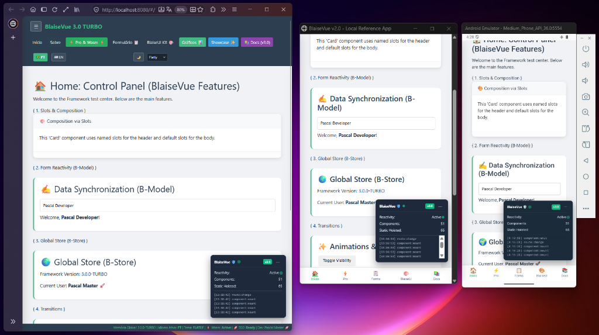

<p align="center">
  <a href="https://github.com/affonsoelias/BlaiseVue">
    
  </a>
</p>

# 🛡️ BlaiseVue: The Universal Reactive Framework for Object Pascal

> **The Universal Reactive Framework for Object Pascal.**  
> Build modern Web (SPA/SSG), Native Mobile (Android/iOS), and Ultra-light Desktop apps from a single Pascal codebase.

<p align="center">
  
</p>

**BlaiseVue** is a high-performance, enterprise-grade universal reactive framework for **Object Pascal**. It combines the type safety, architectural robustness, and raw compilation speed of Pascal with the elegance, ergonomics, and reactivity of **Vue.js**, enabling seamless multiplatform deployment across Web, Mobile, and Desktop from a single codebase.

---

## 🌟 Version 4.0 - 4.4: The Enterprise Universal Release

BlaiseVue 4.0 - 4.4 represents an enterprise generational milestone, delivering full-stack mORMot 2 integration, native mobile and desktop suites, interactive developer cockpit, zero-ASM pure Object Pascal DX, compile-time template verification, and offline-first dataset synchronization:

- **⚡ Compiler Template Type-Checking & Zero-`with()` Native Templates (v4.4)**: Recursive-descent AST evaluator (`bv.fastEval`) with LRU caching, strict CSP compliance, and compile-time AST verification with Levenshtein typo suggestions (`bv check`).
- **💾 Offline-First `TBVDataSet` & Delta Sync (v4.4)**: High-capacity IndexedDB persistence with transactional delta tracking (`FDelta`), server ID reconciliation, and automated reconnect triggers for mORMot 2 (`ApplyUpdates`).
- **🔗 Relational Master-Detail CRUD & Multi-Database ORM (v4.4)**: Automated relational model generation (`bv mormot crud`) with foreign keys, nested views, and pluggable database support (`--db sqlite|postgres|mysql|firebird` or `.env`).
- **🏎️ High-Performance Virtual Scrolling (v4.4)**: DOM virtualization engine (`<bv-virtual-scroll>`) rendering 100,000+ records at a constant 60 FPS in `<bv-data-grid>`.
- **📦 Standalone Library Scaffolding & Packaging (v4.4)**: Dedicated library generator (`bv create --lib`) with interactive license selection (MIT, Apache, LGPL), isolated HMR playground, autonomous test suite, and release packager (`bv lib pack`).
- **🛡️ Project Metadata, Licensing Suite & Clean Slate Reset (v4.4)**: Automated licensing (`bv license`), SemVer bumping (`bv meta bump`), Pascal unit sync (`src/uAppVersion.pas`), and clean slate project reset (`bv reset`) with double-layered safety guards.
- **🛡️ End-to-End Type-Safe Pascal RPC with mORMot 2 (v4.3)**: Shared service interfaces (`ICustomerService`), automated client proxy generation (`bv mormot rpc`), dual HTTP/WebSocket transport, JSON-RPC 2.0, and 100% compile-time API validation in pure Object Pascal.
- **📊 LiveBindings & Reactive `TBVDataSet` (v4.2)**: Delphi/Lazarus data-aware semantics in modern reactive Web applications. Features in-memory cursor navigation (`First`, `Next`, `Prior`, `Last`, `RecNo`), transactional buffering (`Append`, `Edit`, `Post`, `Cancel`, `Delete`), strongly typed fields (`AsString`, `AsInteger`, `AsFloat`, `AsBoolean`), two-way `b-field` directive, offline delta tracking (`FDelta`, `GetDeltaJSON`), and native `<bv-datagrid :dataset="myDS">` integration.
- **📚 Official Package Catalog & Documentation (v4.1)**: Master catalog covering 53+ production components across `@blaise-ui`, `@blaise-charts`, `@blaise-ui-mobile`, and `@blaise-themes`.
- **💎 Idiomatic Object Pascal DX & Zero-ASM Architecture**: 100% pure Pascal application layer powered by `BVPascalDX.pas`. Application views and components run without inline `asm ... end;` blocks, providing type-safe reactive mutations, high-level dialogs (`ShowToast`, `Confirm`), full-stack REST/mORMot CRUD helpers (`ApiFetch`, `ApiSave`, `ApiDelete`, `ApiSetupRealtime`), and native auth/mobile/Wasm bindings.
- **⚡ WebAssembly Acceleration Engine (`BVWasm` / `$wasm`)**: Execute compute-intensive algorithms in the browser with near-native binary speed (2x to 10x faster than pure JavaScript) via `$wasm.call('math', 'fib', 15)` and automated benchmarks (`bv wasm benchmark`).
- **📚 Automatic Documentation Generator & Playground (`bv doc`)**: Zero-configuration Storybook/VuePress-like interactive catalog generator analyzing component AST, props, slots, and events, served directly via `bv doc --serve`.
- **🚀 SSG & Static Pre-rendering (`bv run ssg`)**: Pre-renders routing trees into static HTML for instant First Contentful Paint (<50ms) and complete search engine indexing (SEO).
- **🌊 Zero-Flicker Reactive Hydration**: Seamlessly adopts pre-rendered SSG DOM markup without clearing `#app`, attaching event listeners and reactive proxies with zero layout shifts.
- **🧪 Headless End-to-End Test Suite (`bv test e2e`)**: Validates complete user journeys across routing, forms, theme switches, and hydration (130 automated tests passing across 12 test suites).
- **📋 Reactive Form Validation Engine (`b-validate`)**: Declarative client-side validation rules (`required`, `email`, `min:N`, `max:N`, `numeric`, `pattern`), reactive error tracking (`$errors`), touch states (`$v`), and programmatic validation (`$validate()`).
- **🎬 FLIP List Transitions (`<transition-group>`)**: High-performance collection animations powered by the First-Last-Invert-Play (FLIP) algorithm, custom wrapper tags (`tag="ul"`), and smooth reordering via `.bv-move`.
- **🌐 Native Internationalization (`Blaise-i18n`)**: Embedded multi-locale translation engine with `$t(key, params)`, reactive locale switching (`$setLocale(code)`), and fallback resolution.
- **🎨 Official Themes Package (`packages/blaise-themes`)**: 9 integrated Bootswatch themes (`flatly`, `darkly`, `cosmo`, `cyborg`, `lux`, `pulse`, `solar`, `vapor`, `zephyr`), dynamic stylesheet swapping, dark mode toggle (`data-bs-theme`), and ready-to-use `<bv-theme-toggle>` and `<bv-theme-select>` components.
- **🔤 Official Icons Package (`packages/blaise-icons`)**: Full integration with 2,000+ Bootstrap Icons via `<bv-icon name="..." size="..." color="...">` with zero runtime bloat.
- **⚡ Hot Module Replacement (HMR)**: Instant component recompilation and in-place DOM patching via WebSockets (`:8081`) while preserving active reactive state (`this['State']`).
- **🛣️ Advanced SPA Routing**: Clean URLs via **HTML5 History API**, recursive **Nested Routes** with `<router-view>`, dynamic route parameters (`:id`), and **Navigation Guards** (`beforeEach`, `beforeEnter`, `afterEach`).
- **🧩 Scoped Slots & Templates**: Seamless two-way data passing from child components back to parent templates (`#name="slotProps"`, `b-slot`, `slot-scope`).
- **🚀 Teleport & Suspense**: Mount elements into remote DOM targets (`<teleport to="body">`) and orchestrate asynchronous dependencies (`<suspense>`).
- **🏎️ Static Hoisting & Compiler Pruning**: Compiler-level static analysis tags invariant nodes (`bvStatic = true`), bypassing diff comparisons for $O(1)$ reconciliation.
- **📱 Hybrid Mobile Platform (Capacitor & Android .apk)**: Native mobile runtime targeting Android and iOS with native APK generation via `bv mobile build`.
- **📐 Responsive Grid System (`<bv-container>`, `<bv-row>`, `<bv-col>`)**: Fluid 12-column grid layout with Bootstrap-compatible breakpoints (`cols`, `sm`, `md`, `lg`, `xl`) and gutter controls.
- **🧭 Mobile Bottom Navigation & Drawer**: Bottom-pinned mobile navigation (`<bv-bottom-nav>`, `<bv-bottom-nav-item>`) and off-canvas drawer (`<bv-drawer>`).
- **🛠️ VS Code Official Extension (`.vsix`)**: Triple syntax highlighting for `.bv`, directive autocompletion, BlaiseUI IntelliSense, and snippets (`bv vsix`, `bv extension install`).
- **📦 BlaiseUI Official Component Kit**: Over 25 production-ready UI widgets (`bv-btn`, `bv-card`, `bv-input`, `bv-modal`, `bv-datagrid`, `bv-toast`, `bv-accordion`, `bv-container`, `bv-row`, `bv-col`, `bv-drawer`, `bv-bottom-nav`) styled with clean modern CSS.

---

## 📦 Official Packages Ecosystem

BlaiseVue features a modular package architecture located in `/packages`:

| Package | Description | Key Components / Features |
| :--- | :--- | :--- |
| **`blaise-ui`** | Native Bootstrap-inspired component kit | `<bv-btn>`, `<bv-card>`, `<bv-modal>`, `<bv-datagrid>`, `<bv-toast>`, `<bv-navbar>`, `<bv-tabs>`, `<bv-input>` |
| **`blaise-themes`** | 9 Bootswatch themes + reactive theme management | Flatly, Darkly, Cosmo, Cyborg, Lux, Pulse, Solar, Vapor, Zephyr, `<bv-theme-toggle>`, `<bv-theme-select>`, `$theme` |
| **`blaise-icons`** | Bootstrap Icons library (fonts + CSS) | `<bv-icon name="heart-fill" size="24px" color="red">`, 2,000+ vector icons |
| **`blaise-charts`** | Reactive Chart.js data visualization suite | `<bv-chart>`, `<bv-bar-chart>`, `<bv-line-chart>`, `<bv-pie-chart>`, typed Pascal records (`TBVChartData`, `TBVChartOptions`, `TBVChartPalette`) |
| **`blaise-ui-mobile`** | Mobile-first Ionic components & Pascal wrappers | `<bv-ion-app>`, `<bv-ion-toolbar>`, iOS/Android adaptive themes, `TIonicToast`, `TIonicAlert` |
| **`blaise-studio`** | Developer cockpit & live WebSocket hub | Visual AST inspector, real-time WebSocket monitor, 1-click test/build runner, `TBVStudioClient` |

Install packages directly into your project via the CLI:
```bash
bv lib install themes   # Installs Bootswatch themes and switcher components
bv lib install icons    # Installs Bootstrap Icons fonts and stylesheets
bv lib install ui       # Installs the complete BlaiseUI component suite
bv lib install mobile   # Installs Ionic mobile components and Pascal controllers
bv lib install charts   # Installs Chart.js data visualization suite
```

---

## 🛠️ CLI Quick Reference (`bv.exe`)

The BlaiseVue CLI is a single, zero-dependency native executable compiled with Free Pascal.

```bash
# === Development & Server ===
bv dev                     # Starts development server with HMR on http://localhost:8080 (alias: bv serve)
bv serve                   # Starts development server with HMR
bv run dev                 # Builds project in development mode & launches dev server on http://localhost:8080
bv build                   # Compiles project without launching server (ideal for watchers & CI)
bv run build               # Builds optimized production bundle in dist/
bv run preview             # Local HTTP preview of production build (port 5000)
bv clean                   # Cleans generated files (generated/ and dist/)

# === Scaffolding & Generators ===
bv create <app-name>       # Scaffolds a project with 4-tier testing hierarchy & domain services
bv new c <Name>            # Scaffolds a component (.bv) & automatic test in tests/components/
bv new v <Name>            # Scaffolds a route view (.bv) & automatic test in tests/views/
bv new t <Name>            # Scaffolds a Pascal test file (smart detection: components, views, unit)
bv remove <c|v|t> <Name>   # Safely deletes a component, view, or test
bv list <c|v|t|lib>        # Lists project components, views, tests, or installed libs

# === Package & Theme Management ===
bv lib install <pkg|url>   # Installs official package (themes, icons, ui) or from URL
bv lib remove <name>       # Removes an installed component or package from lib/
bv lib pack [dir]          # Assembles & verifies release artifact (.zip with SHA-256)
bv theme list              # Lists all available installed themes
bv theme use <name>        # Sets default project theme in index.html (e.g. darkly, lux)

# === Project Metadata & Licensing ===
bv license [list|show|set] # Manages project licenses (MIT, Apache, LGPL, GPL, BSD, Commercial)
bv meta [show|get|set|bump]# Manages metadata & synchronizes SemVer with src/uAppVersion.pas
bv reset [--bare] [--force]# Resets demo project to a clean slate (protected against demo-app)

# === Mobile (Android & iOS via Capacitor) ===
bv mobile init [name] [id] # Scaffolds Capacitor & mobile/ native project
bv mobile sync             # Syncs dist/ with native mobile assets
bv mobile build android    # Builds native Android Debug APK in mobile/bin/android/
bv mobile build android --release # Builds optimized Release APK (R8/ProGuard)
bv mobile emulator list    # Lists installed Android Virtual Devices (AVD)
bv mobile emulator start   # Boots Android emulator in background
bv mobile run android      # Installs and launches APK on connected USB device
bv mobile run android --emulator # Boots emulator, installs APK, and runs app
bv mobile open android     # Opens project in Android Studio

# === Desktop (Free Pascal, Lazarus IDE & WebUI) ===
bv desktop init [name]     # Scaffolds Lazarus (.lpi, .lpr) & WebUI project
bv desktop sync            # Syncs dist/ to desktop/assets/
bv desktop build [target]  # Compiles Debug native binary (live console logging)
bv desktop build [target] --release # Compiles Release native binary (pure GUI - NO console)
bv desktop run [target]    # Launches desktop app in Debug mode (with console)
bv desktop run [target] --release # Launches desktop app in Release mode (clean GUI)

# === Backend & Full-Stack (Synopse mORMot 2) ===
bv create <name> --mormot  # Scaffolds full-stack app with mORMot 2 native backend (--fullstack / -m)
bv mormot init             # Scaffolds mORMot 2 backend server in server/
bv mormot build            # Compiles Debug native server with Free Pascal
bv mormot build --release  # Compiles optimized Release native server (-O3, stripped)
bv mormot run              # Starts native backend server (auto-fallback to 8091 if 8090 is busy)
bv mormot kill             # Terminates lingering server.exe instances and releases ports
bv mormot status           # Queries /api/status health endpoint (with 2s fast timeout)
bv mormot deploy           # Packages standalone production bundle in deploy/
bv mormot deploy --zip     # Packages standalone bundle into deploy.zip
bv mormot rpc              # Scaffolds type-safe Pascal RPC client proxies from mORMot 2 SOA interfaces
                           # (Note: bv server commands preserved as aliases)

# === Testing ===
bv test                    # Compiles .test.pas files and runs Vitest suite

# === Cockpit & Multi-Project Management ===
bv update                  # Surgically syncs project infrastructure with latest framework features
bv update --dry-run        # Previews updates without modifying any files (non-destructive safety)
bv enter                   # Enters interactive project Cockpit shell (e.g. [bv: my-app] >)
bv use <project-name>      # Jumps into registered project Cockpit shell from anywhere
bv project add             # Registers current project into global registry (~/.blaisevue/projects.json)
bv project list            # Lists registered projects (* active)
bv project current         # Shows currently active project details
bv project remove <name>   # Unregisters project from global registry
bv rename <s|c|v|p> <New>  # Smart rename for services, components, views, or project name
```

---

## 📖 Roadmap & Technical Documentation

For the complete architectural evolution specifications, delivered enterprise pillars, and future roadmap milestones (v2.0 to v5.0), see:

- 🗺️ **[Technical Roadmap (doc/Documentation/99-roadmap.md)](doc/Documentation/99-roadmap.md)**: Full architecture breakdown, testing matrices, and future horizons.
- 📚 **[Documentation Index (doc/Documentation/00-index.md)](doc/Documentation/00-index.md)**: 33+ comprehensive technical manuals covering CLI, reactivity, components, mobile, desktop, and mORMot 2.

---

## 📂 Project Structure

```text
BlaiseVue/
├── bin/                       # BlaiseVue CLI compiler & dev server (bv.pas, bv.exe)
├── core/                      # Core runtime engine
│   ├── BlaiseVue.pas          # Core SPA instance orchestrator & Hydration
│   ├── BVCompiler.pas         # Template engine, directives, AST parser
│   ├── BVReactivity.pas       # Reactive proxy & dependency tracking
│   ├── BVRouting.pas          # SPA Router & HTML5 History API
│   ├── BVValidation.pas       # Reactive form validation engine (b-validate)
│   ├── BVI18n.pas             # Internationalization engine ($t)
│   ├── BVTheme.pas            # Theme switcher & persistence engine ($theme)
│   ├── BVWasm.pas             # WebAssembly acceleration engine ($wasm)
│   ├── BVStore.pas            # Centralized state management ($store)
│   ├── BVClient.pas           # REST ($api) & WebSocket ($ws) client helpers
├── templates/                 # Scaffolding templates
│   ├── fullstack-mormot/      # High-performance mORMot 2 server template
│   └── BVDevTools.pas         # Bridge to browser DevTools extension (v3.0)
├── packages/                  # Official ecosystem packages
│   ├── blaise-ui/             # 20+ native UI components & styles
│   ├── blaise-themes/         # 9 Bootswatch themes & theme switchers
│   ├── blaise-icons/          # Bootstrap Icons fonts & stylesheet
│   ├── blaise-charts/         # Reactive Chart.js visualization & Pascal wrappers
│   └── blaise-ui-mobile/      # Mobile-first Ionic components & Pascal wrappers
├── vendor/                    # Embedded compiler & backend engines
│   ├── pas2js/                # Multi-platform pas2js transpiler & RTL
│   └── mormot2/               # High-throughput Synopse mORMot 2.4 framework
├── devtools/                  # Manifest V3 Chrome/Edge DevTools extension
├── doc/
│   ├── Documentation/         # 33 comprehensive technical manuals + API Reference
│   └── Course/                # 10-lesson practical course and architecture deep-dive
└── demo-app/                  # Enterprise showcase application (v3.0)
```

---

## 🏁 Quick Start

### 📋 Prerequisites
- **Lazarus IDE (or Free Pascal Compiler 3.2+)**: Recommended IDE and compiler for building the native CLI (`bv` / `bv.exe`), desktop applications (`desktop/`), and mORMot 2 servers (`server/`).
- **Node.js (v18+ LTS) & npm**: Powers the development server with HMR (`bv serve` / `bv dev`), automated testing (`bv test`), and mobile synchronization (`bv mobile`).
- **Android Studio (Recommended for Mobile)**: Required for compiling native Android `.apk` / `.aab` packages (`bv mobile build`), managing emulators, and running `bv mobile open android`. Bundles the Android SDK, Platform-Tools (`adb`), and Java JDK.

> [!NOTE]
> **Pas2JS is pre-bundled**: You do **not** need to install `pas2js`. Official multi-platform binaries for Windows, Linux, and macOS are already included in `vendor/pas2js/`.

### 1. Compile the BlaiseVue CLI
Ensure you have **FPC (Free Pascal Compiler 3.2+)** installed (included with Lazarus):
```bash
cd bin
fpc -O2 bv.pas
# Move bv or bv.exe to your PATH or use directly from bin/
```

### 2. Pre-bundled Pas2JS Compiler
BlaiseVue comes with the `pas2js` transpiler already included under `vendor/pas2js/`. The CLI automatically detects your platform (Windows, Linux, macOS) with zero manual configuration required!

### 3. Launch the Demo App
```bash
cd demo-app
..\bin\bv.exe serve
# Open http://localhost:8080 in your browser
```

---

## ⚖️ Licensing

BlaiseVue is open-source and follows the standard **Lazarus / Free Pascal** licensing model:
- **The BlaiseCLI tool (`bin/`):** Licensed under the **GNU GPL v2**.
- **The BlaiseVue Core (`core/`):** Licensed under the **Modified GNU LGPL v2.1** with a **Static Linking Exception**.

This allows developers to build **commercial and proprietary applications** without having to open-source their proprietary code, while ensuring the framework runtime remains open and accessible to all. See the [LICENSE](LICENSE) file for details.

### 🖋️ Brand Identity & Trademarks
The BlaiseVue name, architecture, and the official **Shadow Hand & White Quill** logo are authored by **Elias Affonso**. For official brand assets, guidelines, and vector files, visit the [Brand Assets Directory](doc/brand/README.md).

---

🛡️ **"BlaiseVue: The Universal Reactive Framework for Object Pascal."** ✨🏆🚀
