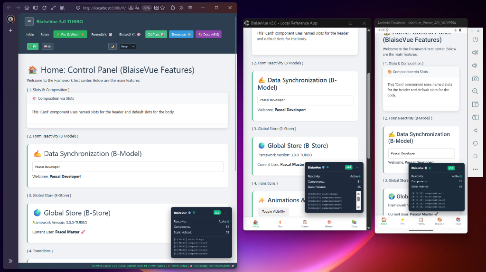

<p align="center">
  <a href="https://github.com/affonsoelias/BlaiseVue">
    
  </a>
</p>

# 🛡️ BlaiseVue: The Universal Reactive Framework for Object Pascal

> **The Universal Reactive Framework for Object Pascal.**  
> Build modern Web (SPA/SSG), Native Mobile (Android/iOS), and Ultra-light Desktop apps from a single Pascal codebase.

<p align="center">
  
</p>

**BlaiseVue** is a high-performance, enterprise-grade universal reactive framework for **Object Pascal**. It combines the type safety, architectural robustness, and raw compilation speed of Pascal with the elegance, ergonomics, and reactivity of **Vue.js**, enabling seamless multiplatform deployment across Web, Mobile, and Desktop from a single codebase.

---

## 🌟 Version 4.0 - 4.4: The Enterprise Universal Release

BlaiseVue 4.0 - 4.4 represents an enterprise generational milestone, delivering full-stack mORMot 2 integration, native mobile and desktop suites, interactive developer cockpit, zero-ASM pure Object Pascal DX, compile-time template verification, and offline-first dataset synchronization:

- **⚡ Compiler Template Type-Checking & Zero-`with()` Native Templates (v4.4)**: Recursive-descent AST evaluator (`bv.fastEval`) with LRU caching, strict CSP compliance, and compile-time AST verification with Levenshtein typo suggestions (`bv check`).
- **💾 Offline-First `TBVDataSet` & Delta Sync (v4.4)**: High-capacity IndexedDB persistence with transactional delta tracking (`FDelta`), server ID reconciliation, and automated reconnect triggers for mORMot 2 (`ApplyUpdates`).
- **🔗 Relational Master-Detail CRUD & Multi-Database ORM (v4.4)**: Automated relational model generation (`bv mormot crud`) with foreign keys, nested views, and pluggable database support (`--db sqlite|postgres|mysql|firebird` or `.env`).
- **🏎️ High-Performance Virtual Scrolling (v4.4)**: DOM virtualization engine (`<bv-virtual-scroll>`) rendering 100,000+ records at a constant 60 FPS in `<bv-data-grid>`.
- **📦 Standalone Library Scaffolding & Packaging (v4.4)**: Dedicated library generator (`bv create --lib`) with interactive license selection (MIT, Apache, LGPL), isolated HMR playground, autonomous test suite, and release packager (`bv lib pack`).
- **🛡️ Project Metadata, Licensing Suite & Clean Slate Reset (v4.4)**: Automated licensing (`bv license`), SemVer bumping (`bv meta bump`), Pascal unit sync (`src/uAppVersion.pas`), and clean slate project reset (`bv reset`) with double-layered safety guards.
- **🛡️ End-to-End Type-Safe Pascal RPC with mORMot 2 (v4.3)**: Shared service interfaces (`ICustomerService`), automated client proxy generation (`bv mormot rpc`), dual HTTP/WebSocket transport, JSON-RPC 2.0, and 100% compile-time API validation in pure Object Pascal.
- **📊 LiveBindings & Reactive `TBVDataSet` (v4.2)**: Delphi/Lazarus data-aware semantics in modern reactive Web applications. Features in-memory cursor navigation (`First`, `Next`, `Prior`, `Last`, `RecNo`), transactional buffering (`Append`, `Edit`, `Post`, `Cancel`, `Delete`), strongly typed fields (`AsString`, `AsInteger`, `AsFloat`, `AsBoolean`), two-way `b-field` directive, offline delta tracking (`FDelta`, `GetDeltaJSON`), and native `<bv-datagrid :dataset="myDS">` integration.
- **📚 Official Package Catalog & Documentation (v4.1)**: Master catalog covering 53+ production components across `@blaise-ui`, `@blaise-charts`, `@blaise-ui-mobile`, and `@blaise-themes`.
- **💎 Idiomatic Object Pascal DX & Zero-ASM Architecture**: 100% pure Pascal application layer powered by `BVPascalDX.pas`. Application views and components run without inline `asm ... end;` blocks, providing type-safe reactive mutations, high-level dialogs (`ShowToast`, `Confirm`), full-stack REST/mORMot CRUD helpers (`ApiFetch`, `ApiSave`, `ApiDelete`, `ApiSetupRealtime`), and native auth/mobile/Wasm bindings.
- **⚡ WebAssembly Acceleration Engine (`BVWasm` / `$wasm`)**: Execute compute-intensive algorithms in the browser with near-native binary speed (2x to 10x faster than pure JavaScript) via `$wasm.call('math', 'fib', 15)` and automated benchmarks (`bv wasm benchmark`).
- **📚 Automatic Documentation Generator & Playground (`bv doc`)**: Zero-configuration Storybook/VuePress-like interactive catalog generator analyzing component AST, props, slots, and events, served directly via `bv doc --serve`.
- **🚀 SSG & Static Pre-rendering (`bv run ssg`)**: Pre-renders routing trees into static HTML for instant First Contentful Paint (<50ms) and complete search engine indexing (SEO).
- **🌊 Zero-Flicker Reactive Hydration**: Seamlessly adopts pre-rendered SSG DOM markup without clearing `#app`, attaching event listeners and reactive proxies with zero layout shifts.
- **🧪 Headless End-to-End Test Suite (`bv test e2e`)**: Validates complete user journeys across routing, forms, theme switches, and hydration (130 automated tests passing across 12 test suites).
- **📋 Reactive Form Validation Engine (`b-validate`)**: Declarative client-side validation rules (`required`, `email`, `min:N`, `max:N`, `numeric`, `pattern`), reactive error tracking (`$errors`), touch states (`$v`), and programmatic validation (`$validate()`).
- **🎬 FLIP List Transitions (`<transition-group>`)**: High-performance collection animations powered by the First-Last-Invert-Play (FLIP) algorithm, custom wrapper tags (`tag="ul"`), and smooth reordering via `.bv-move`.
- **🌐 Native Internationalization (`Blaise-i18n`)**: Embedded multi-locale translation engine with `$t(key, params)`, reactive locale switching (`$setLocale(code)`), and fallback resolution.
- **🎨 Official Themes Package (`packages/core/blaise-themes`)**: 9 integrated Bootswatch themes (`flatly`, `darkly`, `cosmo`, `cyborg`, `lux`, `pulse`, `solar`, `vapor`, `zephyr`), dynamic stylesheet swapping, dark mode toggle (`data-bs-theme`), and ready-to-use `<bv-theme-toggle>` and `<bv-theme-select>` components.
- **🔤 Official Icons Package (`packages/core/blaise-icons`)**: Full integration with 2,000+ Bootstrap Icons via `<bv-icon name="..." size="..." color="...">` with zero runtime bloat.
- **⚡ Hot Module Replacement (HMR)**: Instant component recompilation and in-place DOM patching via WebSockets (`:8081`) while preserving active reactive state (`this['State']`).
- **🛣️ Advanced SPA Routing**: Clean URLs via **HTML5 History API**, recursive **Nested Routes** with `<router-view>`, dynamic route parameters (`:id`), and **Navigation Guards** (`beforeEach`, `beforeEnter`, `afterEach`).
- **🧩 Scoped Slots & Templates**: Seamless two-way data passing from child components back to parent templates (`#name="slotProps"`, `b-slot`, `slot-scope`).
- **🚀 Teleport & Suspense**: Mount elements into remote DOM targets (`<teleport to="body">`) and orchestrate asynchronous dependencies (`<suspense>`).
- **🏎️ Static Hoisting & Compiler Pruning**: Compiler-level static analysis tags invariant nodes (`bvStatic = true`), bypassing diff comparisons for $O(1)$ reconciliation.
- **📱 Hybrid Mobile Platform (Capacitor & Android .apk)**: Native mobile runtime targeting Android and iOS with native APK generation via `bv mobile build`.
- **📐 Responsive Grid System (`<bv-container>`, `<bv-row>`, `<bv-col>`)**: Fluid 12-column grid layout with Bootstrap-compatible breakpoints (`cols`, `sm`, `md`, `lg`, `xl`) and gutter controls.
- **🧭 Mobile Bottom Navigation & Drawer**: Bottom-pinned mobile navigation (`<bv-bottom-nav>`, `<bv-bottom-nav-item>`) and off-canvas drawer (`<bv-drawer>`).
- **🛠️ VS Code Official Extension (`.vsix`)**: Triple syntax highlighting for `.bv`, directive autocompletion, BlaiseUI IntelliSense, and snippets (`bv extension install vscode`, `bv extension pack vscode`).
- **🛡️ Lazarus IDE Official Package (`blaisevue_ide.lpk`)**: Native design-time package for Lazarus IDE with `.bv` multi-syntax highlighting (HTML + Pascal + CSS), File -> New component and view wizards, Tools menu AST diagnostics, and `bv lazarus init` project generation.
- **🔍 Browser DevTools Extension**: Manifest V3 DevTools extension for Chrome, Edge, and Firefox supporting real-time component inspection, reactive state debugging, and WebSocket HMR monitoring (`bv extension install devtools`).
- **🌐 Decentralized Package Ecosystem & Registries**: Enterprise package manager with multi-registry catalogs (`bv repo`), SemVer pinning, global offline cache (`~/.blaisevue/packages/`), `<repo>:<package>` disambiguation, and core reserved names protection.
- **📦 BlaiseUI Official Component Kit**: Over 25 production-ready UI widgets (`bv-btn`, `bv-card`, `bv-input`, `bv-modal`, `bv-datagrid`, `bv-toast`, `bv-accordion`, `bv-container`, `bv-row`, `bv-col`, `bv-drawer`, `bv-bottom-nav`) styled with clean modern CSS.

---

## 📦 Official Packages Ecosystem

BlaiseVue features a modular package architecture located in `/packages`:

| Package | Description | Key Components / Features |
| :--- | :--- | :--- |
| **`blaise-ui`** | Native Bootstrap-inspired component kit | `<bv-btn>`, `<bv-card>`, `<bv-modal>`, `<bv-datagrid>`, `<bv-toast>`, `<bv-navbar>`, `<bv-tabs>`, `<bv-input>` |
| **`blaise-themes`** | 9 Bootswatch themes + reactive theme management | Flatly, Darkly, Cosmo, Cyborg, Lux, Pulse, Solar, Vapor, Zephyr, `<bv-theme-toggle>`, `<bv-theme-select>`, `$theme` |
| **`blaise-icons`** | Bootstrap Icons library (fonts + CSS) | `<bv-icon name="heart-fill" size="24px" color="red">`, 2,000+ vector icons |
| **`blaise-charts`** | Reactive Chart.js data visualization suite | `<bv-chart>`, `<bv-bar-chart>`, `<bv-line-chart>`, `<bv-pie-chart>`, typed Pascal records (`TBVChartData`, `TBVChartOptions`, `TBVChartPalette`) |
| **`blaise-reports`** | Declarative PDF reports and printing engine | PDF report templates, multi-page data tables, headers/footers, print dialogs |
| **`blaise-studio`** | Developer cockpit & live WebSocket hub | Visual AST inspector, real-time WebSocket monitor, 1-click test/build runner, `TBVStudioClient` |
| **`blaise-ui-mobile`** | Mobile-first Ionic components & Pascal wrappers | `<bv-ion-app>`, `<bv-ion-toolbar>`, iOS/Android adaptive themes, `TIonicToast`, `TIonicAlert` |

Install packages directly into your project via the CLI:
```bash
bv lib install themes   # Installs Bootswatch themes and switcher components
bv lib install icons    # Installs Bootstrap Icons fonts and stylesheets
bv lib install ui       # Installs the complete BlaiseUI component suite
bv lib install mobile   # Installs Ionic mobile components and Pascal controllers
bv lib install charts   # Installs Chart.js data visualization suite
```

---

## 🛠️ CLI Quick Reference (`bv.exe`)

The BlaiseVue CLI is a single, zero-dependency native executable compiled with Free Pascal.

```bash
  BlaiseVue CLI v4.4.0 (Universal Pascal Full-Stack Platform)
  ============================================================
  Usage: bv <command> [options]

  # === Scaffolding & Generators ===
  bv create <name>           Scaffolds a new project with 4-tier testing hierarchy & domain services
  bv g c <Name>              Scaffolds a component (.bv) & test in tests/components/ (alias: bv new c)
  bv g v <Name>              Scaffolds a route view (.bv) & test in tests/views/ (alias: bv new v)
  bv g s <Name>              Scaffolds a pure Pascal domain service in src/services/ (alias: bv new s)
  bv g t <Name>              Scaffolds a Pascal test file (.test.pas) (alias: bv new t)
  bv remove <c|v|s|t> <Name> Safely deletes a component, view, service, or test
  bv list <c|v|s|t|lib>      Lists project components, views, services, tests, or installed libs
  bv rename <c|v|s|p>        Smart rename for services, components, views, or project name

  # === Workspace & Project Cockpit ===
  bv enter                   Enters interactive project Cockpit shell ([bv: my-app] >)
  bv use <project-name>      Jumps into registered project Cockpit shell from anywhere
  bv project add             Registers current project into global registry
  bv project list            Lists registered projects (* active)
  bv project current         Shows active project details
  bv project remove <name>   Unregisters a project from global registry

  # === Development & Frontend Build ===
  bv dev                     Builds project in dev mode & starts dev server with HMR on http://localhost:8080
  bv build                   Compiles frontend in development/debug mode (Lazarus & watchers)
  bv build --release         Builds optimized production bundle with hashes in dist/
  bv preview                 Local HTTP preview of production build (port 5000)
  bv ssg                     Pre-renders all routes into static HTML (SSG)
  bv wasm <info|benchmark>   WebAssembly acceleration and performance benchmarks
  bv check [file]            Validates component templates against script declarations (AST Type-Checker)
  bv clean                   Cleans generated build files (generated/ and dist/)

  # === Backend & Full-Stack (Synopse mORMot 2) ===
  bv mormot init             Scaffolds mORMot 2 backend server in server/
  bv mormot run [--release] [--fresh] [--port <p>] Starts native backend server (--fresh kills lingering instances)
  bv mormot build [--release] Compiles native server binary with Free Pascal (-O2 debug / -O3 release)
  bv mormot kill [--port <p>] Terminates lingering server.exe instances & verifies port release
  bv mormot status           Queries running mORMot 2 health endpoint (/api/status)
  bv mormot deploy [--zip]   Assembles standalone production bundle in deploy/
  bv mormot crud <Model>     Scaffolds full-stack ORM model, REST API & reactive DataGrid
  bv mormot auth             Scaffolds JWT authentication, AuthService, LoginView & route guards
  bv mormot docs | swagger   Generates interactive OpenAPI 3.0 & Swagger UI explorer (/api/docs)
  bv mormot docker [--build] Scaffolds sub-20MB Alpine micro-container & docker-compose.yml
  bv mormot rpc              Scaffolds type-safe Pascal RPC client proxies from SOA interfaces

  # === Mobile (Android & iOS via Capacitor) ===
  bv mobile init [name] [id] [--version=<v>] Scaffolds Capacitor & mobile/ native project
  bv mobile upgrade [--check] Migrates Capacitor dependencies & updates Gradle
  bv mobile sync             Syncs dist/ with native mobile assets
  bv mobile remove [-y]      Safely deletes mobile/ and capacitor.config.json
  bv mobile build android    Builds native Android Debug APK in mobile/bin/android/
  bv mobile build android --release Builds optimized Release APK (R8/ProGuard)
  bv mobile build android --bundle Builds Google Play Android App Bundle (.aab)
  bv mobile emulator list    Lists installed Android Virtual Devices (AVD)
  bv mobile emulator start   Boots Android emulator in background
  bv mobile emulator kill    Terminates lingering emulator & QEMU processes (alias: bv mobile kill)
  bv mobile run android      Installs and launches APK on connected USB device
  bv mobile run android --emulator [--release] [--fresh] Boots emulator, compiles & launches app (flags can be combined)
  bv mobile open android     Opens project in Android Studio

  # === Desktop (Free Pascal, Lazarus IDE & WebUI) ===
  bv desktop init [name]     Scaffolds Lazarus (.lpi, .lpr) & WebUI project
  bv desktop sync            Syncs dist/ with desktop/assets/
  bv desktop remove [-y]     Safely deletes desktop/ native project
  bv desktop build [target]  Compiles Debug native binary (live console logging)
  bv desktop build [target] --release Compiles Release native binary (pure GUI - NO console)
  bv desktop run [target]    Launches desktop app in Debug mode (with console)
  bv desktop run [target] --release Launches desktop app in Release mode (clean GUI)

  # === Testing & Docs ===
  bv test                    Compiles and runs all unit tests (.test.pas) with Vitest
  bv test e2e                Runs headless browser End-to-End integration test suite
  bv doc [--serve]           Generates interactive component documentation & playground
  bv studio                  Launches BlaiseVue Studio developer dashboard (port 9000)

  # === Package & Theme Management ===
  bv repo <list|add|remove|default|sync|search> Manages package repositories & ecosystem sources
  bv lib install [<repo>:]<pkg[@ver]|url> [--global|-g] Installs package in project /lib or user cache
  bv lib remove <name> [--global|-g] Removes package from lib/ or global cache
  bv lib update [[<repo>:]name] [--global|-g] Updates package(s) to latest version
  bv lib outdated [--global|-g] Checks for available updates in installed packages
  bv lib list [--global|-g]  Lists installed libraries
  bv lib search [[<repo>:]term] Searches packages in registered repositories
  bv lib pack [dir]          Assembles & verifies release artifact (.zip with SHA-256)
  bv theme [list]            Displays active and available themes in @blaise-themes
  bv theme add <name>        Adds a theme to package.json for optimized bundling
  bv theme remove <name>     Removes a theme from package.json
  bv theme use <name>        Sets active default theme in package.json & index.html
  bv theme reset             Resets theme filters (bundles all themes in compatibility mode)
  bv extension <list|install|remove|pack> [target] Manages development extensions & tools

  # === Project Configuration & Search Paths ===
  bv license [list|show|set] Manages project license (MIT, Apache, LGPL, GPL, BSD, etc.)
  bv meta [show|get|set|bump|sync] Manages project metadata and syncs SemVer across monorepo
  bv path [list]             Lists all active unit search paths (-Fu) in app.cfg
  bv path add <dir|pas2js:p> Adds a folder or official Pas2JS package to app.cfg
  bv path remove <target>    Removes a search path or Pas2JS package from app.cfg
  bv path available          Lists all built-in Pas2JS packages available to link
  bv reset [--bare] [--force] Resets project to a clean slate (protected against demo-app)

  # === Framework Diagnostics & Maintenance ===
  bv doctor                  Diagnoses environment tools (Git, Lazarus, FPC, Pas2JS, Node)
  bv self-update [--check] [--force] Syncs & recompiles BlaiseVue directly from GitHub via Git
  bv channel [use <name>]    Inspects or switches framework branch (main/develop)
  bv update [--dry-run]      Surgically syncs project infrastructure with latest framework features
```

---

## 📖 Roadmap & Technical Documentation

For the complete architectural evolution specifications, delivered enterprise pillars, and future roadmap milestones (v2.0 to v5.0), see:

- 🎓 **[Complete Course: Zero to Ninja (doc/Course/README.md)](doc/Course/README.md)**: 13 beginner-friendly practical modules with step-by-step guides, runnable `.bv` examples, and real-world analogies.
- 🗺️ **[Technical Roadmap (doc/Documentation/99-roadmap.md)](doc/Documentation/99-roadmap.md)**: Full architecture breakdown, testing matrices, and future horizons.
- 📚 **[Documentation Index (doc/Documentation/README.md)](doc/Documentation/README.md)**: 54 comprehensive technical manuals covering CLI, reactivity, components, mobile, desktop, ecosystem, and mORMot 2.
- 🏛️ **[Core Architecture & Internals (doc/Architecture/README.md)](doc/Architecture/README.md)**: Deep dive into the compiler pipeline, AST evaluation, and reactive proxy engine.

---

## 📂 Project Structure

```text
BlaiseVue/
├── bin/                       # BlaiseVue CLI compiler & development toolchain
│   ├── bv.pas & bv.exe        # Zero-dependency native CLI compiler & orchestrator
│   ├── dev-server.js          # Fast local development HTTP server with live HMR
│   ├── studio-server.js       # BlaiseVue Studio telemetry hub & API bridge
│   ├── studio/                # Embedded BlaiseVue Studio web cockpit UI
│   └── templates.res          # Embedded pre-compiled project & component templates
├── core/                      # Core runtime engine (Transpiled via Pas2JS)
│   ├── BlaiseVue.pas          # Core SPA instance orchestrator & hydration
│   ├── BVCompiler.pas         # Template engine, directives & AST parser
│   ├── BVReactivity.pas       # Reactive proxy & dependency tracking ($ref, $computed)
│   ├── BVRouting.pas          # SPA Router, navigation guards & HTML5 History API
│   ├── BVValidation.pas       # Reactive form validation engine (b-validate)
│   ├── BVI18n.pas             # Internationalization & localization engine ($t)
│   ├── BVTheme.pas            # Theme switcher & persistence engine ($theme)
│   ├── BVWasm.pas             # WebAssembly acceleration engine ($wasm)
│   ├── BVStore.pas            # Centralized state management ($store)
│   ├── BVAuth.pas             # JWT authentication, session storage & route protection
│   ├── BVClient.pas           # Reactive REST ($api) & WebSocket ($ws) client helpers
│   ├── BVDataSet.pas          # LiveBindings, reactive TDataSet & offline delta sync
│   ├── BVRpc.pas              # Type-safe Pascal RPC client proxies for mORMot 2 SOA
│   ├── BVMobile.pas           # Capacitor mobile runtime bridge & device events
│   ├── BVDesktop.pas          # WebUI native desktop window & IPC bridge
│   ├── BVDevTools.pas         # Browser DevTools extension telemetry bridge
│   └── Blaise*.pas            # Official Pascal bindings (UI, Charts, Reports, Ionic)
├── templates/                 # Scaffolding templates for new projects
│   ├── fullstack-mormot/      # High-performance native mORMot 2 server template
│   ├── *.bv                   # Component, View and App template blueprints
│   └── *.pas                  # Domain services, test suites and config templates
├── packages/                  # Modular package ecosystem & developer tooling
│   ├── core/                  # Official core framework packages
│   │   ├── blaise-ui/         # 25+ native reactive UI components & styles
│   │   ├── blaise-themes/     # 9 Bootswatch themes & build-time pruning optimizer
│   │   ├── blaise-icons/      # Bootstrap Icons fonts & stylesheet bundle
│   │   ├── blaise-charts/     # Reactive Chart.js visualization & Pascal wrappers
│   │   ├── blaise-reports/    # Declarative PDF reports generation engine
│   │   ├── blaise-studio/     # Developer cockpit telemetry & AST inspector
│   │   └── blaise-ui-mobile/  # Mobile-first Ionic components & Pascal wrappers
│   └── tools/                 # Development extensions & IDE tooling
│       ├── blaise-devtools/   # Browser DevTools extension (Chrome, Firefox, Edge)
│       ├── blaise-vscode/     # Official VS Code extension (.vsix packaging & snippets)
│       └── blaise-lazarus/    # Official Lazarus IDE package (.lpk design-time integration)
├── vendor/                    # Pre-bundled compilers & native frameworks
│   ├── pas2js/                # Official multi-platform Pas2JS transpiler & RTL binaries
│   └── mormot2/               # High-throughput Synopse mORMot 2.4 framework
├── doc/                       # Architecture, manuals & educational courses
│   ├── Architecture/          # Core compiler pipeline, reactivity engine & internals
│   ├── Documentation/         # 54 comprehensive technical manuals + API Reference
│   ├── Course/                # 13-module practical course from beginner to ninja
│   └── brand/                 # Official vector logos, icons & banner assets
└── demo-app/                  # Enterprise showcase application (v4.4.0 Full-Stack)
    ├── src/                   # Reactive frontend SPA (views, components, services)
    ├── server/                # High-throughput native mORMot 2 backend server
    ├── mobile/                # Native Capacitor Android (APK/AAB) & iOS projects
    ├── desktop/               # Native WebUI desktop app with Lazarus project
    └── tests/                 # 4-tier automated test suites with Vitest
```

---

## 🏁 Quick Start

### 📋 Prerequisites
- **Git (v2.30+)**: Required for cloning the framework, automatic selective updates (`bv self-update`), and channel management (`bv channel`).
- **Lazarus IDE (or Free Pascal Compiler 3.2+)**: Recommended IDE and compiler for building the native CLI (`bv` / `bv.exe`), desktop applications (`desktop/`), and mORMot 2 servers (`server/`).
- **Python (v3.8+ Recommended)**: Recommended for executing cross-platform lifecycle scripts (`status.py`, `install.py`, `remove.py`, `pack.py`) for the dynamic developer tooling ecosystem (`bv extension`) and custom user packages (`~/.blaisevue/tools/`).
- **Node.js (v18+ LTS) & npm**: Powers the development server with HMR (`bv dev`), automated testing (`bv test`), and mobile synchronization (`bv mobile`).
- **Android Studio (Recommended for Mobile)**: Required for compiling native Android `.apk` / `.aab` packages (`bv mobile build`), managing emulators, and running `bv mobile open android`. Bundles the Android SDK, Platform-Tools (`adb`), and Java JDK.

> [!NOTE]
> **Pas2JS is pre-bundled**: You do **not** need to install `pas2js`. Official multi-platform binaries for Windows, Linux, and macOS are already included in `vendor/pas2js/`.

### 1. Clone the Repository & Configure PATH
Clone the BlaiseVue SDK and configure the native CLI in your system `PATH`:
```bash
# Clone official stable release channel (main):
git clone https://github.com/affonsoelias/BlaiseVue.git
cd BlaiseVue

# Or clone the active development channel (develop):
git clone -b develop https://github.com/affonsoelias/BlaiseVue.git
cd BlaiseVue
```

#### Set Executable Permissions & PATH (Linux / macOS):
```bash
chmod +x bin/bv vendor/pas2js/pas2js-*/bin/{pas2js,compileserver,makestub,webidl2pas} 2>/dev/null || true

# Add to ~/.zshrc (if using Zsh, e.g. Manjaro/macOS) or ~/.bashrc (if using Bash):
export PATH="$HOME/BlaiseVue/bin:$PATH"

# Reload your active shell:
source ~/.zshrc   # or: source ~/.bashrc
```

On Windows, add the full path to `BlaiseVue\bin` to your System or User Environment `Path` (or invoke directly via `.\bin\bv.exe`).

### 2. Create Your First Project
Scaffold a complete, modern BlaiseVue full-stack project and enter its directory:
```bash
bv create my-app
cd my-app
```
`bv create` automatically scaffolds the reactive frontend, domain services, native mORMot 2 backend, mobile Capacitor runtime, Lazarus IDE project files (`.lpi`/`.lpr`), and 4-tier Vitest test suites with zero manual boilerplate.

### 3. Verify Environment Health
Run the built-in diagnostic doctor **inside** your newly created project directory:
```bash
bv doctor
```
Running `bv doctor` inside your project verifies all system compilers (Git, FPC, Lazarus, Pas2JS, Node) along with your project's local dependencies and mobile configuration with zero false positives.

### 4. Interactive Cockpit Shell (Optional)
BlaiseVue provides an interactive command shell with real-time autocompletion, project context, and unified workflow shortcuts:
```bash
bv enter
# Opens the interactive Cockpit: [bv: my-app] >
```
*(You can exit the shell anytime by typing `exit` or continue executing commands directly via `bv <command>`)*.

### 5. Launch the Development Server
Start the local development server with instant Hot Module Replacement (HMR):
```bash
bv dev
# Open http://localhost:8080 in your browser
```
Any modifications saved in `src/` or `app.bv` are recompiled and hot-swapped in the browser in milliseconds!

### 6. Explore Full-Stack, Mobile & Desktop
Your new project is multi-platform by design:
```bash
# Native mORMot 2 backend server (Port 8090):
bv mormot run

# Native Mobile on Android Emulator (Capacitor):
bv mobile run android --emulator

# Native Desktop Application (WebUI):
bv desktop run
```

> [!TIP]
> **Manual CLI Compilation (Optional)**: Pre-compiled binaries are provided in `bin/`. To rebuild manually with **Free Pascal Compiler 3.2+**, run `fpc -O2 bin/bv.pas -FEbin`. Pas2JS is pre-bundled in `vendor/pas2js/` with zero manual configuration required!

---

## ⚖️ Licensing

BlaiseVue is open-source and follows the standard **Lazarus / Free Pascal** licensing model:
- **The BlaiseCLI tool (`bin/`):** Licensed under the **GNU GPL v2**.
- **The BlaiseVue Core (`core/`):** Licensed under the **Modified GNU LGPL v2.1** with a **Static Linking Exception**.

This allows developers to build **commercial and proprietary applications** without having to open-source their proprietary code, while ensuring the framework runtime remains open and accessible to all. See the [LICENSE](LICENSE) file for details.

### 🖋️ Brand Identity & Trademarks
The BlaiseVue name, architecture, and the official **Shadow Hand & White Quill** logo are authored by **Elias Affonso**. For official brand assets, guidelines, and vector files, visit the [Brand Assets Directory](doc/brand/README.md).

---

🛡️ **"BlaiseVue: The Universal Reactive Framework for Object Pascal."** ✨🏆🚀
