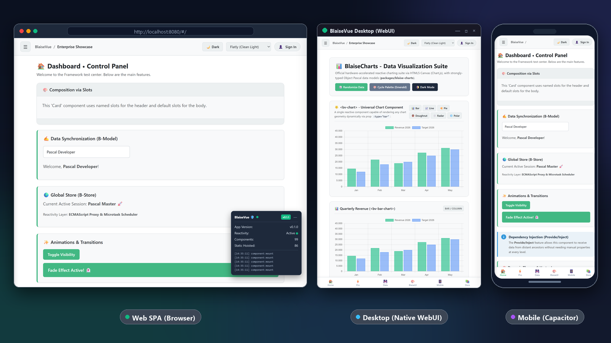

<p align="center">
  <a href="https://github.com/affonsoelias/BlaiseVue">
    
  </a>
</p>

# 🛡️ BlaiseVue: The Universal Reactive Framework for Object Pascal

> **The Universal Reactive Framework for Object Pascal.**  
> Build modern Web (SPA/SSG), Native Mobile (Android/iOS), and Ultra-light Desktop apps from a single Pascal codebase.

<p align="center">
  
</p>

**BlaiseVue** is a high-performance, enterprise-grade universal reactive framework for **Object Pascal**. It combines the type safety, architectural robustness, and raw compilation speed of Pascal with the elegance, ergonomics, and reactivity of **Vue.js**, enabling seamless multiplatform deployment across Web, Mobile, and Desktop from a single codebase.

> [!NOTE]
> ### 🚀 Project Status: Public Pre-Release (`v0.1.x`)
>
> BlaiseVue is currently in active public pre-release (**`v0.1.1`** / **`v0.1.x`** series). The platform is **fully functional, battle-tested, and ready to install in one command via prebuilt binaries (`install.ps1` / `install.sh` — no Git or Free Pascal compiler required to build SPAs)**, create instant projects with zero `npm install`, run the on-demand `demo-app`, test, and evaluate full-stack architectures.
>
> BlaiseVue will continue evolving within the **`v0.1.x`** series across upcoming architectural milestones (including Serverless Edge / BlaiseEdge), with **no scheduled release date yet for `v1.0.0`**.
>
> We warmly invite developers and the Pascal community to install or clone BlaiseVue, build applications, share feedback, and join us in shaping the future of Object Pascal on the modern Web!

---

## 💡 Why BlaiseVue?

The Pascal ecosystem (Delphi and Lazarus) powers **tens of billions of dollars** in enterprise software globally. It underpins critical banking infrastructure, industrial manufacturing ERPs, hospital automation systems, retail point-of-sale (POS) terminals, and mission-critical electronic invoicing across Brazil and worldwide.

For more than 15 years, these organizations have faced the exact same dramatic dilemma:

> *"We need to modernize our ERPs and enterprise systems for the Web, Cloud, and Mobile, but we cannot afford to throw away 20 years of battle-tested Pascal business logic, rewrite everything from scratch, and re-hire an entire team of React/TypeScript or Flutter engineers."*

**BlaiseVue was engineered specifically to solve this dilemma.**

It provides a modern, reactive component model (inspired by Vue.js) written **100% in Object Pascal**. You preserve your business logic, database datasets, and team expertise while compiling directly to ultra-fast, single-page web applications (SPA/SSG), native Android/iOS mobile apps via Capacitor, and lightweight desktop binaries.

If this dilemma sounds familiar to you, **then you should consider BlaiseVue.**

---

## 🧩 Architectural Freedom: Frontend-Only or Full-Stack

BlaiseVue is decoupled by design, giving teams complete architectural freedom across isolated backend directories:

- **Frontend-Only Mode (Zero Backend)**: Build pure reactive Web SPAs, Jamstack sites, or native mobile apps that consume existing corporate REST / GraphQL APIs (Node.js, Go, Python, C#, Java, PHP, or Delphi). Remove any backend cleanly at any time (`bv mormot remove -y`, `bv zephyr remove -y`, or `bv horse remove -y`).
- **Default Enterprise Full-Stack: Synopse mORMot 2 (`server-mormot/`, Port `8090`)**: High-throughput (100k+ req/sec) native Pascal SOA backend with shared interface contracts (`common/contracts.pas`), zero serialization drift, and sub-millisecond response times *(legacy `server/` projects remain supported automatically)*.
- **Native DelSafe Full-Stack (Experimental): Zephyr (`server-zephyr/`, Port `8091`)**: Built-in DelSafe HTTP/1.1 + WebSocket server with integrated static SPA hosting, OWASP security headers, and zero-dependency C99/Pascal binaries (`bv zephyr init`, `bv zephyr run`, `bv zephyr deploy`).
- **Alternative Microframework: Horse (`server-horse/`, Port `9000`)**: Express.js-style lightweight REST microservices via the external **`blaise-horse`** ecosystem tool, completely isolated in `server-horse/` (`bv horse init`, `bv horse run`, `bv horse remove`).

---

## 🔷 Optional DelSafe Integration & Zephyr Backend (Experimental)

BlaiseVue works alongside the **[DelSafe](https://github.com/affonsoelias/delsafe)** language (`--delsafe`, `<script lang="delsafe">`, `.dels` services in `src/services/`, and native `.test.dels` unit tests) for building full-stack applications — while **the BlaiseVue framework itself (CLI, core reactive runtime, compiler, and official UI/data packages) remains 100% written in Free Pascal / Object Pascal**.

- **Completely Optional**: Using DelSafe is entirely optional. Standard Object Pascal remains the primary default experience (`bv create my-app`), and both languages interoperate seamlessly inside the same project (`bv create my-app --delsafe` or `bv g <c|v|s|t> <Name> --delsafe`).
- **Why Add DelSafe to BlaiseVue?**: DelSafe preserves Pascal's readable syntax and mental model while adding modern systems-level guarantees — compile-time ownership/borrow checking, design-by-contract (`require`/`ensure`), `[derive(JSON, Equals)]`, and direct compilation to C99, Object Pascal, and WebAssembly.
- **Why Build Zephyr exclusively in DelSafe?**: Writing the dedicated **Zephyr** backend (`vendor/zephyr`, scaffolded in `server-zephyr/`) in DelSafe gives the framework maximum architectural freedom and end-to-end control over its HTTP/1.1 + WebSocket + SPA serving stack (tight CLI integration, built-in static SPA + history fallback, OWASP security headers, and memory/contract safety without third-party C/C++ bindings).
- **mORMot 2 Remains First-Class**: Adopting Zephyr does **not** replace **Synopse mORMot 2**. `server-mormot/` continues as the battle-tested enterprise Object Pascal backend, and both `server-mormot/` and `server-zephyr/` can coexist cleanly in the same project.

> [!WARNING]
> **Active Testing Notice:** Both the **DelSafe language** and the **Zephyr native backend** are currently **experimental and under active testing**. Expect rapid iterations while core Object Pascal (`pas2js` + `mORMot 2`) remains the stable enterprise baseline.
>
> See the full technical guide in **[59. DelSafe Language Integration & Zephyr Backend](doc/Documentation/59-delsafe-integration-and-zephyr-backend.md)**.

---

## 📦 Official Packages Ecosystem

BlaiseVue features a modular package architecture located in `/packages`:

| Package | Description | Key Components / Features |
| :--- | :--- | :--- |
| **`blaise-ui`** | Native Bootstrap-inspired component kit | `<bv-btn>`, `<bv-card>`, `<bv-modal>`, `<bv-datagrid>`, `<bv-toast>`, `<bv-navbar>`, `<bv-tabs>`, `<bv-input>` |
| **`blaise-themes`** | 9 Bootswatch themes + reactive theme management | Flatly, Darkly, Cosmo, Cyborg, Lux, Pulse, Solar, Vapor, Zephyr, `<bv-theme-toggle>`, `<bv-theme-select>`, `$theme` |
| **`blaise-icons`** | Bootstrap Icons library (fonts + CSS) | `<bv-icon name="heart-fill" size="24px" color="red">`, 2,000+ vector icons |
| **`blaise-charts`** | Reactive Chart.js data visualization suite | `<bv-chart>`, `<bv-bar-chart>`, `<bv-line-chart>`, `<bv-pie-chart>`, typed Pascal records (`TBVChartData`, `TBVChartOptions`, `TBVChartPalette`) |
| **`blaise-reports`** | Declarative PDF reports and printing engine | PDF report templates, multi-page data tables, headers/footers, print dialogs |
| **`blaise-studio`** | Developer cockpit & live WebSocket hub | Visual AST inspector, real-time WebSocket monitor, 1-click test/build runner, `TBVStudioClient` |
| **`blaise-ui-mobile`** | Mobile-first Ionic components & Pascal wrappers | `<bv-ion-app>`, `<bv-ion-toolbar>`, iOS/Android adaptive themes, `TIonicToast`, `TIonicAlert` |

---

## 🌟 Real-World Showcase & Companion Repositories

Explore production software and companion repositories built with and alongside **BlaiseVue**:

- 📐 **[BlaiseNotebook](https://github.com/affonsoelias/BlaiseNotebook)** — Real-world production application built with **BlaiseVue**: an interactive computational notebook environment for Object Pascal (Jupyter/Colab style) featuring reactive Chart.js plots (`<bv-chart>`), persistent stateful kernel execution via Synopse mORMot 2 + WebSockets, interactive DataGrid Pro, one-click Dashboard View, and a cross-platform Python scientific bridge (`numpy`, `pandas`, `scikit-learn`).
- 🔷 **[DelSafe Programming Language](https://github.com/affonsoelias/delsafe)** — Companion Pascal-inspired systems programming language (optional & experimental) with ownership/borrow checking, design-by-contract, and native C99/Pascal/WASM compilation — interoperating directly with BlaiseVue (`--delsafe`, `<script lang="delsafe">`) and powering the native **Zephyr** backend (`vendor/zephyr`).
- 🌐 **[BlaiseVue Ecosystem](https://github.com/affonsoelias/blaisevue-ecosystem)** — Official community registry, external packages, and developer tools (including `blaise-horse`).

---

## 📖 Roadmap & Technical Documentation

For the complete architectural evolution specifications, delivered enterprise pillars, and future roadmap milestones (v2.0 to v5.0), see:

- 🎓 **[Complete Course: Zero to Ninja (doc/Course/README.md)](doc/Course/README.md)**: 13 beginner-friendly practical modules with step-by-step guides, runnable `.bv` examples, and real-world analogies.
- 🗺️ **[Technical Roadmap (doc/Documentation/99-roadmap.md)](doc/Documentation/99-roadmap.md)**: Full architecture breakdown, testing matrices, and future horizons.
- 📚 **[Documentation Index (doc/Documentation/README.md)](doc/Documentation/README.md)**: 59 comprehensive technical manuals covering CLI, reactivity, components, mobile, desktop, ecosystem, mORMot 2, and DelSafe/Zephyr.
- 🏛️ **[Core Architecture & Internals (doc/Architecture/README.md)](doc/Architecture/README.md)**: Deep dive into the compiler pipeline, AST evaluation, and reactive proxy engine.

---

## 📂 Project Structure

```text
BlaiseVue/
├── .github/workflows/         # GitHub Actions CI & cross-platform binary releases (release.yml)
├── bin/                       # BlaiseVue CLI compiler & development toolchain
│   ├── bv.pas                 # Zero-dependency native CLI compiler source (built locally via build.ps1 / build.bat / build.sh)
│   ├── uBVUpgrade.pas         # SHA-256 binary updater, channel manager (stable/nightly), rollback & on-demand fetcher
│   ├── dev-server.js          # Zero-dependency local development HTTP server with native RFC 6455 HMR WebSocket
│   ├── studio-server.js       # Zero-dependency BlaiseVue Studio telemetry hub & API bridge
│   ├── studio/                # Embedded BlaiseVue Studio web cockpit UI
│   └── templates.res          # Embedded pre-compiled project & component templates
├── scripts/                   # Official 1-line installers & release packagers
│   ├── install.ps1 / install.sh             # Prebuilt binary installers (~/.blaisevue, SHA-256 verified)
│   └── package_release.ps1 / .sh            # Cross-platform archive builders + SHA256SUMS.txt
├── core/                      # Core runtime engine (Transpiled via Pas2JS)
│   ├── BlaiseVue.pas          # Core SPA instance orchestrator & hydration
│   ├── BVCompiler.pas         # Template engine, directives & AST parser
│   ├── BVReactivity.pas       # Reactive proxy & dependency tracking ($ref, $computed)
│   ├── BVRouting.pas          # SPA Router, navigation guards & HTML5 History API
│   ├── BVValidation.pas       # Reactive form validation engine (b-validate)
│   ├── BVI18n.pas             # Internationalization & localization engine ($t)
│   ├── BVTheme.pas            # Theme switcher & persistence engine ($theme)
│   ├── BVWasm.pas             # WebAssembly acceleration engine ($wasm)
│   ├── BVStore.pas            # BlaiseX 2.0 modular store (, )
│   ├── BVFSM.pas              # Deterministic Finite State Machines (TBVStateMachine)
│   ├── BVMiddleware.pas       # Action/mutation pipeline (Logger, AuthGuard, Telemetry)
│   ├── BVStoreHistory.pas     # Time-travel debugging, snapshots & DevTools bridge
│   ├── BVAuth.pas             # JWT authentication, session storage & route protection
│   ├── BVClient.pas           # Reactive REST ($api) & WebSocket ($ws) client helpers
│   ├── BVDataSet.pas          # LiveBindings, reactive TDataSet & offline delta sync
│   ├── BVRpc.pas              # Type-safe Pascal RPC client proxies for mORMot 2 SOA
│   ├── BVMobile.pas           # Capacitor mobile runtime bridge & device events
│   ├── BVDesktop.pas          # WebUI native desktop window & IPC bridge
│   ├── BVDevTools.pas         # Browser DevTools extension telemetry bridge
│   └── Blaise*.pas            # Official Pascal bindings (UI, Charts, Reports, Ionic)
├── templates/                 # Scaffolding templates for new projects
│   ├── fullstack-mormot/      # High-performance native mORMot 2 server template
│   ├── *.bv                   # Component, View and App template blueprints
│   └── *.pas                  # Domain services, test suites and config templates
├── packages/                  # Modular package ecosystem & developer tooling
│   ├── core/                  # Official core framework packages
│   │   ├── blaise-ui/         # 25+ native reactive UI components & styles
│   │   ├── blaise-themes/     # 9 Bootswatch themes & build-time pruning optimizer
│   │   ├── blaise-icons/      # Bootstrap Icons fonts & stylesheet bundle
│   │   ├── blaise-charts/     # Reactive Chart.js visualization & Pascal wrappers
│   │   ├── blaise-reports/    # Declarative PDF reports generation engine
│   │   ├── blaise-studio/     # Developer cockpit telemetry & AST inspector
│   │   └── blaise-ui-mobile/  # Mobile-first Ionic components & Pascal wrappers
│   └── tools/                 # Development extensions & IDE tooling
│       ├── blaise-devtools/   # Browser DevTools extension (Chrome, Firefox, Edge)
│       ├── blaise-vscode/     # Official VS Code extension (.vsix packaging & snippets)
│       └── blaise-lazarus/    # Official Lazarus IDE package (.lpk design-time integration)
├── vendor/                    # Pre-bundled compilers & native frameworks
│   ├── pas2js/                # Official Pas2JS transpiler & RTL binaries (per-platform in release archives)
│   ├── mormot2/               # High-throughput Synopse mORMot 2.4 framework (fetched on demand in binary installs)
│   └── zephyr/                # Native DelSafe HTTP/1.1 + WebSocket server (experimental)
├── tests/                     # SDK-level framework test suites (bv test --sdk)
├── doc/                       # Architecture, manuals & educational courses
│   ├── Architecture/          # Core compiler pipeline, reactivity engine & internals
│   ├── Documentation/         # 59 comprehensive technical manuals + API Reference
│   ├── Course/                # 13-module practical course from beginner to ninja
│   └── brand/                 # Official vector logos, icons & banner assets
└── demo-app/                  # Enterprise showcase application (v0.1.x Full-Stack, fetched on demand in binary installs)
    ├── src/                   # Reactive frontend SPA (views, components, services)
    ├── server-mormot/         # High-throughput native mORMot 2 backend server
    ├── mobile/                # Native Capacitor Android (APK/AAB) & iOS projects
    ├── desktop/               # Native WebUI desktop app with Lazarus project
    └── tests/                 # 3-tier application test suites (components, views, services)
```

---

## 🏁 Quick Start

### 📋 Prerequisites
- **Node.js (v18+ LTS)**: Powers the zero-dependency HMR dev server (`bv dev`), Studio (`bv studio`), and on-demand test/mobile tooling (`bv test`, `bv capacitor`).
- **Lazarus IDE (or Free Pascal Compiler 3.2+, Optional)**: Required only if you build native desktop apps (`bv desktop`), native **mORMot 2** servers (`bv mormot`), or compile the CLI from source (`--from-source`).
- **[DelSafe Compiler (`delsafec`, Optional & Recommended — Experimental)](https://github.com/affonsoelias/delsafe)**: Optional compiler needed only if you create `--delsafe` apps, author `<script lang="delsafe">` / `.dels` modules, run `.test.dels` suites, or build the **Zephyr** backend (`bv zephyr`). Standard Object Pascal projects work without it.
- **Python (v3.8+ Recommended)**: Recommended for executing cross-platform lifecycle scripts (`status.py`, `install.py`, `update.py`, `remove.py`, `pack.py`) for the developer tooling ecosystem (`bv tool`) and custom user packages (`~/.blaisevue/tools/`).
- **Android Studio (Recommended for Mobile)**: Required for compiling native Android `.apk` / `.aab` packages (`bv capacitor build`), managing emulators, and running `bv capacitor open android`.

> [!NOTE]
> **Zero `npm install` needed to build & run:** `bv create`, `bv build`, `bv dev`, and `bv studio` work out of the box without installing `node_modules`. `pas2js` is pre-bundled per platform, while `mORMot 2`, `demo-app`, and optional test/mobile packages (`vitest` on `bv test`, `@capacitor/*` on `bv capacitor init`) are fetched automatically on demand.

### 1. Official 1-Line Installation (Prebuilt Binaries — Recommended)
Install the prebuilt BlaiseVue CLI & SDK into `~/.blaisevue` with SHA-256 verification (zero Git or Free Pascal required):

**Windows (PowerShell):**
```powershell
irm https://raw.githubusercontent.com/affonsoelias/BlaiseVue/main/scripts/install.ps1 | iex
```

**Linux / macOS:**
```bash
curl -fsSL https://raw.githubusercontent.com/affonsoelias/BlaiseVue/main/scripts/install.sh | bash
# Add ~/.blaisevue/bin to your PATH as instructed by the installer
```

> [!TIP]
> **Contributors / Building from Source:** Clone the `main` branch (`git clone https://github.com/affonsoelias/BlaiseVue.git`) and run `.\build.ps1` (or `build.bat` / `./build.sh`), then add `BlaiseVue/bin` to your `PATH`.

Verify the environment at any time:
```bash
bv --version
bv doctor
```

### 2. Create the Showcase Demo OR a Clean Project

#### Option A — Scaffold the Showcase Demo (`--demo`)
Explore all BlaiseVue capabilities (reactive views, BlaiseUI, Chart.js, Reports, Offline DataSet, i18n, and mORMot 2 full-stack). On binary installs, `demo-app` is automatically downloaded on demand from GitHub and cached:
```bash
bv create my-demo --demo
cd my-demo
bv doctor          # Inspect environment & project alignment
bv dev             # Frontend SPA + HMR at http://localhost:8080
```
*(Optional)* Start the native mORMot 2 backend (`http://localhost:8090`, auto-downloads mORMot 2 on demand if missing):
```bash
bv mormot run
```

#### Option B — Create & Run a Clean Project from Scratch
Scaffold a clean application in any workspace:
```bash
bv create my-app
# Optional variants:
#   bv create my-app --delsafe           # DelSafe + Object Pascal interop
#   bv create my-app --backend=mormot    # Attach native mORMot 2 server (port 8090)
#   bv create my-app --backend=zephyr    # Attach native Zephyr DelSafe server (port 8091)

cd my-app
bv doctor
bv dev
# Open http://localhost:8080 in your browser
```
Any modifications saved in `src/` are recompiled and hot-swapped in the browser in milliseconds!

### 3. Interactive Cockpit, Channels, Multi-Version & Atomic Updates
```bash
# Interactive Cockpit shell with [TAB] autocompletion:
bv enter

# Manage multiple BlaiseVue versions per project (.blaisevue-version):
bv framework upgrade            # Downloads prebuilt GitHub release (--from-source optional)
bv framework use 0.1.1          # Pin current project to v0.1.1
bv framework use channel        # Follow your global channel again

# Update safely with SHA-256 verification & atomic .bak backup (revert anytime with bv rollback):
bv self-update --check
bv self-update
bv channel                      # Inspect active channel (stable | nightly)
bv channel use nightly          # Switch channel (aliases: main -> stable, develop -> nightly)
bv rollback                     # Restore previous CLI & runtime directories
```

### 4. Explore Full-Stack, Mobile & Desktop
Your project is multi-platform by design:
```bash
# Native mORMot 2 backend server (Port 8090):
bv mormot init
bv mormot run

# Native Zephyr (DelSafe) backend server (Port 8091, experimental):
bv zephyr init
bv zephyr run

# Native Mobile on Android Emulator (Capacitor):
bv capacitor run android --emulator  # or: bv mobile run android --emulator

# Native Desktop Application (WebUI):
bv desktop run
```

---

## ⚖️ Licensing

BlaiseVue is open-source and follows the standard **Lazarus / Free Pascal** licensing model:
- **The BlaiseCLI tool (`bin/`):** Licensed under the **GNU GPL v2**.
- **The BlaiseVue Core (`core/`):** Licensed under the **Modified GNU LGPL v2.1** with a **Static Linking Exception**.

This allows developers to build **commercial and proprietary applications** without having to open-source their proprietary code, while ensuring the framework runtime remains open and accessible to all. See the [LICENSE](LICENSE) file for details.

### 🖋️ Brand Identity & Trademarks
The BlaiseVue name, architecture, and the official **Shadow Hand & White Quill** logo are authored by **Elias Affonso**. For official brand assets, guidelines, and vector files, visit the [Brand Assets Directory](doc/brand/README.md).

---

🛡️ **"BlaiseVue: The Universal Reactive Framework for Object Pascal."** ✨🏆🚀
