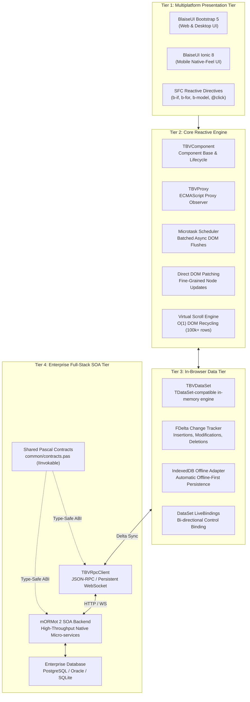
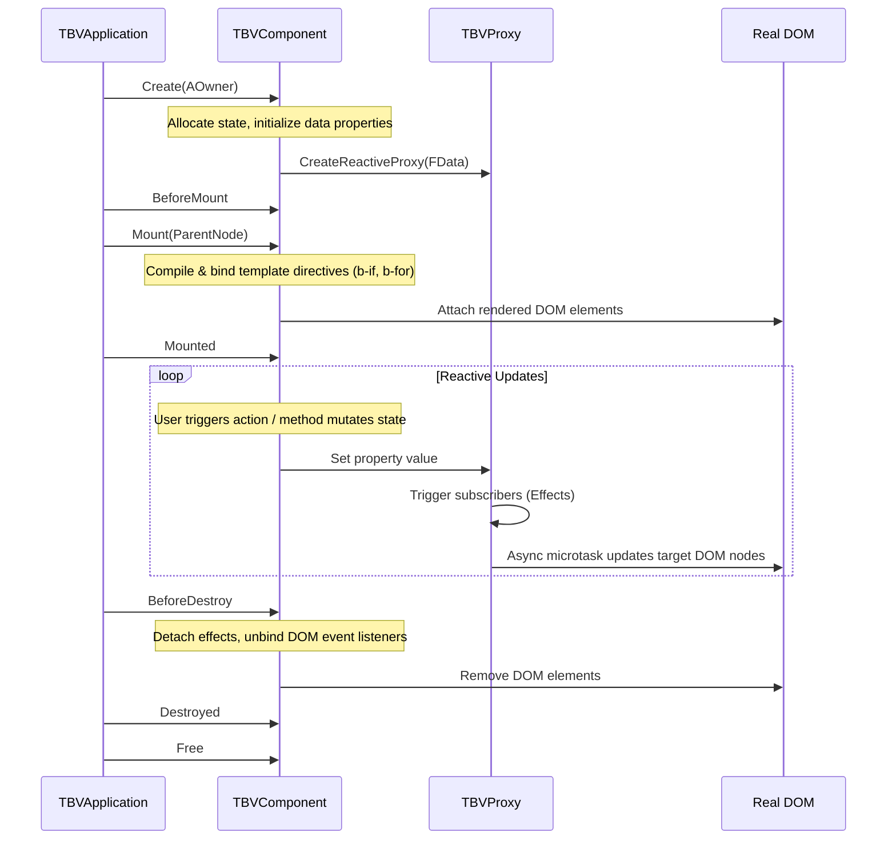

# 🏗️ Framework Architecture: High-Level Overview
**Enterprise Universal Architecture Specification (Version 4.4)**

BlaiseVue is an enterprise-grade application framework designed to bridge the gap between high-performance, strongly typed **Object Pascal** and the modern **Web, Desktop, and Mobile** runtime ecosystems.

Instead of translating Pascal to an intermediate framework like React, Angular, or Vue.js at runtime, BlaiseVue implements its own native reactive core directly on the browser's ECMAScript runtime via **Pas2JS**, coupled with a lightweight compilation and asset bundling toolchain written in Free Pascal (`bin/bv.pas`).

---

## 1. The 4-Tier Enterprise Blueprint

BlaiseVue 4.4 is architectured into four distinct, loosely coupled tiers:

---

## 2. Deep Dive: Architectural Tiers

### Tier 1: Multiplatform Presentation Tier
The presentation layer translates declarative templates into high-performance DOM trees. It provides two purpose-built component ecosystems:
- **BlaiseUI Web & Desktop (Bootstrap 5)**: Standardized enterprise components (`BVButton`, `BVCard`, `BVModal`, `BVGrid`, `BVNavbar`, `BVSwitch`, `BVCheckbox`, `BVRadio`, `BVDropdown`, `BVSkeleton`, `BVSlider`). Optimized for keyboard-driven data entry, data tables, and desktop density.
- **BlaiseUI Mobile (Ionic 8)**: Native-feeling touch components (`BVIonPage`, `BVIonHeader`, `BVIonContent`, `BVIonList`, `BVIonItem`, `BVIonInput`, `BVIonToggle`, `BVIonCheckbox`, `BVIonSelect`, `BVIonRefresher`, `BVIonSearchBar`, `BVIonFab`, `BVIonBackButton`). Optimized for 60/120 FPS mobile interactions, touch gestures, safe area insets, and iOS/Android adaptive themes.

### Tier 2: Core Reactive Engine
The heart of BlaiseVue is its fine-grained reactivity system:
- **Zero Heavy VDOM Overhead**: Unlike traditional virtual DOM frameworks that reconstruct entire virtual subtrees on state changes, BlaiseVue creates direct fine-grained closures ("Effects") bound to target DOM text nodes and element attributes.
- **Microtask Batching**: Multiple synchronous mutations within a Pascal method or event handler are automatically aggregated. The DOM is updated exactly once in the next microtask cycle (`Promise.resolve().then()`), preventing layout thrashing.
- **Virtual Scrolling**: Integrated engine capable of rendering lists exceeding 100,000 records with an $O(1)$ memory footprint by recycling a small pool of DOM nodes.

### Tier 3: In-Browser Data Tier (`TBVDataSet`)
For Pascal developers migrating desktop Delphi/Lazarus applications, BlaiseVue provides an in-browser database engine that mirrors the standard `TDataSet` API:
- **In-Memory Cursor**: Supports navigation (`First`, `Next`, `Prior`, `Last`, `Eof`, `Bof`), filtering, calculated fields, and multi-field sorting.
- **Delta Tracking (`FDelta`)**: Tracks all record state changes (`dsBrowse`, `dsEdit`, `dsInsert`) in an append-only transaction log without mutating historical data prematurely.
- **Offline Storage**: Seamless integration with the browser's `IndexedDB` engine for robust offline-first functionality.

### Tier 4: Enterprise Full-Stack SOA Tier (mORMot 2)
BlaiseVue eliminates the boundary between frontend and backend via shared Object Pascal source contracts:
- **Shared Interface Contracts (`common/contracts.pas`)**: A single pure Pascal interface (inheriting from `IInvokable`) defines service methods, parameters, and return types.
- **End-to-End Type Safety**: The server (compiled with FPC and mORMot 2) implements the interface; the browser client (compiled with Pas2JS) invokes the interface transparently through `TBVRpcClient`.
- **Zero Serialization Glue**: No manual REST endpoints, no Swagger synchronization drift, and no fragile string-based endpoint URLs.

---

## 3. Universal Multiplatform Runtimes

BlaiseVue delivers a single codebase across four enterprise deployment targets:

| Target | Architecture | Core Characteristics |
| :--- | :--- | :--- |
| **Web SPA / SSG** | Standalone static bundle (`index.html`, `app.js`, `app.css`). | Zero backend dependency; deployable to Nginx, AWS S3, Cloudflare Pages, or Docker. Sub-second initial load. |
| **Desktop WebUI** | Native C/Pascal host with embedded lightweight WebUI engine. | **< 10 MB** standalone binary. Zero Chromium/Electron bloat. Direct access to native OS file systems, system tray, native menus, and multi-window. |
| **Mobile (Capacitor 7+)** | Native Android (APK/AAB) and iOS (IPA) wrappers with bridge runtime. | Native hardware access (Camera, Biometrics, Geolocation, SQLite, Local Notifications). Deep integration with Ionic 8 components. |
| **Enterprise Server (mORMot 2)** | Native compiled microservice or monolith daemon. | Multi-threaded SOA server capable of handling tens of thousands of requests per second with microsecond latency. |

---

## 4. Component Lifecycle & Memory Model

Each `TBVComponent` instance undergoes a strictly managed lifecycle to guarantee deterministic execution and prevent browser memory leaks:

### Deterministic Memory Management
1. **Scope Isolation**: Event listeners attached by `b-on` or `@event` are tracked in a component-scoped registry and automatically deregistered upon component destruction.
2. **Effect Cleanup**: Before an effect is re-executed or destroyed, all its active subscriptions in the reactivity dependency graph are severed to prevent zombie listeners and memory retention.
3. **Timer & Subscription Teardown**: Components provide managed hooks (`RegisterTimer`, `RegisterSubscription`) that guarantee automatic disposal during teardown.

---

🛡️ **Next Architectural Guides:**
- [**02. Reactivity Engine**](02-Reactivity-Engine.md) – Deep dive into `TBVProxy`, dependency graphs, and batch scheduling.
- [**03. Compiler Pipeline**](03-Compiler-Pipeline.md) – How `.bv` SFCs are tokenized, AST-evaluated, and transpiled.
- [**05. Data & RPC Architecture**](05-Data-and-RPC-Architecture.md) – In-browser `TBVDataSet` internals and mORMot 2 SOA.
