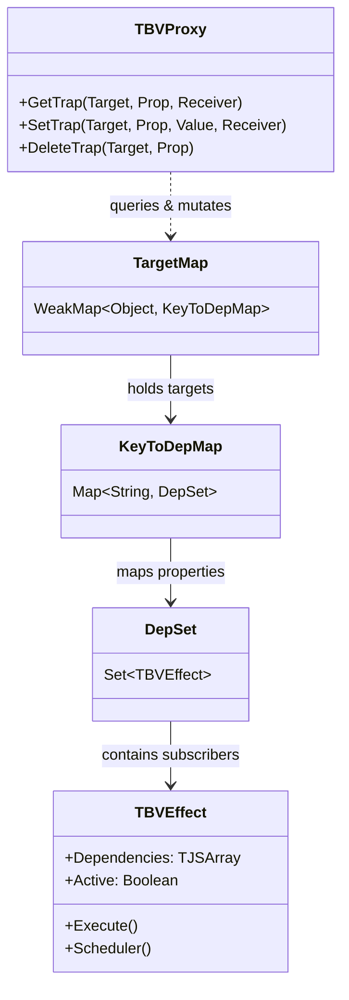
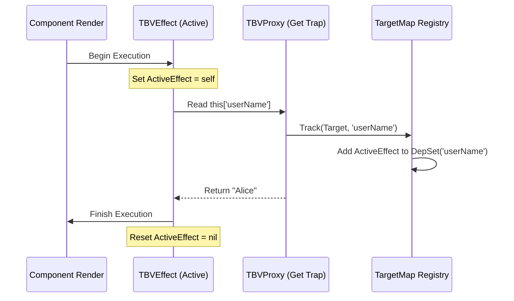
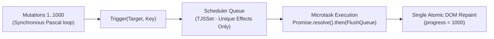
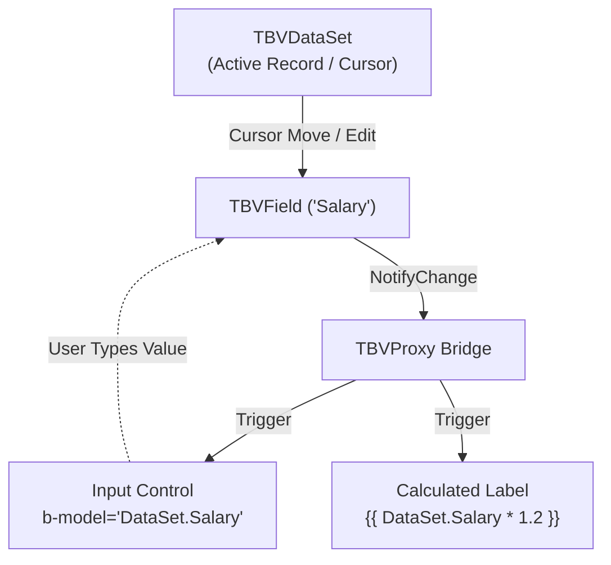

# 🧠 Deep Dive: The Reactivity Engine
**Internal Mechanics of TBVProxy, Dependency Tracking, and Microtask Batching**

The core foundation of BlaiseVue is its fine-grained, dependency-tracking reactivity engine. Rather than relying on dirty checking loops (AngularJS) or full virtual DOM diffing (React), BlaiseVue utilizes modern **ECMAScript Proxies** combined with a fine-grained **Observer Pattern** to achieve direct, surgical DOM updates with $O(1)$ patching complexity.

---

## 1. The Reactivity Dependency Graph

Reactivity in BlaiseVue centers on three primitive concepts:
1. **Target**: The underlying Pascal data object wrapped by `TBVProxy`.
2. **Key**: The specific property being read or written (e.g., `'counter'`, `'selectedUser'`).
3. **Effect (`TBVEffect`)**: An executable computation (such as a DOM update closure or computed property getter) that depends on one or more reactive keys.



### The `TargetMap` Data Structure
At the runtime level, all reactive dependencies are stored in a hierarchical, memory-leak-safe registry:
```pascal
var
  // Target -> Map(Key -> Set(Effects))
  FTargetMap: TJSWeakMap;
```
Because the outermost container is a `WeakMap`, when a component instance is destroyed, all its associated dependency mappings are automatically eligible for browser garbage collection without manual unregistering of each individual property.

---

## 2. Proxy Traps: `Get` and `Set` Mechanics

When a Pascal component defines state inside `<script>` (or in its `data:` registration), BlaiseVue wraps the raw record/object inside `TBVProxy`.

### The `Get` Trap: Automatic Dependency Collection (`Track`)
When any template binding, computed property, or watcher reads a reactive property:

```pascal
function TBVProxy.GetTrap(ATarget: JSValue; AProp: String; AReceiver: JSValue): JSValue;
begin
  Result := GetJSProperty(ATarget, AProp);
  
  // If an effect is currently actively running, register it as a subscriber
  if ActiveEffect <> nil then
    Track(ATarget, AProp);
end;
```



### The `Set` Trap: Notification and Dispatch (`Trigger`)
When a method or event mutates a reactive property:

```pascal
function TBVProxy.SetTrap(ATarget: JSValue; AProp: String; AValue: JSValue; AReceiver: JSValue): Boolean;
var
  OldValue: JSValue;
begin
  OldValue := GetJSProperty(ATarget, AProp);
  if not IsStrictlyEqual(OldValue, AValue) then
  begin
    SetJSProperty(ATarget, AProp, AValue);
    Trigger(ATarget, AProp); // Notify all subscribed effects
  end;
  Result := True;
end;
```

---

## 3. The Asynchronous Microtask Scheduler

A critical performance challenge in reactive systems is preventing redundant DOM updates when multiple mutations occur within a single tick.

Consider this Pascal method:
```pascal
procedure TUserProfile.UpdateMetrics;
var
  i: Integer;
begin
  for i := 1 to 1000 do
    Data['progress'] := i; // 1,000 synchronous mutations
end;
```

Without a scheduler, the DOM would attempt 1,000 synchronous layout recalculations and repaints. BlaiseVue solves this using an **asynchronous microtask queue**:



### Scheduler Implementation Highlights:
1. **Deduplication (`TJSSet`)**: Effects pushed to the queue are stored in a JavaScript `Set`. Duplicate requests for the same effect are discarded in $O(1)$ time.
2. **Microtask Queueing**: The queue is scheduled using `Promise.resolve().then(...)`, ensuring DOM updates run after current Pascal code finishes, but *before* the browser renders the next frame.
3. **Loop Guard & Recursion Cap**: If an effect accidentally mutates a state variable that it also reads, a recursion counter prevents infinite locking by capping cyclic invocations at 100 iterations and throwing a diagnostic `EBVReactivityCycleError`.

---

## 4. Fine-Grained Direct DOM Patching

BlaiseVue does **not** generate an expensive synthetic Virtual DOM tree on every render. Instead, the compiler generates surgical closures directly targeting DOM elements:

```pascal
// Generated binding closure for: <span>{{ user.name }}</span>
procedure BindUserName(AElement: TJSElement; AComponent: TBVComponent);
begin
  AComponent.CreateEffect(procedure
  begin
    // This closure automatically re-runs whenever user.name changes
    AElement.textContent := String(AComponent.Data['user']['name']);
  end);
end;
```

### Performance Comparison:
| Metric | Traditional Virtual DOM | BlaiseVue Direct Reactive Patching |
| :--- | :--- | :--- |
| **State Mutation Overhead** | Reconstructs virtual VNode tree for entire component branch | $O(1)$ directly queues subscribed effect |
| **Diffing Cost** | $O(N)$ tree traversal comparing Old VNode vs New VNode | **$0$ (Zero)** diffing overhead |
| **DOM Touch Points** | Replaces or patches reconciled nodes | Modifies *only* the specific TextNode or attribute |
| **Memory Allocation** | Continuous garbage collection of transient VNodes | Zero transient allocations during updates |

---

## 5. LiveBindings with `TBVDataSet`

A major architectural innovation in BlaiseVue 4.4 is the native bridge between the reactivity engine and the in-browser database `TBVDataSet`:



When cursor navigation methods (`First`, `Next`, `Prior`) or field assignments (`FieldByName('Salary').AsFloat := 5000.00`) are executed:
1. The `TBVDataSet` emits an internal `OnRecordChange` event.
2. The proxy wrapper detects the cursor movement and fires `Trigger` for all bound fields.
3. Bound UI controls (`b-model="emp.Salary"` or `{{ emp.Salary }}`) update immediately and synchronously in the next microtask.

---

## 6. Global State: `TBVStore 2.0` (BlaiseX)

For cross-component application state, `TBVStore 2.0` leverages the exact same reactive proxy primitives:
- **State**: Wrapped in `TBVProxy` to automatically participate in the dependency graph.
- **Getters**: Wrapped in computed `TBVEffect` instances with automatic memoization.
- **Actions**: Async Pascal methods supporting complex orchestration, API queries, and atomic commits.
- **State Machines (`TBVStateMachine`)**: Formalized finite state machines with deterministic transitions, guard conditions, and reactive state tracking.

---

🛡️ **Next Architectural Guides:**
- [**03. Compiler Pipeline**](03-Compiler-Pipeline.md) – How `.bv` SFCs are tokenized, AST-evaluated, and transpiled.
- [**05. Data & RPC Architecture**](05-Data-and-RPC-Architecture.md) – In-browser database internals and full-stack mORMot 2 SOA.
- [**06. Virtual DOM & Virtual Scroll**](06-Virtual-DOM-and-Virtual-Scroll.md) – $O(1)$ memory virtual scrolling for 100k+ records.
