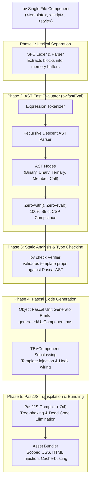
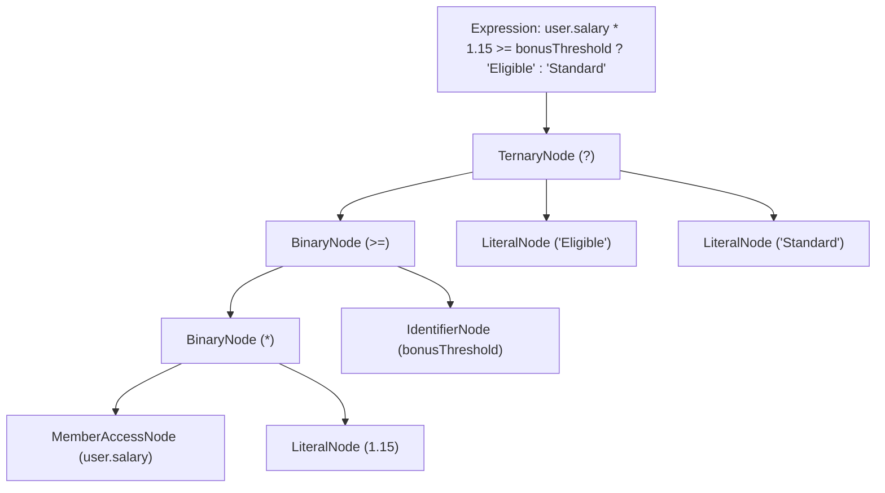

# ⚙️ The Compiler Pipeline
**From .bv Single File Components to Optimized Multiplatform Bundles**

The BlaiseVue Compiler (`bin/bv.pas`) is the central orchestrator of the development and build lifecycle. It transforms human-readable `.bv` Single File Components (SFCs) into strongly typed Object Pascal units, verifies expressions through an internal Abstract Syntax Tree (AST) evaluator, and links with **Pas2JS** to produce optimized production JavaScript and multiplatform executables.

---

## 1. The 5-Phase Compilation Architecture



---

## 2. Phase 1: Lexical Separation (SFC Stripping)

The compiler reads the `.bv` source file and extracts three isolated content blocks:
1. **`<template>`**: HTML structure enhanced with BlaiseVue directives (`b-if`, `b-for`, `b-model`, `b-bind`, `@click`).
2. **`<script>`**: Pure Object Pascal unit content declaring the component's state, methods, computed properties, and lifecycle hooks.
3. **`<style>`**: Standard or scoped CSS definitions for component styling.

The parser handles nested tags, multi-line string escaping, and scoped attribute injection (e.g., `data-bv-v123abc`).

---

## 3. Phase 2: AST Fast Evaluator (`bv.fastEval`)

In traditional lightweight web engines, template expressions (`{{ user.firstName + ' ' + user.lastName }}`) were often evaluated using `eval()` or JavaScript's `with(this) { ... }` construct. 

### Why BlaiseVue Replaced `with()` and `eval()`:
- **Enterprise CSP Violation**: Strict **Content Security Policy (CSP)** rules in banking, defense, and healthcare prohibit `unsafe-eval`.
- **V8 / SpiderMonkey De-optimizations**: JavaScript engines cannot optimize scopes containing `with()`, degrading performance by up to $10\times$.
- **Security Vulnerabilities**: String evaluation creates potential Cross-Site Scripting (XSS) vectors.

### The Recursive Descent AST Parser:
BlaiseVue 4.4 features its own dedicated expression compiler (`bv.fastEval`). It parses expressions into an in-memory Abstract Syntax Tree:



### Supported AST Node Types:
- **`TLiteralNode`**: Numeric, string, boolean, and null literals.
- **`TIdentifierNode`**: Variable lookups resolved through the component's reactive proxy.
- **`TMemberAccessNode`**: Deep property navigation (e.g., `customer.orders[0].total`).
- **`TBinaryNode` / `TUnaryNode`**: Arithmetic, logical (`&&`, `||`, `!`), and comparison operators (`==`, `!=`, `<`, `>`, `<=`, `>=`).
- **`TTernaryNode`**: Conditional expressions (`condition ? truthy : falsy`).
- **`TFunctionCallNode`**: Safe invocation of component methods with arguments.

Evaluation traverses the AST directly in Pascal / JavaScript without generating dynamic code strings, achieving **100% strict CSP compliance**.

---

## 4. Phase 3: Static Analysis & Type Checking (`bv check`)

Before passing code to the transpiler, the compiler runs static analysis:
```bash
bv check
```
- **Identifier Validation**: Verifies that every identifier referenced in `<template>` expressions exists in the `<script>` component declaration.
- **Type Compatibility**: Checks method signatures referenced in `@click` or `@input` handlers.
- **Actionable Diagnostics**: Emits standard compiler error format (`filename(line,col): error: Unknown property 'usreName' on TComponent; did you mean 'userName'?`).

---

## 5. Phase 4: Pascal Code Generation

The compiler synthesizes a valid Object Pascal unit in the `.bv/generated/` directory:

```pascal
unit U_UserProfile_bv;

{$mode objfpc}{$H+}

interface

uses
  SysUtils, Classes, JS, Web, BVComponent, BVReactivity;

type
  TUserProfile = class(TBVComponent)
  private
    FUserName: String;
    FSalary: Double;
  public
    function GetTemplate: String; override;
    procedure RegisterBindings; override;
    // User-declared methods from <script>
    procedure PromoteUser;
  end;

implementation

function TUserProfile.GetTemplate: String;
begin
  Result := '<div class="card"><h3>{{ userName }}</h3>...</div>';
end;

procedure TUserProfile.RegisterBindings;
begin
  // Surgical direct DOM binding logic generated here
end;

end.
```

---

## 6. Phase 5: Pas2JS Transpilation & Optimization

The CLI invokes the **Pas2JS** compiler with high-performance compiler directives:
```bash
pas2js -Jc -Jmin -O4 -Tbrowser -Fu./core -Fu./generated main.pas
```
- **`-O4` Maximum Optimization**: Inlines small routines and folds constant expressions.
- **`-Jmin` Production Minification**: Strips identifiers, comments, and whitespace.
- **Smart Linking & Tree-Shaking**: Any unused Pascal classes or units from the RTL are stripped from the final JavaScript artifact.
- **Scoped CSS & Asset Pipeline**: Merges component styles into `dist/css/app.css` and injects versioned script tags (`app.js?v=hash`) into `dist/index.html` for cache busting.

---

🛡️ **Next Architectural Guides:**
- [**04. Contributing Guide**](04-Contributing-Guide.md) – Development standards, test runner, and PR workflows.
- [**05. Data & RPC Architecture**](05-Data-and-RPC-Architecture.md) – In-browser database internals and full-stack mORMot 2 SOA.
- [**06. Virtual DOM & Virtual Scroll**](06-Virtual-DOM-and-Virtual-Scroll.md) – $O(1)$ memory virtual scrolling for 100k+ records.
