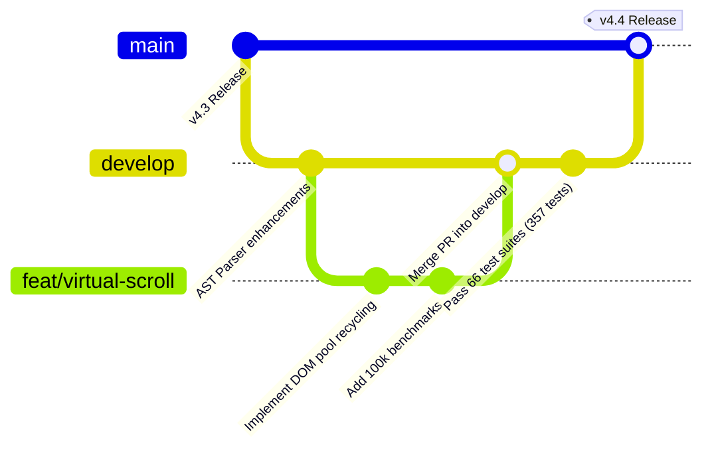

# 🛡️ Contributing to BlaiseVue
**Engineering Standards, Git Workflow, and Test Specifications**

We are thrilled that you want to contribute to **BlaiseVue**! Contributing to this repository means helping build a modern, high-performance, and type-safe future for Object Pascal across the Web, Desktop, and Mobile.

---

## 1. Git Workflow & Branching Strategy

BlaiseVue follows a strict **Git Flow** branching model to ensure enterprise stability:



### Branch Rules:
- **`main`**: Production-ready code only. Tagged with formal SemVer releases (e.g., `v4.4.0`). Direct pushes to `main` are strictly forbidden.
- **`develop`**: The primary integration branch. All active development, feature branches, and bug fixes merge into `develop`.
- **Feature Branches (`feat/<feature-name>`)**: Branch off `develop`. Used for new directives, components, or CLI tools.
- **Fix Branches (`fix/<issue-name>`)**: Branch off `develop`. Used for bug fixes and regression patches.

---

## 2. Setting Up the Development Toolchain

### Prerequisites:
- **Free Pascal Compiler (FPC)**: Version 3.2.2 or later (for building the CLI).
- **Pas2JS**: Version 2.2.0 or later (transpilation engine).
- **Node.js**: Version 18+ (used by the test harness and mobile Capacitor tooling).

### Building the CLI from Source:
Whenever you modify compiler logic in `bin/` or `core/`:
```bash
# Compile the bv CLI binary with level 3 optimizations
fpc bin/bv.pas -FEbin -O3
```

---

## 3. Object Pascal Coding Conventions

To ensure the codebase remains clean, maintainable, and readable across global enterprise teams:

### Naming Conventions:
- **Classes and Types**: `PascalCase` with prefix `T` (e.g., `TBVComponent`, `TBVDataSet`, `TBVProxy`).
- **Interfaces**: `PascalCase` with prefix `I` (e.g., `IInvokable`, `IBVObservable`).
- **Private Fields**: `PascalCase` with prefix `F` (e.g., `FActiveEffect`, `FDeltaLog`).
- **Parameters and Locals**: `camelCase` or `PascalCase` with prefix `A` for parameters (e.g., `AOwner`, `recordIndex`).
- **Constants**: `PascalCase` or uppercase with underscores (e.g., `MAX_RECURSION_DEPTH`).

### Architectural Rules:
- **Strong Typing**: Avoid overuse of untyped `JSValue`. Use specific Pascal types (`String`, `Integer`, `Double`, `TJSArray`, `TJSElement`) whenever possible.
- **English Only**: All source code, comments, test names, commit messages, and documentation must be written in clear English.
- **Zero Memory Leaks**: Ensure every dynamic subscription, event listener, or timer created during a component's lifecycle is cleanly detached in `BeforeDestroy` or `Destroy`.

---

## 4. BlaiseUI Component Guidelines

When introducing new components to `BlaiseUI`:
1. **Web / Desktop Components**:
   - Must use standard **Bootstrap 5** classes (`btn`, `card`, `form-check-input`, `dropdown-menu`).
   - Must provide customizable properties (`Variant`, `Size`, `Disabled`).
   - Must emit standard Pascal events (`OnClick`, `OnChange`).
2. **Mobile Components**:
   - Must integrate with **Ionic 8** custom elements (`ion-page`, `ion-item`, `ion-toggle`).
   - Must support touch gestures, haptic feedback hooks, and mobile safe-area insets.
3. **Accessibility (WCAG 2.1 AA)**:
   - Form inputs and interactive controls must expose proper `role`, `aria-label`, and `tabindex` attributes.
   - Keyboard navigation (`Enter`, `Space`, `Tab`, `Escape`) must be fully functional.

---

## 5. Automated Testing Standards

BlaiseVue enforces a **100% test pass requirement**. No Pull Request will be merged if any automated test fails.

The framework currently runs **66 test suites containing 357 automated tests**:

```bash
# Run the entire test suite
bv test

# Run End-to-End (E2E) browser verification
bv test e2e

# Run performance and memory benchmarks
bv test bench
```

### Adding a New Test Suite:
Use the CLI to scaffold a new test:
```bash
bv new t TestFeatureName
```
This generates a test unit in `tests/` utilizing `TBVTestContext`:

```pascal
unit Test_FeatureName;

{$mode objfpc}{$H+}

interface

uses
  SysUtils, Classes, BVTestFramework, BVReactivity;

type
  TTestFeature = class(TBVTestCase)
  published
    procedure TestReactivityTrigger;
    procedure TestDOMPatching;
  end;

implementation

procedure TTestFeature.TestReactivityTrigger;
var
  Data: JSValue;
begin
  // Arrange & Act
  Data := CreateReactiveState;
  // Assert
  AssertTrue('State should notify subscriber', WasNotified);
end;

initialization
  RegisterTest(TTestFeature);
end.
```

---

## 6. Pull Request (PR) Checklist

Before submitting a Pull Request to `develop`:
- [ ] Working branch was created from the latest `develop`.
- [ ] CLI compiled cleanly with `fpc bin/bv.pas -FEbin`.
- [ ] All 66 test suites passed (`bv test` shows 357/357 green).
- [ ] New features or bug fixes have dedicated unit tests in `tests/`.
- [ ] Relevant documentation updated in `doc/Documentation/` or `doc/Architecture/`.
- [ ] Commit messages follow the conventional format:
  - `feat: add BVSlider component to BlaiseUI`
  - `fix: prevent effect cycle in TBVDataSet LiveBindings`
  - `docs: update architecture overview for v4.4`

---

🛡️ **"In Pascal we trust. Let's build something great together."** ✨🏆🌍
