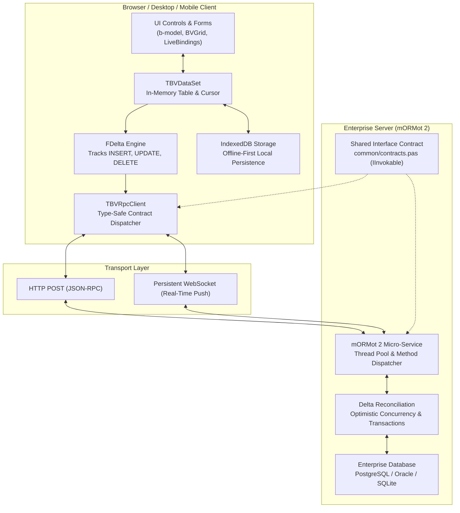
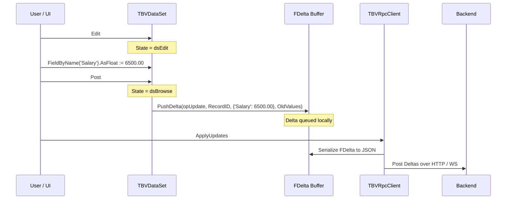

# 💾 Data & RPC Architecture
**In-Browser TBVDataSet, Offline Delta Synchronization, and mORMot 2 SOA Integration**

One of the defining innovations of BlaiseVue 4.4 is its unified data architecture. While traditional web frameworks require frontend developers to manually coordinate Redux/Pinia stores, REST endpoints, and complex serialization schemas, BlaiseVue provides an **in-browser database engine (`TBVDataSet`)** that mirrors Delphi/Lazarus paradigms, paired with a **type-safe RPC pipeline** backed by the industry-leading **mORMot 2** SOA framework.

---

## 1. Architectural Overview of the Data Pipeline



---

## 2. In-Browser Database: `TBVDataSet`

The `TBVDataSet` class brings the mature, decades-proven `TDataSet` cursor architecture directly to browser ECMAScript environments via Pas2JS.

### Memory & Record Buffer Architecture:
- **Record Storage**: Records are maintained as an internal contiguous array of typed JS objects (`FRecords: TJSArray`).
- **Cursor Pointer**: An integer index (`FCursor: Integer`) tracks the active record position.
- **State Machine**: The dataset transitions through standard states:
  - `dsInactive`: Dataset closed, buffers unallocated.
  - `dsBrowse`: Normal navigation mode (`First`, `Next`, `Prior`, `Last`).
  - `dsEdit`: Active record locked for modification in the buffer.
  - `dsInsert`: Brand new record instantiated in the buffer.

```pascal
type
  TBVFieldType = (ftString, ftInteger, ftFloat, ftBoolean, ftDateTime, ftBlob);

  TBVDataSet = class(TPersistent)
  private
    FRecords: TJSArray;
    FCursor: Integer;
    FState: TBVDataSetState;
    FFields: TList;
    FDelta: TJSArray; // Delta change tracking buffer
  public
    procedure Open;
    procedure Close;
    procedure First;
    procedure Next;
    procedure Prior;
    procedure Last;
    function Eof: Boolean;
    function Bof: Boolean;
    procedure Edit;
    procedure Insert;
    procedure Post;
    procedure Cancel;
    function FieldByName(const AName: String): TBVField;
  end;
```

---

## 3. The Delta Log Architecture (`FDelta`)

To eliminate wasteful network payloads, BlaiseVue does **not** transmit entire tables or whole records back to the server. Instead, it utilizes an append-only **Delta Log**:



### Delta Operation Structure:
```json
[
  {
    "operation": "UPDATE",
    "table": "Employees",
    "primaryKey": 1042,
    "version": 4,
    "changes": {
      "Salary": 6500.00
    },
    "original": {
      "Salary": 5000.00
    }
  },
  {
    "operation": "INSERT",
    "table": "Orders",
    "temporaryKey": "tmp_99182",
    "changes": {
      "CustomerID": 84,
      "OrderDate": "2026-11-08T20:00:00Z",
      "Total": 349.50
    }
  }
]
```

### Advantages:
1. **Minimal Payload**: Only modified fields are transmitted over the wire.
2. **Offline Queuing**: When disconnected, deltas accumulate in local storage and batch-transmit upon reconnection.
3. **Conflict Detection**: The server compares `original` values against the database record to detect concurrent edits.

---

## 4. Offline-First Storage with IndexedDB

BlaiseVue includes an automatic IndexedDB abstraction layer (`TBVIndexedDBAdapter`).

### Storage Mechanics:
- **Schema Mapping**: Each `TBVDataSet` can be assigned an offline store name.
- **Hydration**: On application startup, the dataset can open from local IndexedDB storage in sub-millisecond time without waiting for network responses.
- **Sync Journal**: Uncommitted deltas are persisted to a dedicated `_bv_deltas` object store. If the browser tab or app is closed abruptly, changes are preserved.

---

## 5. Full-Stack RPC with mORMot 2

BlaiseVue connects the browser client and the backend server through **pure Object Pascal interface contracts**.

### Shared Contract Definition (`common/contracts.pas`):
```pascal
unit contracts;

{$mode objfpc}{$H+}

interface

uses
  mORMot2; // Or lightweight client-side contract shim

type
  IOrderService = interface(IInvokable)
    ['{7F2C9B10-A39B-4D88-82E1-F120A45D8C12}']
    function GetPendingOrders(const CustomerID: Integer): String;
    function ApplyOrderDeltas(const DeltasJSON: String): Boolean;
    function CalculateTax(const Subtotal: Double; const State: String): Double;
  end;

implementation

end.
```

### Client-Side RPC Invocation:
The browser client calls the interface method as if it were a local Pascal class:
```pascal
procedure TOrderForm.ConfirmOrder;
var
  OrderService: IOrderService;
begin
  OrderService := TBVRpcClient.GetService<IOrderService>;
  
  // Asynchronous remote method invocation
  OrderService.ApplyOrderDeltas(DataSet.GetDeltaJSON).Then(
    procedure(Success: Boolean)
    begin
      if Success then
      begin
        DataSet.CommitUpdates;
        ShowToast('Order successfully processed!');
      end;
    end
  );
end;
```

### Server-Side Implementation (mORMot 2):
On the server side (compiled natively with FPC), the service is implemented and registered in the high-performance SOA engine:

```pascal
type
  TOrderService = class(TInterfacedObject, IOrderService)
  public
    function GetPendingOrders(const CustomerID: Integer): String;
    function ApplyOrderDeltas(const DeltasJSON: String): Boolean;
    function CalculateTax(const Subtotal: Double; const State: String): Double;
  end;

// Service registration in mORMot 2 server daemon:
Server.ServiceRegister(TOrderService, [TypeInfo(IOrderService)], sicShared);
```

---

## 6. Real-Time Streaming & WebSocket Push

In addition to standard request-response HTTP RPC, `TBVRpcClient` supports persistent **WebSocket connections**:
- **Real-Time Data Streaming**: Server can push live database updates directly to client `TBVDataSet` instances.
- **Heartbeat & Reconnection**: Automatic exponential backoff reconnection guarantees zero dropped messages in unstable network conditions.
- **Multi-Tenant Channel Subscriptions**: Clients subscribe to topics (e.g., `orders.hospital.icu`) and receive live notifications.

---

🛡️ **Next Architectural Guides:**
- [**01. Architecture Overview**](01-Architecture-Overview.md) – Universal platform blueprint.
- [**02. Reactivity Engine**](02-Reactivity-Engine.md) – Deep dive into `TBVProxy` and LiveBindings.
- [**06. Virtual DOM & Virtual Scroll**](06-Virtual-DOM-and-Virtual-Scroll.md) – $O(1)$ memory virtual scrolling for 100k+ records.
