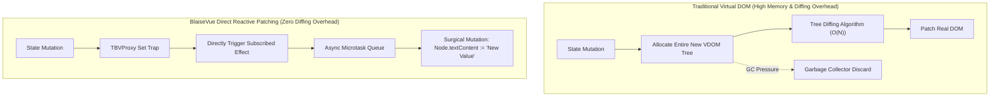
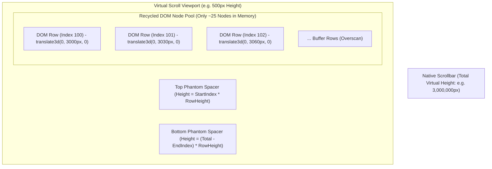

# ⚡ Virtual DOM & Virtual Scroll Architecture
**Fine-Grained Direct DOM Patching, Directive Lifecycles, and O(1) Memory Virtual Scrolling**

Modern web applications frequently suffer from high CPU usage and garbage collection pauses when dealing with large datasets. BlaiseVue tackles this challenge through two complementary architectural strategies:
1. **Fine-Grained Direct DOM Patching** instead of heavy Virtual DOM tree diffing.
2. An integrated **Virtual Scrolling Engine** capable of rendering over 100,000 records at 60 FPS with constant $O(1)$ DOM memory footprint.

---

## 1. Direct DOM Patching vs. Heavy Virtual DOM

Many popular web frameworks (React, Vue 2) use an in-memory representation of the DOM tree (Virtual DOM). When state changes, the framework creates a completely new Virtual DOM tree, runs an $O(N)$ diffing algorithm, and commits changes to the browser.



### Architectural Trade-offs:
| Architectural Attribute | Traditional Virtual DOM | BlaiseVue Direct Reactive Patching |
| :--- | :--- | :--- |
| **Memory Allocation per Update** | High (allocates thousands of transient VNode JS objects) | **Zero** (no intermediate objects allocated) |
| **Computational Complexity** | $O(N)$ where $N$ is the count of nodes in the component branch | **$O(1)$** direct effect execution |
| **Garbage Collector Pauses** | Frequent GC cycles during rapid data streaming | Minimal GC pressure, ideal for real-time dashboards |
| **Code Footprint** | Large VDOM diffing engine included in runtime | Extremely compact runtime footprint (< 25 KB) |

---

## 2. Directive Engine Architecture

BlaiseVue compiles declarative HTML directives into specialized execution controllers:

### A. Conditional Rendering (`b-if`, `b-else-if`, `b-else`)
- **Comment Anchors**: The compiler places an invisible comment node (`<!-- b-if: condition -->`) in the DOM tree.
- **Subtree Mounting**: When the condition evaluates to `True`, the compiled DOM fragment is cloned and inserted adjacent to the anchor. When `False`, the DOM nodes are cleanly removed, detaching reactive effects and event listeners to prevent leaks.

### B. List Rendering (`b-for`)
- **Keyed Reconciliation**: When rendering repeating elements (`b-for="item in items"` with `:key="item.id"`), the engine maintains a key-to-node cache.
- When the list is mutated (e.g., sorted or filtered), existing DOM elements are moved within the parent container rather than being destroyed and recreated, maintaining focus and transition state.

### C. Two-Way Binding (`b-model`)
- Binds an input element's value to a reactive property or `TBVDataSet` field.
- Listens to native browser events (`input`, `change`, `blur`) and sets the corresponding proxy property or dataset field (`Field.AsString := Value`), which in turn triggers dependent computed properties.

---

## 3. The Virtual Scrolling Engine

In enterprise ERP software, users regularly view grids containing 10,000 to 500,000 rows (sales journals, audit logs, inventory registers). Creating real DOM nodes for every row causes immediate browser tab freezing and excessive RAM consumption.

BlaiseVue solves this with a **Virtual Windowing Engine**:



---

## 4. The Mathematical Windowing Algorithm

The engine calculates visible row ranges using fixed or dynamic row height estimations:

### Calculations:
1. **Total Virtual Height**:
   $$\text{TotalHeight} = \text{TotalRecordCount} \times \text{RowHeight}$$
2. **First Visible Row Index**:
   $$\text{StartIndex} = \max\left(0, \left\lfloor \frac{\text{ScrollTop}}{\text{RowHeight}} \right\rfloor - \text{BufferCount}\right)$$
3. **Last Visible Row Index**:
   $$\text{EndIndex} = \min\left(\text{TotalRecordCount} - 1, \left\lceil \frac{\text{ScrollTop} + \text{ViewportHeight}}{\text{RowHeight}} \right\rceil + \text{BufferCount}\right)$$
4. **Buffer (Overscan)**: Pre-renders $3$ to $5$ rows above and below the viewport. This guarantees that during fast thumb scrolling or mouse-wheel gestures, the user never experiences blank white flickering.

---

## 5. Constant $O(1)$ Memory via DOM Node Recycling

Rather than creating new elements when scrolling down and destroying them when scrolling up, the virtual scrolling engine initializes a **fixed pool of DOM elements**:

$$\text{PoolSize} = \left\lceil \frac{\text{ViewportHeight}}{\text{RowHeight}} \right\rceil + (2 \times \text{BufferCount})$$

For a typical 600px viewport with 30px row height and a buffer of 5 rows, the pool size is:
$$\text{PoolSize} = \frac{600}{30} + 10 = 30 \text{ elements}$$

### Recycling Execution:
```pascal
procedure TBVVirtualScroll.RecycleRow(const AElement: TJSElement; const ARecordIndex: Integer);
var
  YOffset: Double;
  RecordData: JSValue;
begin
  // Calculate spatial position using hardware-accelerated CSS transform
  YOffset := ARecordIndex * FRowHeight;
  AElement.style.setProperty('transform', Format('translate3d(0px, %.2fpx, 0px)', [YOffset]));
  
  // Re-bind record data into the recycled DOM node in O(1) time
  RecordData := FDataSet.GetRecordAt(ARecordIndex);
  FRowBinder(AElement, RecordData);
end;
```

---

## 6. Achieving 60 FPS / 120 FPS Scroll Smoothness

To maintain a fluid 60 FPS (or 120 FPS on high-refresh ProMotion / 120Hz displays):
1. **Passive Scroll Listeners**: Scroll event listeners are registered with `{ passive: true }`, ensuring the browser's compositor thread does not wait for JavaScript before updating the scrollbar position.
2. **`requestAnimationFrame` Throttling**: Layout calculations are synchronized with the browser's vertical sync (vsync) using `window.requestAnimationFrame`, preventing dropped frames.
3. **GPU Compositing**: Rows are positioned exclusively via CSS `transform: translate3d(...)` instead of `style.top`, enabling off-thread GPU acceleration without triggering DOM layout recalculation.

---

🛡️ **Next Architectural Guides:**
- [**01. Architecture Overview**](01-Architecture-Overview.md) – Universal platform blueprint.
- [**02. Reactivity Engine**](02-Reactivity-Engine.md) – Deep dive into `TBVProxy` and LiveBindings.
- [**05. Data & RPC Architecture**](05-Data-and-RPC-Architecture.md) – In-browser database internals and full-stack mORMot 2 SOA.
