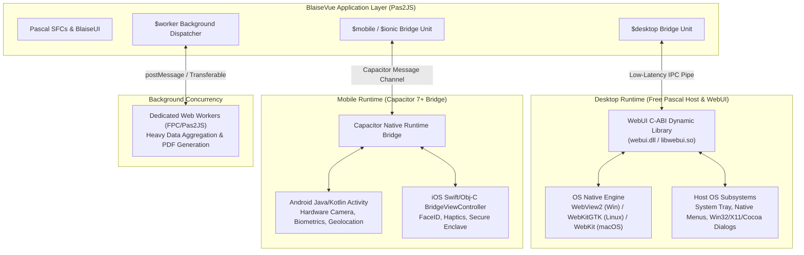
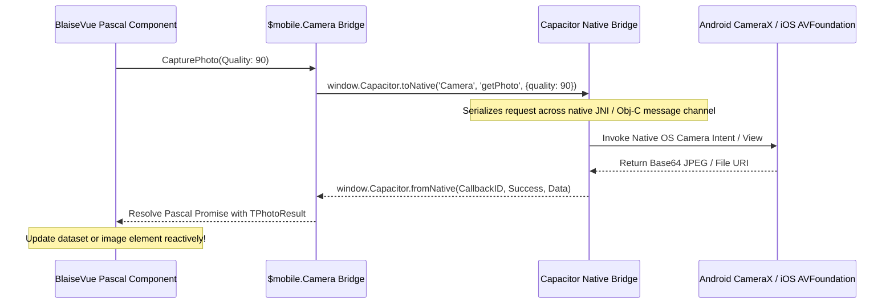

# 🔌 Multiplatform Runtimes & Native Bridges
**Low-Level IPC, Desktop WebUI C-ABI, Mobile Capacitor Bridges, and Web Worker Multi-Threading**

A core architectural pillar of BlaiseVue 4.4 is its **Universal Multiplatform Architecture**. Rather than trapping developers inside a single runtime sandbox, BlaiseVue establishes direct, low-latency communication bridges between compiled Object Pascal code and the underlying host operating systems across **Desktop (Windows, Linux, macOS)**, **Mobile (Android, iOS)**, and **Multi-Threaded Web Workers**.

---

## 1. High-Level Multiplatform Bridge Architecture



---

## 2. Desktop WebUI Bridge Internals

Traditional desktop web solutions (Electron) bundle a full Chromium engine (~80 MB) and a separate Node.js runtime (~40 MB), resulting in executables over 120 MB and idle RAM consumption exceeding 300 MB.

BlaiseVue uses **WebUI**: an ultra-lightweight C library that embeds the operating system's pre-installed web rendering engine:
- **Windows**: Microsoft Edge WebView2 (Chromium Evergreen Runtime).
- **Linux**: WebKitGTK (GNOME native WebKit engine).
- **macOS**: Apple WebKit / WKWebView (Cocoa native engine).

### The C-ABI Interop Layer
The native Pascal host executable (`DesktopApp.pas`) links against the WebUI dynamic library (`webui-2.dll` or `libwebui-2.so`) through pure Pascal external declarations:

```pascal
unit U_WebUI_ABI;

{$mode objfpc}{$H+}

interface

uses
  SysUtils, DynLibs;

const
  {$IFDEF WINDOWS} WebUILib = 'webui-2.dll'; {$ENDIF}
  {$IFDEF LINUX}   WebUILib = 'libwebui-2.so'; {$ENDIF}
  {$IFDEF DARWIN}  WebUILib = 'libwebui-2.dylib'; {$ENDIF}

type
  size_t = PtrUInt;

function webui_new_window: size_t; cdecl; external WebUILib;
function webui_show(window: size_t; const content: PChar): Boolean; cdecl; external WebUILib;
function webui_set_size(window: size_t; width, height: Cardinal): Boolean; cdecl; external WebUILib;
procedure webui_set_fullscreen(window: size_t; status: Boolean); cdecl; external WebUILib;
procedure webui_close(window: size_t); cdecl; external WebUILib;
procedure webui_exit; cdecl; external WebUILib;
function webui_wait: Boolean; cdecl; external WebUILib;

// Event binding between JS and Pascal
type
  TWebUIEventCallback = procedure(e: Pointer); cdecl;

function webui_bind(window: size_t; const element: PChar; func: TWebUIEventCallback): size_t; cdecl; external WebUILib;

implementation

end.
```

### Window Message Pump & IPC Synchronization
1. **In-Process Communication**: Communication between the native Free Pascal binary and the WebView utilizes in-memory named pipes or local loopback sockets, keeping IPC call latency below **0.2 milliseconds**.
2. **Event Dispatching**: When a user clicks a button bound to a native action, the JavaScript bridge calls `webui.call("NativePascalProcedure", payload)`. The WebUI loop translates this into a native callback on the Pascal host thread.
3. **Thread Safety**: Long-running background operations spawned in Pascal utilize `TThread.Queue` or `TThread.Synchronize` to post responses safely back to the UI thread without blocking window message processing.

---

## 3. Mobile Capacitor 7+ Bridge Internals

For Android and iOS platforms, BlaiseVue uses **Capacitor 7+** as a high-performance native container.



### Hardware Plugin Marshaling in Pascal
BlaiseVue wraps Capacitor's JavaScript bridge in type-safe Pascal abstractions (`BVHardware.pas`):

```pascal
type
  TBVPhotoResult = record
    Format: String;
    Base64String: String;
    Path: String;
  end;

  TBVCamera = class
  public
    class function TakePhoto(const AQuality: Integer = 90): TJSPromise;
  end;

class function TBVCamera.TakePhoto(const AQuality: Integer): TJSPromise;
begin
  Result := TJSPromise.New(procedure(Resolve, Reject: TJSPromiseResolver)
  begin
    asm
      if (window.Capacitor && window.Capacitor.Plugins && window.Capacitor.Plugins.Camera) {
        window.Capacitor.Plugins.Camera.getPhoto({
          quality: AQuality,
          allowEditing: false,
          resultType: 'base64'
        }).then(function(photo) {
          Resolve(photo);
        }).catch(function(err) {
          Reject(err);
        });
      } else {
        Reject(new Error('Capacitor Camera plugin not available on this platform'));
      }
    end;
  end);
end;
```

### Mobile Native Shell Considerations:
- **Safe Area Insets**: BlaiseVue Mobile components automatically read CSS environment variables (`env(safe-area-inset-top)` and `env(safe-area-inset-bottom)`) to adapt layouts for notches, dynamic islands, and home indicator bars.
- **Biometric Authentication**: Integrates directly with Android BiometricPrompt and iOS LocalAuthentication (`FaceID`/`TouchID`) for secure financial transactions.

---

## 4. Multi-Threading with Object Pascal Web Workers

JavaScript in the browser runs on a single main UI thread. Heavy operations (e.g., crunching 500,000 ledger rows, generating a 50-page Vector PDF, or performing complex cryptography) can drop frames and cause interface stuttering.

BlaiseVue supports **Web Workers compiled directly from Object Pascal units**:

```mermaid
flowchart LR
    MainUI["Main UI Thread (TBVComponent)<br/>60 / 120 FPS Rendering"] 
    Worker["Background Worker Thread (U_TaxWorker.pas)<br/>Heavy Matrix Math & Aggregation"]

    MainUI -->|PostMessage(DatasetSnapshot)| Worker
    Worker -->|Computes in Background (No UI Lag)| Worker
    Worker -->|PostMessage(AggregatedResults)| MainUI
    MainUI -->|Microtask Schedule Update| RealDOM["DOM Repaint"]
```

### Implementation Pattern:
```pascal
unit U_TaxWorker;

{$mode objfpc}{$H+}

interface

uses
  SysUtils, JS, Web;

procedure WorkerInit;

implementation

procedure ProcessTaxCalculations(const AData: JSValue);
var
  Total: Double;
begin
  // Execute heavy CPU computation off the main thread...
  Total := PerformHeavyFiscalMath(AData);
  
  // Post message back to the UI thread
  TJSWorkerGlobalScope.PostMessage(Total);
end;

procedure WorkerInit;
begin
  TJSWorkerGlobalScope.OnMessage := procedure(E: TJSMessageEvent)
  begin
    ProcessTaxCalculations(E.Data);
  end;
end;

initialization
  WorkerInit;
end.
```

---

🛡️ **Next Architectural Guides:**
- [**08. State Machines & Store Architecture**](08-State-Machines-and-Store-Architecture.md) – BlaiseX 2.0 internal mechanics and deterministic FSMs.
- [**09. Component Model & Slot Transclusion**](09-Component-Model-and-Slot-Transclusion.md) – `TBVComponent` class hierarchy, scoped slots, and teleportation.
