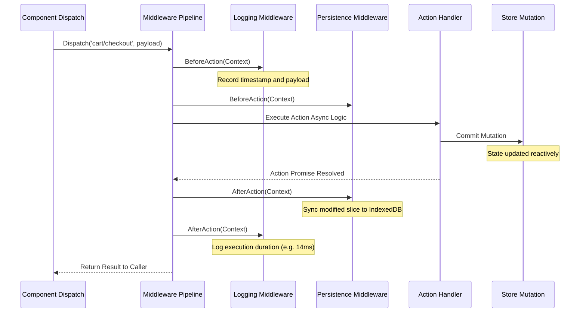
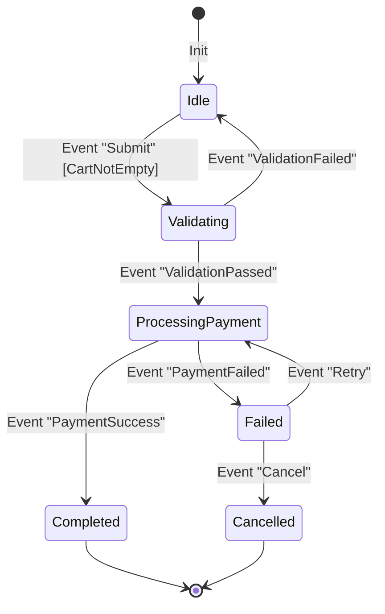

# 🧠 State Machines & Store Architecture
**BlaiseX 2.0 Global Store Mechanics, Middleware Pipelines, and Deterministic Finite State Machines**

In complex enterprise applications, state quickly outgrows single component boundaries. BlaiseVue 4.4 provides two complementary state management architectures:
1. **BlaiseX 2.0 (`TBVStore`)**: A domain-modularized, reactive state store with an extensible middleware pipeline.
2. **Finite State Machines (`TBVStateMachine` / `BVFSM`)**: A mathematically rigorous state machine engine that makes impossible UI states structurally unrepresentable.

---

## 1. High-Level State Architecture

```mermaid
flowchart TD
    subgraph Components["Component Presentation Layer"]
        C1["OrderView.bv"]
        C2["CartDrawer.bv"]
        C3["CheckoutModal.bv"]
    end

    subgraph BlaiseX["BlaiseX 2.0 Store Core (TBVStore)"]
        State["Reactive Proxy State (Domain Slices)"]
        Getters["Memoized Computed Getters"]
        Mutations["Synchronous Mutations (Atomic)"]
        Actions["Asynchronous Actions (Orchestration)"]
    end

    subgraph Middleware["Middleware Pipeline"]
        Logger["Action Logger & Telemetry"]
        Persist["LocalStorage / IndexedDB Sync"]
        WSSync["WebSocket State Broadcast"]
    end

    subgraph FSM["Finite State Machine Core (TBVStateMachine)"]
        States["States (Idle, Processing, Succeeded, Failed)"]
        Transitions["State Transition Matrix"]
        Guards["Guard Predicates (CanTransition)"]
        SideEffects["OnEnter / OnExit Side Effects"]
    end

    Components <-->|b-model / LiveBindings| State
    Components -->|Dispatch('checkout/submit')| Actions
    Actions --> Middleware
    Middleware --> Mutations
    Mutations -->|Trigger| State
    State --> Getters
    Getters --> Components

    Actions <-->|Send Event (eSubmit)| FSM
    FSM -->|Current State & Flags| Components
```

---

## 2. BlaiseX 2.0 Internal Store Architecture

Rather than maintaining a massive monolithic state tree that invalidates broadly, BlaiseX partitions state into **Domain Slices**:

```pascal
unit Store_Cart;

{$mode objfpc}{$H+}

interface

uses
  SysUtils, Classes, JS, BVStore, BVReactivity;

type
  TCartItem = record
    Id: Integer;
    Title: String;
    Price: Double;
    Qty: Integer;
  end;

  TCartStore = class(TBVStoreSlice)
  private
    FItems: TJSArray;
  public
    // State initialization
    procedure InitState; override;
    
    // Mutations (Synchronous State Modifiers)
    procedure AddItem(const AItem: TCartItem);
    procedure RemoveItem(const AId: Integer);
    procedure Clear;
    
    // Getters (Memoized Computed Queries)
    function GetTotalItems: Integer;
    function GetCartTotal: Double;
    
    // Actions (Asynchronous Orchestration)
    function Checkout(const APaymentToken: String): TJSPromise;
  end;

implementation

// Implementation details...
end.
```

### The Mutation Guarantee:
- **Synchronous Execution**: Mutations are strictly synchronous. This guarantees that state transitions are deterministic and can be intercepted by developer tools before any side effects execute.
- **Proxy Reactivity**: State modifications inside mutations invoke `TBVProxy.SetTrap`, which triggers microtask scheduled updates on all subscribed component DOM elements.

---

## 3. The Middleware Pipeline Architecture

Every action dispatched through the store passes through an extensible **onion-style middleware chain**:



### Writing a Custom Middleware in Pascal:
```pascal
type
  TBVAuditMiddleware = class(TBVMiddleware)
  public
    procedure BeforeAction(const AActionName: String; const APayload: JSValue); override;
    procedure AfterAction(const AActionName: String; const AResult: JSValue); override;
    procedure OnError(const AActionName: String; const AError: Exception); override;
  end;

procedure TBVAuditMiddleware.BeforeAction(const AActionName: String; const APayload: JSValue);
begin
  WriteLn('[Audit] Action started: ', AActionName, ' at ', DateTimeToStr(Now));
end;

procedure TBVAuditMiddleware.AfterAction(const AActionName: String; const AResult: JSValue);
begin
  WriteLn('[Audit] Action completed: ', AActionName);
end;

procedure TBVAuditMiddleware.OnError(const AActionName: String; const AError: Exception);
begin
  WriteLn('[Audit Alert] Action failed: ', AActionName, ' -> ', AError.Message);
end;
```

---

## 4. Deterministic Finite State Machines (`TBVStateMachine`)

In traditional frontend code, complex processes (e.g., payment checkouts, file uploads, document approvals) are often managed with scattered boolean variables:
```pascal
// Anti-pattern: Boolean explosion leading to impossible states
var
  isLoading: Boolean;
  isSuccess: Boolean;
  isError: Boolean;
  isCancelled: Boolean;
```
This inevitably leads to **impossible UI states** where `isLoading = True` and `isSuccess = True` simultaneously.

BlaiseVue introduces the **`TBVStateMachine` (BVFSM)** engine:



### The Transition Matrix and Guard Rules:
The state machine defines transitions through an immutable matrix:

```pascal
type
  TCheckoutState = (csIdle, csValidating, csProcessing, csCompleted, csFailed, csCancelled);
  TCheckoutEvent = (ceSubmit, ceValidOk, ceValidFail, cePaySuccess, cePayFail, ceRetry, ceCancel);

procedure SetupCheckoutFSM(AFSM: TBVStateMachine);
begin
  AFSM.Configure(csIdle)
    .Permit(ceSubmit, csValidating, @GuardCartNotEmpty);

  AFSM.Configure(csValidating)
    .Permit(ceValidOk, csProcessing)
    .Permit(ceValidFail, csIdle);

  AFSM.Configure(csProcessing)
    .OnEntry(@InitiateGatewayTransaction)
    .Permit(cePaySuccess, csCompleted)
    .Permit(cePayFail, csFailed);

  AFSM.Configure(csFailed)
    .Permit(ceRetry, csProcessing)
    .Permit(ceCancel, csCancelled);

  AFSM.Configure(csCompleted)
    .OnEntry(@SendConfirmationEmail);
end;
```

### Advantages of the FSM Architecture:
1. **Total Determinism**: If the system is in `csCompleted`, sending a `ceSubmit` event is simply rejected; double-charging a customer becomes structurally impossible.
2. **Side Effect Encapsulation**: Entry actions (`OnEntry`) and exit actions (`OnExit`) guarantee that timers, loaders, and telemetry are initiated and terminated cleanly.
3. **Reactive UI Binding**: Components bind directly to `fsm.CurrentState` or boolean helpers (`fsm.IsIn(csProcessing)`), keeping templates clean and declarative.

---

## 5. Time-Travel Debugging & State Snapshots

Because mutations in BlaiseX are strictly synchronous and atomic, BlaiseVue supports **Time-Travel Debugging**:
- **State Snapshots**: After every committed mutation, an in-memory snapshot of the domain slice is captured in a circular ring buffer (`FCircularHistory: TList`).
- **Undo / Redo**: Calling `Store.Undo` reverts state to the prior snapshot and triggers DOM patching without making network roundtrips.
- **Action Replay**: Developer tools (such as **BlaiseVue Studio**) can replay historical action logs from production bug reports to reproduce edge-case bugs deterministically.

---

🛡️ **Next Architectural Guides:**
- [**09. Component Model & Slot Transclusion**](09-Component-Model-and-Slot-Transclusion.md) – `TBVComponent` class hierarchy, scoped slots, and teleportation.
- [**01. Architecture Overview**](01-Architecture-Overview.md) – Return to framework high-level layers.
