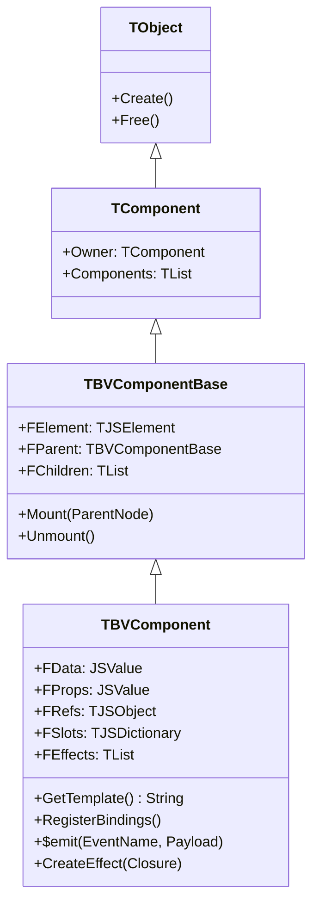
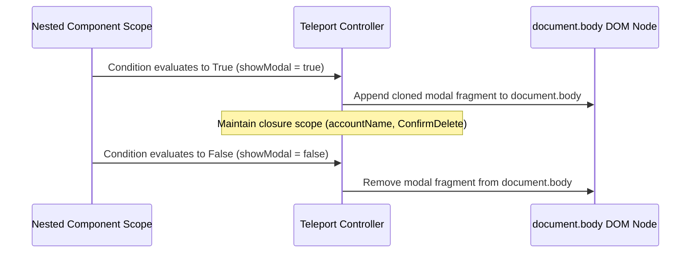

# 🧩 Component Model & Slot Transclusion
**TBVComponent Class Hierarchy, One-Way Props Contracts, Scoped Slots, and Teleportation**

At the center of user interface development in BlaiseVue is the **Component Model**. Rather than manipulating raw DOM trees or relying on monolithic templates, applications are constructed as trees of encapsulated, reusable components (`TBVComponent`).

This document details the low-level object-oriented hierarchy, reactive property validation, the compilation of scoped slots into typed Pascal closures, and DOM teleportation mechanics.

---

## 1. Class Hierarchy & Memory Structure

Every Single File Component (`.bv`) compiled by the BlaiseVue toolchain descends from the base `TBVComponent` class:



### Key Internal Fields of `TBVComponent`:
- **`FElement`**: The root DOM element (or DocumentFragment for multi-root components) representing this component in the live browser tree.
- **`FData`**: The reactive state record wrapped in `TBVProxy`.
- **`FProps`**: An immutable, read-only reactive proxy containing properties passed down by the parent component.
- **`FRefs`**: A dictionary mapping element IDs (`b-ref="myInput"`) to raw DOM elements or child component instances.
- **`FSlots`**: A hash map of compiled slot render closures provided by the parent.
- **`FEffects`**: A list of all reactive dependency effects (`TBVEffect`) registered by this component. During unmount, every effect in this list is systematically severed to guarantee zero memory leaks.

---

## 2. Reactive Props & One-Way Data Flow

BlaiseVue enforces **Strict One-Way Data Flow**: data flows down from parent to child via props, and events flow up from child to parent via `$emit`.

```mermaid
flowchart TD
    subgraph Parent["Parent Component (OrderPage.bv)"]
        ParentState["State: totalAmount = 149.50"]
        TemplateBind["&lt;InvoiceBadge :amount='totalAmount' @refresh='Reload' /&gt;"]
    end

    subgraph Child["Child Component (InvoiceBadge.bv)"]
        PropsProxy["ReadOnly Proxy: props.amount"]
        DOMDisplay["&lt;span&gt;{{ props.amount }}&lt;/span&gt;"]
        EmitBtn["&lt;button @click='$emit(&quot;refresh&quot;)'&gt;Refresh&lt;/button&gt;"]
    end

    ParentState -->|Props Binding (One-Way)| PropsProxy
    PropsProxy --> DOMDisplay
    EmitBtn -->|Custom Event ($emit)| Parent
```

### The Read-Only Props Proxy Trap:
To prevent child components from accidentally mutating parent state, the `props` object is wrapped in a specialized **read-only proxy**:

```pascal
function TBVComponent.CreateReadOnlyPropsProxy(const ARawProps: JSValue): JSValue;
begin
  // SetTrap will intercept and throw an exception if a child attempts mutation:
  // "EBVPropsMutationError: Cannot mutate prop 'amount' directly in child component. Use $emit instead."
  Result := TBVProxy.CreateReadOnly(ARawProps);
end;
```

---

## 3. Custom Events & Event Dispatching (`$emit`)

Communication back to the parent occurs through the `$emit` message bus:

```pascal
procedure TInvoiceBadge.HandleButtonClick;
var
  Payload: JSValue;
begin
  Payload := CreateJSONPayload(['timestamp', Now, 'action', 'user_clicked']);
  
  // Dispatches event to parent listener: @refresh="ParentMethod"
  $emit('refresh', Payload);
end;
```

### Event Dispatch Internals:
1. **Direct Handler Invocation**: Unlike generic browser DOM events that bubble through the entire document tree, BlaiseVue `$emit` events resolve directly against the parent's registered handler in $O(1)$ time.
2. **Type-Safe Payloads**: Payloads can be primitives, records, or full Pascal class instances.

---

## 4. Slot Transclusion & Scoped Slots Compilation

Slots allow parent components to inject arbitrary HTML fragments or child components into designated insertion points inside a child component's template.

### A. Default & Named Slots
When the compiler encounters `<slot name="header"></slot>` in a child template:
1. It registers an insertion placeholder node.
2. During mounting, it retrieves the compiled render function corresponding to `'header'` from `FSlots` and appends the resulting DOM fragment.

### B. Scoped Slots (Data Passing to Slots)
Scoped slots represent a powerful pattern where the **child provides data** that the **parent uses to format the template**.

Consider a generic table component:
```html
<!-- Child: DataTable.bv -->
<table>
  <tr b-for="(item, idx) in items" :key="item.id">
    <!-- Child exposes 'row' and 'index' to the slot -->
    <slot name="row" :row="item" :index="idx">
      <!-- Default fallback if parent provides no slot -->
      <td>{{ item.id }}</td>
    </slot>
  </tr>
</table>
```

```html
<!-- Parent: CustomerList.bv -->
<DataTable :items="customers">
  <!-- Parent formats how 'row' should look -->
  <template #row="{ row, index }">
    <td class="highlight">#{{ index + 1 }} - <strong>{{ row.name }}</strong> ({{ row.email }})</td>
  </template>
</DataTable>
```

### The Transclusion Compiler Transformation:
The BlaiseVue compiler transforms this into a typed **slot closure function**:

```pascal
// Generated in Parent:
function TCustomerList.RenderRowSlot(ASlotScope: JSValue): TJSElement;
var
  RowData: JSValue;
  IndexVal: Integer;
begin
  RowData := ASlotScope['row'];
  IndexVal := Integer(ASlotScope['index']);
  
  // Creates and returns the compiled <td> element bound to parent scope
  Result := CreateDOMElement('td', Format('#%d - %s (%s)', [IndexVal + 1, String(RowData['name']), String(RowData['email'])]));
end;
```
This enables flexible visual customization with **zero lexical scope leaking** between parent and child!

---

## 5. Dynamic Components & Teleportation

### A. Dynamic Components (`<component :is="...">`)
In dashboards and multi-tab applications, components frequently switch based on active state:
```html
<component :is="activeTabComponent" :data="tabData" />
```
- **Lifecycle Synchronization**: When `activeTabComponent` changes from `TGeneralSettings` to `TSecuritySettings`:
  1. The existing component's `BeforeDestroy` hook is invoked.
  2. All its DOM nodes and reactive effects are detached.
  3. The new component is instantiated, its props are bound, and its `Mounted` hook is called.

### B. DOM Teleportation (`<teleport to="...">`)
Certain user interface elements (such as modal dialogs, global toast notifications, floating tooltips, and context menus) must logically belong to a component, but **physically reside at the top of the DOM tree** (e.g., inside `document.body`) to prevent CSS `overflow: hidden` clipping and `z-index` stacking context bugs.

```html
<!-- Inside Deeply Nested Child Component -->
<div class="nested-widget">
  <button @click="showModal = true">Delete Account</button>

  <!-- Teleport renders the modal directly into <body> while keeping event scope! -->
  <teleport to="body" b-if="showModal">
    <div class="modal-backdrop">
      <div class="modal-dialog">
        <h3>Confirm Deletion</h3>
        <p>Are you sure you want to delete account {{ accountName }}?</p>
        <button @click="ConfirmDelete">Yes, Delete</button>
        <button @click="showModal = false">Cancel</button>
      </div>
    </div>
  </teleport>
</div>
```



### Teleport Highlights:
- **Logical State Preservation**: Even though the modal is physically attached to `<body>`, all bindings (`{{ accountName }}`) and methods (`ConfirmDelete`) execute within the origin component instance.
- **Clean Destruction**: When the parent component is destroyed, any active teleported DOM nodes in `<body>` are automatically cleaned up, leaving zero orphan elements.

---

🛡️ **Next Architectural Guides:**
- [**01. Architecture Overview**](01-Architecture-Overview.md) – Return to framework high-level layers.
- [**02. Reactivity Engine**](02-Reactivity-Engine.md) – Deep dive into `TBVProxy` and LiveBindings.
- [**07. Multiplatform Runtimes & Bridges**](07-Multiplatform-Runtimes-and-Bridges.md) – Desktop WebUI and Mobile Capacitor bridges.
