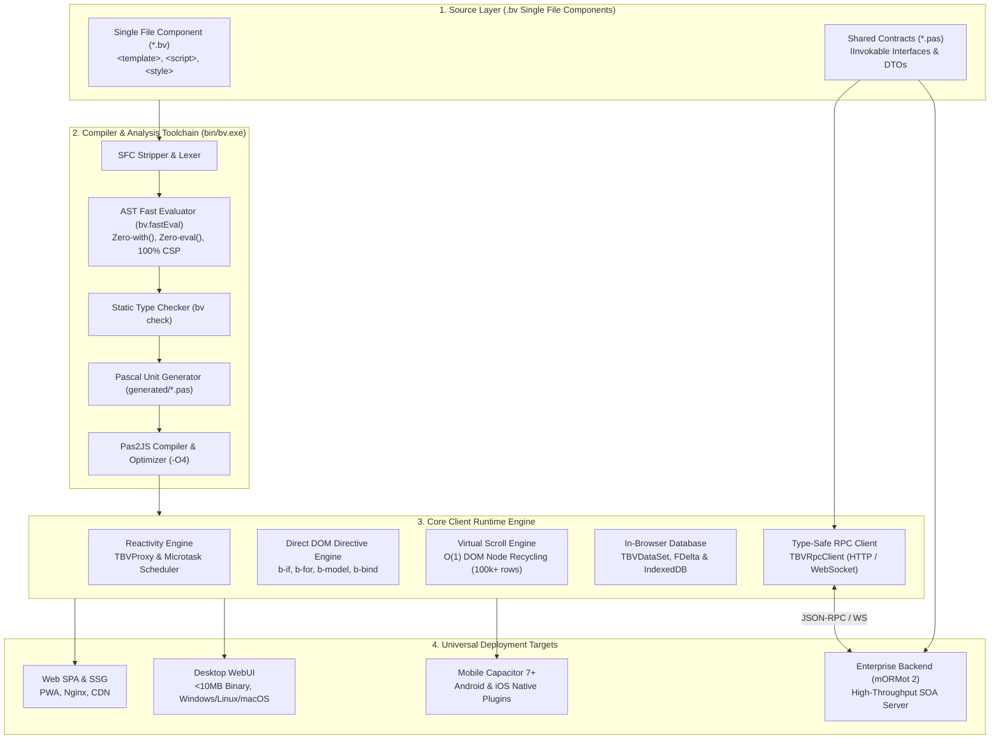

# 🏛️ BlaiseVue Core Architecture & Internals
**Enterprise Universal Architecture Specification (Version 4.4)**

Welcome to the internal engineering and architectural specifications of the **BlaiseVue Framework**.

This section is dedicated to framework core engineers, compiler developers, software architects, and open-source contributors who wish to understand the low-level mechanics of the platform, the AST compiler pipeline, the reactive proxy engine, the in-browser database, and the full-stack RPC transport layer.

---

## 🗺️ High-Level Architectural Blueprint

BlaiseVue connects modern web technologies with the type safety, performance, and enterprise durability of Object Pascal. The diagram below illustrates how source artifacts travel through the compiler, runtime, and deployment tiers:

---

## 📚 Architectural Guides

| Document | Focus Area | Description |
| :--- | :--- | :--- |
| 🏗️ [**01. Architecture Overview**](01-Architecture-Overview.md) | Platform Layers | Complete 4-tier universal architecture, execution lifecycle, memory model, and runtime targets. |
| 🧠 [**02. Reactivity Engine**](02-Reactivity-Engine.md) | Proxy & DOM Patching | Deep dive into `TBVProxy`, dependency tracking (`Track`/`Trigger`), async microtask scheduler, and `TBVDataSet` LiveBindings. |
| ⚙️ [**03. Compiler Pipeline**](03-Compiler-Pipeline.md) | Transpilation & AST | 5-phase compilation pipeline: SFC stripping, AST Fast Evaluator (`bv.fastEval`), CSP compliance, `bv check`, and Pas2JS linking. |
| 🛡️ [**04. Contributing Guide**](04-Contributing-Guide.md) | Contributor Standards | Git branching strategy (`develop` $\rightarrow$ `main`), building the CLI, running 66 test suites (357 tests), and BlaiseUI standards. |
| 💾 [**05. Data & RPC Architecture**](05-Data-and-RPC-Architecture.md) | Database & SOA | Internal mechanics of `TBVDataSet`, in-memory cursor, delta log (`FDelta`), offline IndexedDB sync, and mORMot 2 RPC. |
| ⚡ [**06. Virtual DOM & Virtual Scroll**](06-Virtual-DOM-and-Virtual-Scroll.md) | Rendering & Performance | Fine-grained direct DOM patching, directive binding lifecycles, and $O(1)$ memory virtual scroll engine for 100k+ records at 60 FPS. |
| 🔌 [**07. Multiplatform Runtimes & Bridges**](07-Multiplatform-Runtimes-and-Bridges.md) | Host OS Interop | Low-level C-ABI WebUI bindings (<10MB desktop), Capacitor 7+ mobile bridge, hardware plugins, and Web Worker threads. |
| 🧠 [**08. State Machines & Store Architecture**](08-State-Machines-and-Store-Architecture.md) | State & FSM | BlaiseX 2.0 domain slices, middleware pipeline, deterministic finite state machines (`BVFSM`), and time-travel debugging. |
| 🧩 [**09. Component Model & Slot Transclusion**](09-Component-Model-and-Slot-Transclusion.md) | Component Internals | `TBVComponent` hierarchy, read-only props proxies, custom events `$emit`, scoped slots compilation, and DOM teleportation. |

---

## 🗺️ Framework Reference Ecosystem

For end-user development guides, practical tutorials, and API manuals:
- 📖 [**Technical Documentation (55 Manuals)**](../Documentation/README.md) – Complete reference for all directives, components, and tools.
- 🎓 [**Practical Course (29 Modules)**](../Course/README.md) – Step-by-step masterclass covering Web, Mobile, Desktop, and mORMot 2.
- 🗺️ [**Technical Roadmap (v2.0 – v5.0)**](../Documentation/99-roadmap.md) – Framework evolution, enterprise milestones, and future horizons.
