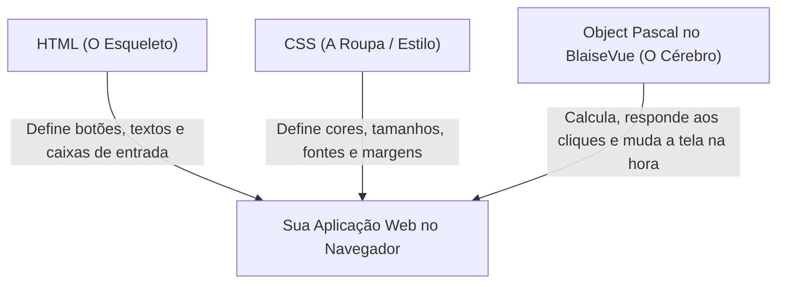

# 📝 Módulo 01: O Início da Sua Jornada Web com Pascal
**Descubra como o Pascal cria páginas web modernas do zero e de forma descomplicada.**

Seja muito bem-vindo! Se você nunca criou uma página para a internet antes, ou se você já programa em Pascal (Delphi, Lazarus/Free Pascal) para computadores desktop e sempre achou o desenvolvimento web confuso ou cheio de siglas estranhas, este módulo foi feito especialmente para você.

---

## 🌐 1. Como Funciona uma Página da Web?

Toda página na internet — desde uma página simples até sistemas como YouTube ou Mercado Livre — é composta por três camadas fundamentais:



1. **HTML (O Esqueleto)**: Diz o que existe na tela (por exemplo: um título `<h1>`, um parágrafo `<p>`, ou um botão `<button>`).
2. **CSS (A Roupa / Estilo)**: Diz como as coisas devem se parecer (cores de fundo, tamanhos de fonte, alinhamentos).
3. **Pascal no BlaiseVue (O Cérebro)**: É onde a inteligência mora! É ele quem responde quando você clica em um botão, soma valores e decide o que mostrar.

No desenvolvimento web tradicional, você precisaria de arquivos separados e aprender linguagens diferentes. No **BlaiseVue**, tudo o que uma tela precisa fica reunido em um único arquivo com a extensão **`.bv`**!

---

## 📦 2. A Anatomia de um Arquivo `.bv` (Componente de Arquivo Único)

Um arquivo `.bv` é dividido em três blocos fáceis de entender:

```html
<!-- PARTE 1: O que o usuário vê na tela (HTML) -->
<template>
  <div class="cartao">
    <h1>{{ titulo }}</h1>
    <p>Olá, seja bem-vindo ao mundo do BlaiseVue!</p>
  </div>
</template>

<!-- PARTE 2: A inteligência e os dados em Pascal -->
<script>
  data:
    titulo: string = 'Minha Primeira Aplicação';
</script>

<!-- PARTE 3: O visual e as cores (CSS) -->
<style>
  .cartao {
    background-color: #f0f4f8;
    padding: 20px;
    border-radius: 8px;
    font-family: sans-serif;
  }
  h1 {
    color: #2b6cb0;
  }
</style>
```

> [!NOTE]
> Observe as chaves duplas: `{{ titulo }}`. Isso se chama **Interpolação**. Elas dizem para o navegador: *"Vá até o bloco `<script>` em Pascal, pegue o valor da variável `titulo` e desenhe aqui na tela!"*.

---

## 🚀 3. Passo a Passo: Colocando a Aplicação para Rodar

Vamos agora colocar a aplicação de exemplo para rodar no seu computador! Siga estes 4 passos:

### Passo 1: Verificar se tudo está saudável
Abra o seu terminal (Prompt de Comando, PowerShell ou Terminal do Linux/macOS) na pasta do BlaiseVue e digite:
```bash
bv doctor
```
Você verá uma mensagem informando que suas ferramentas (Free Pascal, Node.js, Python, etc.) estão prontas com o símbolo `[v]`.

### Passo 2: Iniciar o Servidor de Desenvolvimento
Ainda no terminal, entre na pasta da aplicação de demonstração e digite:
```bash
cd demo-app
bv run dev
```
*(Dica: você também pode digitar apenas `bv dev`)*.

O terminal mostrará algo como:
```text
  ➜  Local:   http://localhost:8080/
  ➜  Network: use --host to expose
```

### Passo 3: Abrir no Navegador
Abra o seu navegador de internet favorito (Google Chrome, Firefox, Edge, etc.) e acesse:  
👉 `http://localhost:8080`

Você verá a tela da aplicação carregando imediatamente!

### Passo 4: Fazer Sua Primeira Alteração ao Vivo (HMR)
1. Deixe o navegador aberto em uma metade da tela.
2. Abra o arquivo `demo-app/src/views/Home.bv` em seu editor de código (como o VS Code ou Antigravity IDE).
3. Procure a variável de título ou o texto do cabeçalho e altere para:
   ```pascal
   'Meu Primeiro App Reativo com Pascal!'
   ```
4. Salve o arquivo (`Ctrl + S`).
5. **Olhe para o navegador!** A tela atualiza instantaneamente, sem você precisar clicar no botão de recarregar a página! Isso se chama **HMR (Hot Module Replacement)**.

---

## 🎯 4. Exercício Prático do Módulo 01

Para fixar o que você aprendeu, tente fazer este pequeno desafio:

1. No arquivo `Home.bv`, dentro da tag `<template>`, adicione uma nova linha com um parágrafo:
   ```html
   <p class="meu-texto">Aprendendo Pascal para a Web com BlaiseVue!</p>
   ```
2. No bloco `<style>`, dê uma cor bonita para ele:
   ```css
   .meu-texto {
     color: #38a169;
     font-weight: bold;
     font-size: 18px;
   }
   ```
3. Salve o arquivo e confira o resultado na tela do navegador!

---

## 🏆 Resumo do Que Você Aprendeu
- Como o HTML, o CSS e o Pascal trabalham juntos.
- A estrutura de um arquivo `.bv` (`<template>`, `<script>`, `<style>`).
- Como iniciar o servidor de testes com `bv run dev`.
- Como o BlaiseVue atualiza a tela na hora em que você salva suas alterações.

**Tudo pronto? Vamos dar vida às nossas variáveis no [Módulo 02: O Motor Reativo](02-reactivity.md)!** ⚔️🛡️✨
