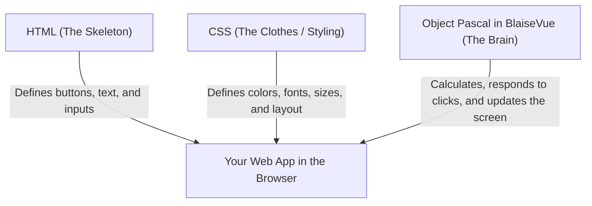

# 📝 Module 01: The Beginning of Your Web Pascal Journey
**Discover how Object Pascal builds modern web applications from scratch.**

Welcome! If you have never created a web page before, or if you already know Pascal for desktop software (Delphi, Lazarus/Free Pascal) and always found modern web development overly complicated, this module is made specifically for you.

---

## 🌐 1. How Does a Web Page Work?

Every web application on the internet — from simple landing pages to large-scale platforms — is composed of three fundamental layers:



1. **HTML (The Skeleton)**: Declares what elements exist on the screen (such as titles `<h1>`, paragraphs `<p>`, or buttons `<button>`).
2. **CSS (The Styling)**: Declares how things look (background colors, fonts, margins, animations).
3. **Pascal in BlaiseVue (The Brain)**: Where logic lives! It responds when the user clicks a button, calculates numbers, and decides what to show.

In traditional web development, you would need separate files and different languages. In **BlaiseVue**, everything a screen needs is unified in a single file with the extension **`.bv`**!

---

## 📦 2. The Anatomy of a `.bv` File (Single File Component)

A `.bv` file is divided into three intuitive sections:

```html
<!-- PART 1: What the user sees on screen (HTML template) -->
<template>
  <div class="card">
    <h1>{{ title }}</h1>
    <p>Hello and welcome to the BlaiseVue world!</p>
  </div>
</template>

<!-- PART 2: The logic and data in Object Pascal -->
<script>
  data:
    title: string = 'My First BlaiseVue Application';
</script>

<!-- PART 3: The styling and colors (CSS) -->
<style>
  .card {
    background-color: #f0f4f8;
    padding: 20px;
    border-radius: 8px;
    font-family: sans-serif;
  }
  h1 {
    color: #2b6cb0;
  }
</style>
```

> [!NOTE]
> Notice the double curly braces: `{{ title }}`. This is called **Interpolation**. It tells the browser: *"Look at the `<script>` block in Pascal, retrieve the value of the `title` variable, and render it right here on the screen!"*.

---

## 🚀 3. Step-by-Step: Creating & Running Your First Application

Let's create and run your very first BlaiseVue application on your computer:

### Step 1: Create Your Project
Open your terminal and scaffold a new project with the CLI:
```bash
bv create my-app
cd my-app
```
BlaiseVue automatically sets up your project structure, reactive templates, local dependencies, and native desktop/mobile bridges!

### Step 2: Verify Environment Health
Inside your project directory (`my-app`), run the diagnostic doctor:
```bash
bv doctor
```
You will see that all tools (Free Pascal, InstantFPC, Python 3, Node.js, and project dependencies) are detected and verified with `[v]`.

### Step 3: Start the Development Server (or enter Cockpit)
You can optionally enter the interactive project Cockpit via `bv enter`, or start the dev server directly:
```bash
bv dev
```

The terminal will display:
```text
  ➜  Local:   http://localhost:8080/
  ➜  Network: use --host to expose
```

### Step 4: Open in Your Browser
Open your favorite web browser (Google Chrome, Firefox, Edge, Safari) and navigate to:  
👉 `http://localhost:8080`

The application will render immediately!

### Step 5: Make Your First Live Edit (HMR)
1. Keep your browser open on one side of your screen.
2. Open `src/views/Home.bv` inside `my-app` in your code editor (such as VS Code or Antigravity IDE).
3. Locate the title variable in the `<script>` section and change it to:
   ```pascal
   'My First Reactive App in Pascal!'
   ```
4. Save the file (`Ctrl + S`).
5. **Look at the browser!** The screen updates instantly without needing a full page reload! This is **Hot Module Replacement (HMR)** in action.

---

## 🎯 4. Practical Exercise: Module 01

To solidify what you have learned:

1. Inside `Home.bv`, within the `<template>` block, add a new paragraph line:
   ```html
   <p class="custom-text">Learning Pascal for the modern Web with BlaiseVue!</p>
   ```
2. In the `<style>` block, add a nice green style for it:
   ```css
   .custom-text {
     color: #38a169;
     font-weight: bold;
     font-size: 18px;
   }
   ```
3. Save the file and observe the instant live update in your browser!

---

## 🏆 What You Learned Today
- How HTML, CSS, and Object Pascal work together seamlessly.
- The structure of a `.bv` component (`<template>`, `<script>`, `<style>`).
- How to start the dev server with `bv run dev`.
- How BlaiseVue delivers instant live updates as soon as you save.

**Ready to give life to your data? Let's move on to [Module 02: The Reactive Engine](02-reactivity.md)!** ⚔️🛡️✨
