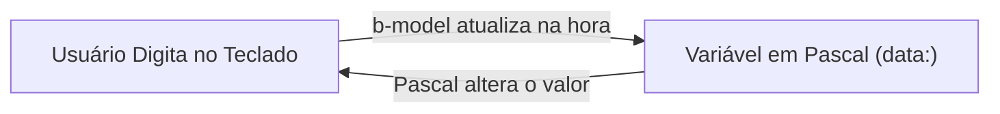

# 🔄 Módulo 04: Sincronização com b-model
**O diálogo contínuo entre o teclado do usuário e as variáveis em Pascal.**

Até agora, você aprendeu a mostrar dados do Pascal na tela e a responder a cliques de botões. Mas como fazemos para o usuário digitar informações — como seu nome, email, ou o valor de uma compra — e o Pascal receber isso em tempo real?

A resposta é a diretiva mágica **`b-model`**!

---

## 🪞 1. O Que é "Ligação de Mão Dupla" (Two-Way Binding)?

Pense no `b-model` como um espelho perfeito de mão dupla:



- **Mão 1 (Da tela para o Pascal):** Conforme o usuário digita cada letra dentro de uma caixa `<input>`, a variável em Pascal recebe esse novo texto no mesmo milissegundo.
- **Mão 2 (Do Pascal para a tela):** Se o seu código Pascal alterar o valor da variável (por exemplo, limpando o campo ou carregando dados de um banco), a caixa de texto na tela atualiza na mesma hora!

---

## 🎛️ 2. Tipos de Campos Suportados

O `b-model` funciona com qualquer elemento de formulário da Web:

### Caixa de Texto Comum
```html
<label>Seu Nome:</label>
<input type="text" b-model="nome">
<p>Você digitou: {{ nome }}</p>
```

### Caixa de Seleção Sim/Não (Checkbox)
```html
<label>
  <input type="checkbox" b-model="aceitouTermos">
  Concordo com os termos de uso
</label>
```

### Menu Suspenso (Select)
```html
<select b-model="pais">
  <option value="Brasil">Brasil</option>
  <option value="Portugal">Portugal</option>
  <option value="Angola">Angola</option>
</select>
```

---

## 🚀 3. Exemplo Completo Passo a Passo: O Gerador de Crachá em Tempo Real

Vamos construir uma aplicação interativa: um formulário onde você digita os dados de um profissional e, ao lado, um **Crachá de Identificação** é desenhado e atualizado letra por letra em tempo real!

Copie e cole este código no seu arquivo de visualização (ex: `src/views/Home.bv`):

```html
<template>
  <div class="container-cracha">
    
    <!-- LADO ESQUERDO: O Formulário de Entrada -->
    <div class="formulario">
      <h3>📝 Dados do Profissional</h3>

      <div class="campo">
        <label>Nome Completo:</label>
        <input type="text" b-model="nome" placeholder="Digite seu nome">
      </div>

      <div class="campo">
        <label>Cargo / Função:</label>
        <input type="text" b-model="cargo" placeholder="Ex: Desenvolvedor Pascal">
      </div>

      <div class="campo">
        <label>Nível de Acesso:</label>
        <select b-model="nivel">
          <option value="Visitante">Visitante</option>
          <option value="Operador">Operador</option>
          <option value="Administrador">Administrador</option>
        </select>
      </div>

      <div class="campo-check">
        <label>
          <input type="checkbox" b-model="ativo">
          Crachá Ativo no Sistema
        </label>
      </div>

      <div class="acoes">
        <!-- Demonstra a mão inversa: Pascal altera e os inputs refletem! -->
        <button class="btn btn-preencher" @click="preencherExemplo">Preencher Exemplo</button>
        <button class="btn btn-limpar" @click="limpar">Limpar Tudo</button>
      </div>
    </div>

    <!-- LADO DIREITO: O Crachá que Reflete os Dados -->
    <div class="preview">
      <h3>🪪 Visualização do Crachá</h3>
      
      <div class="cracha" :class="{ 'cracha-inativo': !ativo }">
        <div class="cracha-topo">
          <span class="logo">🛡️ BLAISE CORP</span>
          <span class="status-tag" :class="ativo ? 'tag-verde' : 'tag-vermelha'">
            {{ ativo ? 'ATIVO' : 'BLOQUEADO' }}
          </span>
        </div>

        <div class="cracha-foto">
          👤
        </div>

        <div class="cracha-dados">
          <h4>{{ nome || 'Nome da Pessoa' }}</h4>
          <p class="cargo-texto">{{ cargo || 'Cargo a Definir' }}</p>
          <div class="nivel-badge">{{ nivel }}</div>
        </div>
      </div>
    </div>

  </div>
</template>

<script>
  data:
    nome: string = '';
    cargo: string = '';
    nivel: string = 'Visitante';
    ativo: boolean = true;

  methods:
    // Ação: Preenche dados no Pascal e o b-model joga para os inputs!
    procedure preencherExemplo;
    begin
      this['nome'] := 'Blaise Pascal';
      this['cargo'] := 'Arquiteto de Software & Matemático';
      this['nivel'] := 'Administrador';
      this['ativo'] := true;
    end;

    // Ação: Zera todas as variáveis
    procedure limpar;
    begin
      this['nome'] := '';
      this['cargo'] := '';
      this['nivel'] := 'Visitante';
      this['ativo'] := false;
    end;
</script>

<style>
  .container-cracha {
    display: flex;
    gap: 30px;
    max-width: 800px;
    margin: 30px auto;
    font-family: sans-serif;
  }
  .formulario, .preview {
    flex: 1;
    background: #ffffff;
    padding: 24px;
    border-radius: 12px;
    box-shadow: 0 4px 15px rgba(0,0,0,0.06);
  }
  .campo {
    margin-bottom: 14px;
  }
  .campo label {
    display: block;
    font-size: 13px;
    font-weight: bold;
    margin-bottom: 4px;
    color: #4a5568;
  }
  .campo input, .campo select {
    width: 100%;
    padding: 10px;
    border: 1px solid #cbd5e0;
    border-radius: 6px;
    font-size: 14px;
    box-sizing: border-box;
  }
  .campo-check {
    margin: 16px 0;
  }
  .acoes {
    display: flex;
    gap: 10px;
    margin-top: 15px;
  }
  .btn {
    padding: 8px 14px;
    border: none;
    border-radius: 6px;
    font-weight: bold;
    cursor: pointer;
  }
  .btn-preencher { background: #3182ce; color: white; }
  .btn-limpar { background: #e2e8f0; color: #4a5568; }

  /* Estilo do Crachá */
  .cracha {
    border: 2px solid #2b6cb0;
    border-radius: 12px;
    padding: 20px;
    background: linear-gradient(135deg, #f7fafc 0%, #edf2f7 100%);
    text-align: center;
    transition: opacity 0.3s ease;
  }
  .cracha-inativo {
    opacity: 0.5;
    border-color: #e53e3e;
  }
  .cracha-topo {
    display: flex;
    justify-content: space-between;
    align-items: center;
    margin-bottom: 15px;
  }
  .logo { font-weight: bold; font-size: 12px; color: #2b6cb0; }
  .status-tag {
    font-size: 11px;
    padding: 2px 8px;
    border-radius: 10px;
    font-weight: bold;
  }
  .tag-verde { background: #c6f6d5; color: #22543d; }
  .tag-vermelha { background: #fed7d7; color: #742a2a; }
  .cracha-foto {
    font-size: 64px;
    margin: 10px 0;
  }
  .cracha-dados h4 {
    margin: 8px 0 4px 0;
    font-size: 18px;
    color: #1a202c;
  }
  .cargo-texto {
    margin: 0;
    font-size: 13px;
    color: #718096;
  }
  .nivel-badge {
    display: inline-block;
    margin-top: 12px;
    background: #2b6cb0;
    color: white;
    padding: 4px 12px;
    border-radius: 12px;
    font-size: 11px;
    font-weight: bold;
  }
</style>
```

---

## 🎯 4. Exercício Prático do Módulo 04

Para praticar com o `b-model`:

1. Adicione um novo campo no formulário: **"Departamento / Setor"** (ex: Financeiro, TI, Vendas).
2. Na seção `data:`, declare a nova variável:
   ```pascal
   departamento: string = 'Tecnologia da Informação';
   ```
3. No crachá visual, exiba o departamento logo abaixo do cargo:
   ```html
   <p class="depto-texto">Setor: {{ departamento }}</p>
   ```
4. Digite no novo campo e veja o crachá atualizar letra por letra!

---

## 🏆 Resumo do Que Você Aprendeu
- O que é o *Two-Way Data Binding* (Ligação de mão dupla).
- Como conectar campos de formulário (`<input>`, `<select>`, `<input type="checkbox">`) com variáveis em Pascal.
- Como o `b-model` mantém o HTML e o Pascal 100% sincronizados sem você precisar programar escutadores manuais.

**E se precisarmos fazer contas matemáticas ou transformar dados automaticamente? Vamos ao [Módulo 05: O Poder do Cérebro (Computed)](05-computed.md)!** ⚔️🛡️✨
