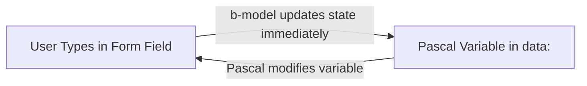

# 🔄 Module 04: Synchronization with b-model
**The seamless dialogue between user input and Pascal variables.**

So far, you have learned how to render Pascal data onto the screen and respond to button clicks. But how do we capture information that the user types — such as names, email addresses, or quantities — and feed it back to Pascal in real time?

The answer is the two-way binding directive: **`b-model`**!

---

## 🪞 1. What is "Two-Way Data Binding"?

Think of `b-model` as a two-way reactive mirror:



- **Way 1 (DOM to Pascal):** As the user types into an `<input>` field, the corresponding Pascal variable receives the updated value on every single keystroke.
- **Way 2 (Pascal to DOM):** If your Pascal code changes the variable (e.g. loading saved data from an API or resetting a form), the input on screen updates simultaneously!

---

## 🎛️ 2. Supported Form Controls

The `b-model` directive works seamlessly with all standard HTML form controls:

### Standard Text Input
```html
<label>Your Name:</label>
<input type="text" b-model="userName">
<p>You typed: {{ userName }}</p>
```

### Boolean Checkbox
```html
<label>
  <input type="checkbox" b-model="termsAccepted">
  I agree to the terms of service
</label>
```

### Dropdown Menu (Select)
```html
<select b-model="selectedCountry">
  <option value="United States">United States</option>
  <option value="United Kingdom">United Kingdom</option>
  <option value="Brazil">Brazil</option>
</select>
```

---

## 🚀 3. Full Step-by-Step Example: Real-Time ID Badge Generator

Let's build an interactive application: a form where you enter employee details, and an **ID Badge** beside the form updates letter-by-letter in real time!

Replace your view component (e.g. `src/views/Home.bv`) with:

```html
<template>
  <div class="badge-app-container">
    
    <!-- LEFT COLUMN: The Input Form -->
    <div class="form-panel">
      <h3>📝 Employee Details</h3>

      <div class="field">
        <label>Full Name:</label>
        <input type="text" b-model="fullName" placeholder="Enter full name">
      </div>

      <div class="field">
        <label>Role / Position:</label>
        <input type="text" b-model="role" placeholder="e.g. Lead Pascal Architect">
      </div>

      <div class="field">
        <label>Access Level:</label>
        <select b-model="accessLevel">
          <option value="Visitor">Visitor</option>
          <option value="Operator">Operator</option>
          <option value="Administrator">Administrator</option>
        </select>
      </div>

      <div class="checkbox-field">
        <label>
          <input type="checkbox" b-model="isActive">
          Active Security Badge
        </label>
      </div>

      <div class="action-buttons">
        <!-- Demonstrates the reverse direction: Pascal assigns data and inputs update! -->
        <button class="btn btn-preset" @click="loadPreset">Load Example</button>
        <button class="btn btn-clear" @click="clearForm">Clear Form</button>
      </div>
    </div>

    <!-- RIGHT COLUMN: The Real-Time ID Badge -->
    <div class="preview-panel">
      <h3>🪪 Live Badge Preview</h3>
      
      <div class="id-badge" :class="{ 'badge-inactive': !isActive }">
        <div class="badge-header">
          <span class="corp-logo">🛡️ BLAISE CORP</span>
          <span class="status-pill" :class="isActive ? 'pill-active' : 'pill-disabled'">
            {{ isActive ? 'ACTIVE' : 'BLOCKED' }}
          </span>
        </div>

        <div class="badge-avatar">
          👤
        </div>

        <div class="badge-info">
          <h4>{{ fullName || 'Employee Name' }}</h4>
          <p class="role-text">{{ role || 'Role to be assigned' }}</p>
          <div class="access-badge">{{ accessLevel }}</div>
        </div>
      </div>
    </div>

  </div>
</template>

<script>
  data:
    fullName: string = '';
    role: string = '';
    accessLevel: string = 'Visitor';
    isActive: boolean = true;

  methods:
    // Action: Fills data in Pascal, and b-model updates all inputs on screen!
    procedure loadPreset;
    begin
      this['fullName'] := 'Blaise Pascal';
      this['role'] := 'Principal Software Architect & Mathematician';
      this['accessLevel'] := 'Administrator';
      this['isActive'] := true;
    end;

    // Action: Resets all variables
    procedure clearForm;
    begin
      this['fullName'] := '';
      this['role'] := '';
      this['accessLevel'] := 'Visitor';
      this['isActive'] := false;
    end;
</script>

<style>
  .badge-app-container {
    display: flex;
    gap: 30px;
    max-width: 820px;
    margin: 30px auto;
    font-family: sans-serif;
  }
  .form-panel, .preview-panel {
    flex: 1;
    background: #ffffff;
    padding: 24px;
    border-radius: 12px;
    box-shadow: 0 4px 16px rgba(0,0,0,0.06);
  }
  .field {
    margin-bottom: 14px;
  }
  .field label {
    display: block;
    font-size: 13px;
    font-weight: bold;
    margin-bottom: 4px;
    color: #4a5568;
  }
  .field input, .field select {
    width: 100%;
    padding: 10px;
    border: 1px solid #cbd5e0;
    border-radius: 6px;
    font-size: 14px;
    box-sizing: border-box;
  }
  .checkbox-field {
    margin: 16px 0;
  }
  .action-buttons {
    display: flex;
    gap: 10px;
    margin-top: 15px;
  }
  .btn {
    padding: 8px 14px;
    border: none;
    border-radius: 6px;
    font-weight: bold;
    cursor: pointer;
  }
  .btn-preset { background: #3182ce; color: white; }
  .btn-clear { background: #e2e8f0; color: #4a5568; }

  /* Badge Styling */
  .id-badge {
    border: 2px solid #2b6cb0;
    border-radius: 12px;
    padding: 20px;
    background: linear-gradient(135deg, #f7fafc 0%, #edf2f7 100%);
    text-align: center;
    transition: opacity 0.3s ease;
  }
  .badge-inactive {
    opacity: 0.45;
    border-color: #e53e3e;
  }
  .badge-header {
    display: flex;
    justify-content: space-between;
    align-items: center;
    margin-bottom: 15px;
  }
  .corp-logo { font-weight: bold; font-size: 12px; color: #2b6cb0; }
  .status-pill {
    font-size: 11px;
    padding: 2px 8px;
    border-radius: 10px;
    font-weight: bold;
  }
  .pill-active { background: #c6f6d5; color: #22543d; }
  .pill-disabled { background: #fed7d7; color: #742a2a; }
  .badge-avatar {
    font-size: 64px;
    margin: 10px 0;
  }
  .badge-info h4 {
    margin: 8px 0 4px 0;
    font-size: 18px;
    color: #1a202c;
  }
  .role-text {
    margin: 0;
    font-size: 13px;
    color: #718096;
  }
  .access-badge {
    display: inline-block;
    margin-top: 12px;
    background: #2b6cb0;
    color: white;
    padding: 4px 12px;
    border-radius: 12px;
    font-size: 11px;
    font-weight: bold;
  }
</style>
```

---

## 🎯 4. Practical Exercise: Module 04

1. Add a new input field: **"Department"** (e.g. Engineering, Finance, Security).
2. In the `data:` section, declare the variable:
   ```pascal
   department: string = 'Software Engineering';
   ```
3. Display the department on the ID badge underneath the role.
4. Type in the input and watch the badge synchronize letter-by-letter!

---

## 🏆 What You Learned Today
- The mechanics of two-way data binding with `b-model` (and alias `v-model`).
- How form elements (`<input>`, `<select>`, `<input type="checkbox">`) stay synchronized with Pascal state.
- How assigning variables in Pascal immediately updates input elements on screen without manual event listeners.


---

## 📖 Deeper Technical Reference
For advanced form controls, modifiers, and custom component bindings:
- **[Chapter 08: Form Inputs & Two-Way Binding (b-model)](../Documentation/08-forms-model.md)** — Complete specification of `b-model` / `v-model`, modifiers (`.trim`, `.number`, `.lazy`), and text synchronization.
- **[Chapter 38: Enhanced Form Controls (Select, Radio, Focused)](../Documentation/38-enhanced-form-controls.md)** — Binding radio button groups, dynamic multi-select arrays, and input focus states.

---

**What if we need to perform calculations or compute derived values automatically? Let's move to [Module 05: The Brain (Computed Properties)](05-computed.md)!** ⚔️🛡️✨
