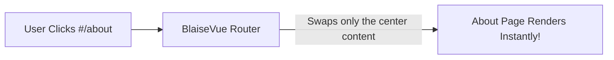

# 🛰️ Module 08: Flicker-Free Navigation (SPAs & Routing)
**Create seamless multi-page user journeys that load with the speed of a native mobile app.**

You have probably noticed that older websites flash a white blank screen every time you click a link. In contrast, modern web apps like Spotify Web, Gmail, or Twitter load instantly when switching tabs, without any flicker or page reload.

This architectural pattern is called a **Single Page Application (SPA)** — and BlaiseVue comes with a built-in router ready out of the box!

---

## ⚡ 1. What is an SPA and How Does Routing Work?

In traditional websites, every menu click asks the web server for a completely new HTML file.

In a BlaiseVue SPA:
1. The browser downloads the application shell **only once**.
2. When the user navigates to a route like `#/about`, the **BlaiseVue Router** catches the URL hash change.
3. It smoothly replaces the active component inside `<router-view>` **in a single frame**, without reloading the browser!



---

## 🗺️ 2. Automatic Route Discovery in BlaiseVue

BlaiseVue organizes view screens inside the **`src/views/`** directory:

- `src/views/Home.bv` ➔ Route: `#/` or `#/home`
- `src/views/About.bv` ➔ Route: `#/about`
- `src/views/Products.bv` ➔ Route: `#/products`
- `src/views/Contact.bv` ➔ Route: `#/contact`

You do not need to maintain complex routing manifests for standard workflows; the compiler associates views automatically!

---

## 🔗 3. Navigating Between Pages

There are two primary ways to navigate users between screens:

### Method 1: Using Standard HTML Links
Simply prefix the target route with the hash (`#`) symbol:
```html
<nav>
  <a href="#/home">Home</a>
  <a href="#/about">About Us</a>
  <a href="#/contact">Contact Us</a>
</nav>
```

### Method 2: Programmatic Navigation in Pascal
When you want to redirect the user after an action (e.g. after a form submission or login):
```pascal
procedure completeRegistration;
begin
  // Save data... and then redirect to the success view!
  TJSFunction(this['$router']['push']).apply(this['$router'], ['#/success']);
end;
```

---

## 🚀 4. Full Step-by-Step Example: Building an App Navigation Bar

Let's build a top navigation bar that stays persistent across all screens.

Open your main application layout file (e.g. `App.bv`) and set up the layout:

```html
<template>
  <div class="app-layout">
    
    <!-- Top Persistent Navigation Bar -->
    <header class="navbar">
      <div class="brand">
        <span class="brand-icon">🛡️</span>
        <strong>BlaiseVue Portal</strong>
      </div>

      <nav class="nav-links">
        <a href="#/" class="nav-item">🏠 Home</a>
        <a href="#/about" class="nav-item">ℹ️ About</a>
        <a href="#/contact" class="nav-item">📞 Contact</a>
      </nav>
    </header>

    <!-- Main View Outlet Where the Active Screen Renders -->
    <main class="main-content">
      <!-- BlaiseVue router injects the active view here! -->
      <router-view></router-view>
    </main>

    <!-- Global Persistent Footer -->
    <footer class="app-footer">
      <p>© 2026 - Built with Object Pascal and the BlaiseVue Framework.</p>
    </footer>

  </div>
</template>

<style>
  body {
    margin: 0;
    font-family: -apple-system, BlinkMacSystemFont, 'Segoe UI', Roboto, sans-serif;
    background-color: #f7fafc;
  }
  .navbar {
    display: flex;
    justify-content: space-between;
    align-items: center;
    background-color: #2b6cb0;
    color: white;
    padding: 14px 28px;
    box-shadow: 0 2px 10px rgba(0,0,0,0.1);
  }
  .brand {
    display: flex;
    align-items: center;
    gap: 8px;
    font-size: 18px;
  }
  .nav-links {
    display: flex;
    gap: 16px;
  }
  .nav-item {
    color: #e2e8f0;
    text-decoration: none;
    font-weight: bold;
    font-size: 14px;
    padding: 6px 12px;
    border-radius: 6px;
    transition: background 0.2s ease;
  }
  .nav-item:hover {
    background-color: rgba(255, 255, 255, 0.15);
    color: #ffffff;
  }
  .main-content {
    max-width: 900px;
    margin: 30px auto;
    padding: 0 20px;
    min-height: calc(100vh - 180px);
  }
  .app-footer {
    text-align: center;
    padding: 20px;
    background: #edf2f7;
    color: #718096;
    font-size: 13px;
  }
</style>
```

---

## 🎯 5. Practical Exercise: Module 08

1. Create a new screen called `Contact.bv` inside `src/views/`:
   ```html
   <template>
     <div class="contact-card">
       <h2>📞 Contact Us</h2>
       <p>Reach out anytime at: <strong>team@myproject.com</strong></p>
     </div>
   </template>
   <style>
     .contact-card {
       background: white;
       padding: 24px;
       border-radius: 8px;
       box-shadow: 0 2px 8px rgba(0,0,0,0.06);
     }
   </style>
   ```
2. Navigate to `http://localhost:8080` and click the "📞 Contact" link in the menu.
3. Observe how the new page mounts instantly without a browser page refresh!

---

## 🏆 What You Learned Today
- Why Single Page Applications provide superior user experience and speed.
- How the BlaiseVue router maps views in `src/views/` to URL hash routes.
- How to navigate using standard links `href="#/..."` or programmatically via `$router.push`.
- The role of the `<router-view>` outlet for hosting dynamic screens.

**Need to execute code right when a component mounts or focus an input? Let's dive into [Module 09: $refs and Lifecycle](09-refs.md)!** ⚔️🛡️✨
