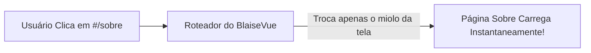

# 🛰️ Módulo 08: Navegação sem Recarregar (Rotas e SPAs)
**Crie sistemas fluidos com múltiplas telas que abrem na velocidade de um app nativo.**

Você já deve ter reparado que sites mais antigos piscam uma tela branca toda vez que você clica em um link. Já em aplicativos modernos como Spotify Web, Gmail ou Twitter, você clica nos menus laterais e o conteúdo muda instantaneamente sem recarregar o navegador.

Isso é o que chamamos de **SPA (Single Page Application)** — e o BlaiseVue já vem com um roteador integrado pronto para isso!

---

## ⚡ 1. O Que É uma SPA e Como Funciona o Roteamento?

Nas aplicações tradicionais, cada clique em um menu pede um arquivo HTML totalmente novo para o servidor.

Em uma SPA com o BlaiseVue:
1. O seu navegador carrega a casca da aplicação **uma única vez**.
2. Quando o usuário clica em um link como `#/sobre`, o **Roteador do BlaiseVue** percebe a mudança na URL.
3. Ele esconde a página antiga e coloca a página nova na tela **no mesmo milissegundo**, sem nenhuma piscada!



---

## 🗺️ 2. As Rotas Automáticas do BlaiseVue

O BlaiseVue organiza as suas telas dentro da pasta **`src/views/`**:

- `src/views/Home.bv` ➔ Rota: `#/` ou `#/home`
- `src/views/About.bv` ➔ Rota: `#/about`
- `src/views/Products.bv` ➔ Rota: `#/products`
- `src/views/Contact.bv` ➔ Rota: `#/contact`

Você não precisa configurar arquivos gigantescos de rotas se não quiser; o compilador reconhece as suas telas automaticamente!

---

## 🔗 3. Como Navegar Entre Páginas

Existem duas formas fáceis de levar o usuário de uma tela para outra:

### Forma 1: Usando Links Comuns no HTML
Basta colocar o caminho com o símbolo de cerquilha (`#`):
```html
<nav>
  <a href="#/home">Início</a>
  <a href="#/about">Sobre Nós</a>
  <a href="#/contact">Fale Conosco</a>
</nav>
```

### Forma 2: Navegando Através do Código Pascal
Se você quiser mudar de página depois que o usuário clicar em um botão ou terminar de salvar um cadastro:
```pascal
procedure finalizarCadastro;
begin
  // Salva os dados... e depois redireciona para a tela de sucesso!
  TJSFunction(this['$router']['push']).apply(this['$router'], ['#/sucesso']);
end;
```

---

## 🚀 4. Exemplo Completo Passo a Passo: Criando Uma Barra de Navegação

Vamos estruturar um menu superior que funciona em qualquer tela do seu sistema.

Abra o seu arquivo principal de layout (ou `App.bv`) e monte a navegação:

```html
<template>
  <div class="aplicacao-layout">
    
    <!-- Barra Superior de Navegação -->
    <header class="navbar">
      <div class="marca">
        <span class="icone-marca">🛡️</span>
        <strong>Meu Portal BlaiseVue</strong>
      </div>

      <nav class="links-menu">
        <a href="#/" class="link-item">🏠 Início</a>
        <a href="#/about" class="link-item">ℹ️ Sobre</a>
        <a href="#/contact" class="link-item">📞 Contato</a>
      </nav>
    </header>

    <!-- Área Onde a Página Selecionada Aparece -->
    <main class="conteudo-principal">
      <!-- O roteador do BlaiseVue injeta a view ativa aqui! -->
      <router-view></router-view>
    </main>

    <!-- Rodapé Comum a Todas as Páginas -->
    <footer class="rodape">
      <p>© 2026 - Desenvolvido com Object Pascal e BlaiseVue.</p>
    </footer>

  </div>
</template>

<style>
  body {
    margin: 0;
    font-family: -apple-system, BlinkMacSystemFont, 'Segoe UI', Roboto, sans-serif;
    background-color: #f7fafc;
  }
  .navbar {
    display: flex;
    justify-content: space-between;
    align-items: center;
    background-color: #2b6cb0;
    color: white;
    padding: 14px 28px;
    box-shadow: 0 2px 10px rgba(0,0,0,0.1);
  }
  .marca {
    display: flex;
    align-items: center;
    gap: 8px;
    font-size: 18px;
  }
  .links-menu {
    display: flex;
    gap: 16px;
  }
  .link-item {
    color: #e2e8f0;
    text-decoration: none;
    font-weight: bold;
    font-size: 14px;
    padding: 6px 12px;
    border-radius: 6px;
    transition: background 0.2s ease;
  }
  .link-item:hover {
    background-color: rgba(255, 255, 255, 0.15);
    color: #ffffff;
  }
  .conteudo-principal {
    max-width: 900px;
    margin: 30px auto;
    padding: 0 20px;
    min-height: calc(100vh - 180px);
  }
  .rodape {
    text-align: center;
    padding: 20px;
    background: #edf2f7;
    color: #718096;
    font-size: 13px;
  }
</style>
```

---

## 🎯 5. Exercício Prático do Módulo 08

1. Crie uma nova tela chamada `Contact.bv` dentro da pasta `src/views/`:
   ```html
   <template>
     <div class="cartao-contato">
       <h2>📞 Fale Conosco</h2>
       <p>Envie um e-mail para: <strong>contato@meuprojeto.com</strong></p>
     </div>
   </template>
   <style>
     .cartao-contato {
       background: white;
       padding: 24px;
       border-radius: 8px;
     }
   </style>
   ```
2. Abra o navegador em `http://localhost:8080` e clique no link "📞 Contato".
3. Veja a nova página abrir instantaneamente sem nenhum recarregamento de tela!

---

## 🏆 Resumo do Que Você Aprendeu
- A grande vantagem de uma SPA (Single Page Application) em velocidade e experiência de usuário.
- Como o roteador do BlaiseVue mapeia arquivos em `src/views/` para rotas na URL.
- Como navegar usando links `href="#/..."` ou programaticamente com `$router.push`.
- O papel do elemento `<router-view>` para projetar as páginas ativas.

**Quer saber o momento exato em que a tela carrega ou tocar em um campo diretamente? Siga para o [Módulo 09: $refs e Ciclo de Vida](09-refs.md)!** ⚔️🛡️✨
