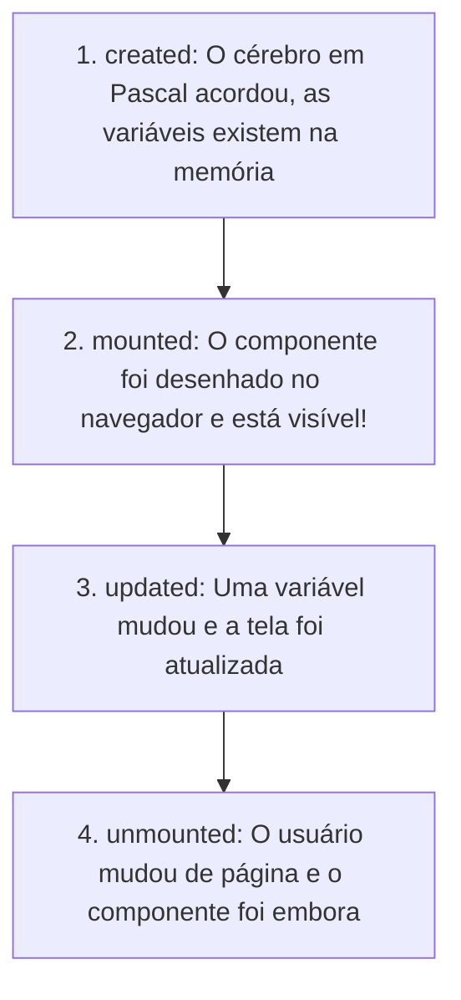

# 👁️ Módulo 09: $refs e o Ciclo de Vida do Componente
**Descubra os momentos exatos em que a tela nasce e como tocar diretamente nos elementos.**

Na maior parte do tempo no BlaiseVue, você não precisa se preocupar em manipular o HTML diretamente — você simplesmente altera uma variável no Pascal e a reatividade cuida de atualizar a tela.

No entanto, existem situações do mundo real em que você precisa de controle direto:
- Colocar o cursor piscando automaticamente dentro de uma caixa de texto assim que a página carregar (foco).
- Tocar um som ou iniciar um contador regressivo no momento certo.
- Limpar um campo e focar nele de novo após o clique de um botão.

Para isso, usamos os ganchos do **Ciclo de Vida** e a diretiva **`b-ref`**!

---

## 🐣 1. O Que É o Ciclo de Vida (Lifecycle)?

Assim como uma pessoa tem fases na vida (nascer, crescer e se despedir), todo componente no BlaiseVue passa por quatro etapas principais:



| Gancho | O Que Acontece? | Exemplo Típico de Uso |
| :--- | :--- | :--- |
| **`created:`** | As variáveis do `data:` já foram criadas, mas o HTML ainda não existe na tela. | Carregar dados iniciais de uma API ou banco de dados. |
| **`mounted:`** | O HTML acabou de ser desenhado na tela! | Colocar foco no cursor, iniciar bibliotecas de gráficos ou timers. |
| **`updated:`** | Algo mudou e o BlaiseVue redesenhou a tela. | Salvar um rascunho automático ou registrar auditoria. |
| **`unmounted:`** | O componente está sendo destruído (usuário mudou de tela). | Parar timers para não gastar memória do computador. |

---

## 🎯 2. O Que É o `b-ref` (A Varinha Mágica de Acesso Direto)?

Para dar um nome único a um elemento HTML específico e poder tocá-lo pelo Pascal, colocamos o atributo `b-ref`:

```html
<!-- Damos o identificador 'meuInput' para esta caixa: -->
<input type="text" b-ref="meuInput">
```

E no seu código Pascal, você acessa esse elemento através do dicionário especial `this['$refs']`:

```pascal
procedure focarNaCaixa;
begin
  // Acessa o elemento HTML diretamente e chama a função de foco nativa:
  TJSObject(this['$refs'])['meuInput'].focus();
end;
```

---

## 🚀 3. Exemplo Completo Passo a Passo: Campo de Busca com Foco Automático

Vamos criar um componente de busca inteligente onde:
1. Assim que a página abrir (`mounted:`), o cursor já aparece piscando na caixa de busca para o usuário não precisar clicar nela.
2. Ao clicar no botão "Limpar", o texto é apagado e o cursor volta a piscar nela imediatamente usando `$refs`!

Copie e cole este código no seu arquivo de visualização (ex: `src/views/Home.bv`):

```html
<template>
  <div class="cartao-busca">
    <h2>🔍 Busca Rápida de Produtos</h2>
    <p class="instrucao">O cursor é focado automaticamente assim que a tela abre!</p>

    <div class="linha-busca">
      <!-- b-ref dá uma etiqueta direta para este elemento -->
      <input 
        type="text" 
        b-ref="campoBusca"
        b-model="termoBusca" 
        placeholder="Digite o nome do item..."
        @keyup.enter="executarBusca">

      <button class="btn btn-buscar" @click="executarBusca">Buscar</button>
      <button class="btn btn-limpar" @click="limparEFocar">Limpar</button>
    </div>

    <!-- Feedback do que está sendo digitado -->
    <div class="resultado" b-if="mensagemStatus != ''">
      {{ mensagemStatus }}
    </div>
  </div>
</template>

<script>
  data:
    termoBusca: string = '';
    mensagemStatus: string = '';

  methods:
    procedure executarBusca;
    begin
      if Trim(string(this['termoBusca'])) = '' then
        this['mensagemStatus'] := '⚠️ Por favor, digite algo para buscar!'
      else
        this['mensagemStatus'] := '🔎 Buscando resultados para: "' + string(this['termoBusca']) + '"...';
    end;

    procedure limparEFocar;
    begin
      // 1. Limpa o texto da variável reativa
      this['termoBusca'] := '';
      this['mensagemStatus'] := 'Campo limpo. Pode digitar novamente!';

      // 2. Usa $refs para colocar o cursor piscando de volta no input!
      TJSObject(this['$refs'])['campoBusca'].focus();
    end;

  mounted:
    // Gancho do Ciclo de Vida: Executa automaticamente assim que o HTML nasce na tela!
    procedure;
    begin
      WriteLn('Componente carregado na tela! Aplicando foco automático...');
      TJSObject(this['$refs'])['campoBusca'].focus();
    end;
</script>

<style>
  .cartao-busca {
    max-width: 520px;
    margin: 40px auto;
    background: #ffffff;
    padding: 24px;
    border-radius: 12px;
    box-shadow: 0 4px 18px rgba(0,0,0,0.08);
    font-family: sans-serif;
  }
  .instrucao {
    font-size: 13px;
    color: #718096;
    margin-bottom: 20px;
  }
  .linha-busca {
    display: flex;
    gap: 8px;
  }
  .linha-busca input {
    flex: 1;
    padding: 10px 14px;
    border: 2px solid #cbd5e0;
    border-radius: 6px;
    font-size: 14px;
    outline: none;
    transition: border-color 0.2s ease;
  }
  .linha-busca input:focus {
    border-color: #3182ce;
  }
  .btn {
    padding: 10px 16px;
    border: none;
    border-radius: 6px;
    cursor: pointer;
    font-weight: bold;
    font-size: 13px;
  }
  .btn-buscar { background: #3182ce; color: white; }
  .btn-limpar { background: #e2e8f0; color: #4a5568; }
  .resultado {
    margin-top: 16px;
    padding: 12px;
    background: #ebf8ff;
    color: #2b6cb0;
    border-radius: 6px;
    font-size: 14px;
    font-weight: bold;
  }
</style>
```

---

## 🎯 4. Exercício Prático do Módulo 09

1. Salve o arquivo e abra o navegador. Repare que você não precisou dar nenhum clique com o mouse: o cursor já está piscando na caixa de texto pronto para você digitar!
2. Digite um texto qualquer, clique em "Limpar" e veja como o texto desaparece e o cursor continua piscando no campo sem você perder o foco.

---

## 🏆 Resumo do Que Você Aprendeu
- As quatro fases do ciclo de vida: `created`, `mounted`, `updated`, `unmounted`.
- O poder do gancho `mounted:` para executar códigos logo que o HTML entra no ar.
- Como dar uma etiqueta para uma tag usando `b-ref="nome"`.
- Como acessar e chamar métodos nativos do elemento com `this['$refs']['nome'].focus()`.

**Quer virar um mestre dos comandos no terminal? Siga para o [Módulo 10: O Maestro do Terminal (CLI)](10-cli.md)!** ⚔️🛡️✨
