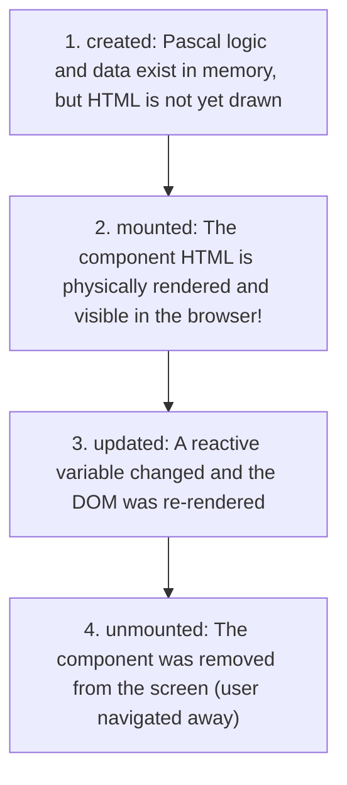

# 👁️ Module 09: $refs and Component Lifecycles
**Discover exact component mounting moments and how to access elements directly.**

Most of the time in BlaiseVue, you do not need to touch the DOM tree manually — you update a Pascal variable and the reactivity engine handles the screen update for you.

However, real-world development occasionally demands direct physical element access:
- Placing the blinking cursor automatically into a search box as soon as the screen loads (autofocus).
- Playing an audio cue or initializing a third-party charting library.
- Clearing an input and returning keyboard focus back to it when the user clicks "Clear".

To handle these scenarios, we use **Lifecycle Hooks** and the **`b-ref`** directive!

---

## 🐣 1. What is the Component Lifecycle?

Just like living beings go through stages (birth, activity, and departure), every BlaiseVue component progresses through four core stages:



| Lifecycle Hook | What Happens? | Typical Use Case |
| :--- | :--- | :--- |
| **`created:`** | The `data:` variables exist in memory, but the DOM element is not mounted yet. | Pre-fetching remote data from an API. |
| **`mounted:`** | The component has been rendered into the live browser DOM! | Autofocusing inputs, starting animation timers, measuring element dimensions. |
| **`updated:`** | State changed and the virtual DOM patched the HTML. | Auto-saving drafts or writing audit logs. |
| **`unmounted:`** | The component is being torn down. | Cleaning up background intervals or active WebSocket listeners. |

---

## 🎯 2. What is `b-ref` (Direct Element Handle)?

To assign a unique identifier to a specific HTML tag so you can interact with it directly in Pascal, attach the `b-ref` attribute:

```html
<!-- Assign the reference identifier 'searchInput' to this input: -->
<input type="text" b-ref="searchInput">
```

In your Pascal code, you access that physical DOM node via the special dictionary `this['$refs']`:

```pascal
procedure focusSearch;
begin
  // Access the native DOM element and invoke its browser method:
  TJSObject(this['$refs'])['searchInput'].focus();
end;
```

---

## 🚀 3. Full Step-by-Step Example: Autofocusing Search Field

Let's build an interactive search widget where:
1. As soon as the page finishes mounting (`mounted:`), the cursor is automatically focused inside the search box without requiring a mouse click.
2. Clicking the "Clear" button resets the text and immediately returns focus back to the input using `$refs`!

Replace your view component (e.g. `src/views/Home.bv`) with:

```html
<template>
  <div class="search-card">
    <h2>🔍 Instant Product Search</h2>
    <p class="instruction">The cursor is automatically focused as soon as the screen mounts!</p>

    <div class="search-row">
      <!-- b-ref gives this element an accessible handle in Pascal -->
      <input 
        type="text" 
        b-ref="searchInput"
        b-model="searchTerm" 
        placeholder="Type a product name..."
        @keyup.enter="performSearch">

      <button class="btn btn-search" @click="performSearch">Search</button>
      <button class="btn btn-clear" @click="clearAndFocus">Clear</button>
    </div>

    <!-- Feedback banner -->
    <div class="status-banner" b-if="statusMessage != ''">
      {{ statusMessage }}
    </div>
  </div>
</template>

<script>
  data:
    searchTerm: string = '';
    statusMessage: string = '';

  methods:
    procedure performSearch;
    begin
      if Trim(string(this['searchTerm'])) = '' then
        this['statusMessage'] := '⚠️ Please enter a keyword to search!'
      else
        this['statusMessage'] := '🔎 Searching catalog for: "' + string(this['searchTerm']) + '"...';
    end;

    procedure clearAndFocus;
    begin
      // 1. Reset reactive state
      this['searchTerm'] := '';
      this['statusMessage'] := 'Search cleared. Ready for next query!';

      // 2. Return focus directly to the input via $refs!
      TJSObject(this['$refs'])['searchInput'].focus();
    end;

  mounted:
    // Lifecycle Hook: Runs automatically right when HTML finishes mounting!
    procedure;
    begin
      WriteLn('Component mounted! Applying automatic keyboard focus...');
      TJSObject(this['$refs'])['searchInput'].focus();
    end;
</script>

<style>
  .search-card {
    max-width: 520px;
    margin: 40px auto;
    background: #ffffff;
    padding: 24px;
    border-radius: 12px;
    box-shadow: 0 4px 18px rgba(0,0,0,0.08);
    font-family: sans-serif;
  }
  .instruction {
    font-size: 13px;
    color: #718096;
    margin-bottom: 20px;
  }
  .search-row {
    display: flex;
    gap: 8px;
  }
  .search-row input {
    flex: 1;
    padding: 10px 14px;
    border: 2px solid #cbd5e0;
    border-radius: 6px;
    font-size: 14px;
    outline: none;
    transition: border-color 0.2s ease;
  }
  .search-row input:focus {
    border-color: #3182ce;
  }
  .btn {
    padding: 10px 16px;
    border: none;
    border-radius: 6px;
    cursor: pointer;
    font-weight: bold;
    font-size: 13px;
  }
  .btn-search { background: #3182ce; color: white; }
  .btn-clear { background: #e2e8f0; color: #4a5568; }
  .status-banner {
    margin-top: 16px;
    padding: 12px;
    background: #ebf8ff;
    color: #2b6cb0;
    border-radius: 6px;
    font-size: 14px;
    font-weight: bold;
  }
</style>
```

---

## 🎯 4. Practical Exercise: Module 09

1. Save the file and reload your browser. Notice how the cursor is already blinking in the input field without you needing to click on it!
2. Type a search query, then click "Clear". Observe how the input is emptied and the keyboard focus returns to the input box automatically.

---

## 🏆 What You Learned Today
- The four lifecycle stages: `created`, `mounted`, `updated`, and `unmounted`.
- How the `mounted:` hook executes logic as soon as physical HTML is active.
- How to tag an element using `b-ref="name"`.
- How to call native browser methods directly via `this['$refs']['name'].focus()`.

---

## 📖 Deeper Technical Reference
For deep-dive documentation on lifecycle timings and reference proxy caching:
- **[Chapter 11: Component Lifecycle & Hooks](../Documentation/11-lifecycle-hooks.md)** — Detailed timeline of beforeCreate, created, beforeMount, mounted, beforeUpdate, updated, beforeDestroy, and destroyed hooks.
- **[Chapter 12: Template References ($refs)](../Documentation/12-template-refs.md)** — Resolving child component instances, direct DOM access, and nextTick synchronization.

**Ready to master the developer command line? Proceed to [Module 10: The Terminal Maestro (CLI bv)](10-cli.md)!** ⚔️🛡️✨
