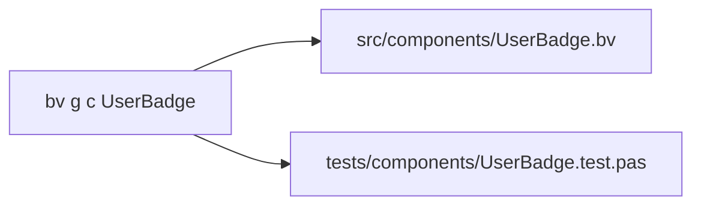

# ⚔️ Module 10: The CLI Scaffolding Maestro
**Master the developer commands that scaffold, run, test, and package your applications.**

If you have never worked with the command line before (that terminal window with text), it might feel intimidating at first glance. But don't worry: the terminal is simply a way to speak directly to your operating system using clear, lightning-fast text commands!

To make life easy, BlaiseVue provides a unified command-line tool called **`bv`** (or `bv.exe` on Windows). It serves as your automated co-pilot: handling code scaffolding, compilation, testing, and configuration with single-word commands.

---

## 💻 1. How to Open Your Terminal

- **Inside your editor (VS Code / Antigravity IDE):**  
  Press the keyboard shortcut **`Ctrl + '`** (or navigate to *Terminal $\rightarrow$ New Terminal*). A terminal will open directly inside your project folder!
- **On Windows:** Open *PowerShell* or *Command Prompt*.
- **On Linux or macOS:** Open your system *Terminal* app.

> [!TIP]
> **Two Essential Terminal Shortcuts:**
> 1. **Repeat previous command:** Press the **Up Arrow ($\uparrow$)** key. The terminal retypes your last command for you!
> 2. **Stop a running server:** Press **`Ctrl + C`** to gracefully terminate a process.

---

## ⚡ 2. Instant Scaffolding & Code Generation (`bv g` / `bv new`)

Instead of creating files manually and remembering how to wire up Pascal imports, the CLI scaffolds components, route views, services, and their corresponding unit tests automatically with one command!



### 1. Scaffold a Reusable Component (`bv g c`)
```bash
bv g c UserBadge
# (or alias:)
bv new c UserBadge
```
* **What it generates:**
  - `src/components/UserBadge.bv`: A clean Single File Component with `<template>`, `<script>`, and `<style scoped>`.
  - `tests/components/UserBadge.test.pas`: A ready-to-run Pascal unit test suite validating that your component mounts cleanly!

### 2. Scaffold a Full Route View (`bv g v`)
```bash
bv g v Dashboard
# (or alias:)
bv new v Dashboard
```
* **What it generates:**
  - `src/views/Dashboard.bv`: A complete page view component.
  - Automatically registers the view into your router mapping (`/#/dashboard`).
  - `tests/views/Dashboard.test.pas`: Unit tests for route transitions.

### 3. Scaffold a Domain Service (`bv g s`)
```bash
bv g s TaxCalculator
# (or alias:)
bv new s TaxCalculator
```
* **What it generates:**
  - `src/services/uTaxCalculator.pas`: A pure Object Pascal class with constructor, destructor, and clean typed business methods.
  - Keeps business math and business rules cleanly separated from visual templates.

### 4. Inspecting, Listing & Safe Deletion
```bash
# List all registered components in the project:
bv list c

# List all route views:
bv list v

# List all domain services:
bv list s

# Safely remove a component AND its associated unit test file in one go:
bv remove c UserBadge
```

### 5. Smart Renaming Across the Codebase (`bv rename`)
Renaming files manually can lead to broken references. `bv rename` updates filenames and internal Pascal unit names simultaneously:
```bash
# Rename component UserBadge -> ProfileBadge across all files:
bv rename c UserBadge ProfileBadge
```

---

## 🧰 3. Essential Development & Diagnostics Commands

Here are the operational commands you will use daily:

### 1. Start the Development Server
Launches the local development server with live Hot Module Replacement (HMR) on port `8080`:
```bash
bv dev
```
Open your browser at `http://localhost:8080` and start coding with instant live reload!

### 2. Environment Health Check (`bv doctor`)
Performs a comprehensive diagnostic scan to ensure all required compilers and scripting engines are healthy:
```bash
bv doctor
```
It validates:
- **Git**: For version control and automated framework updates.
- **Free Pascal (FPC) & InstantFPC**: The Pascal compiler and script runner.
- **Python 3**: Recommended for executing dynamic tool package scripts.
- **Pas2JS & mORMot 2**: The embedded web and backend Pascal frameworks.
- **Node.js**: For running the Vitest automated testing suite and HMR server.

### 3. Run Automated Unit Tests
Compiles and validates your test suites (`.test.pas`):
```bash
bv test
```

### 4. Build for Production (`bv build`)
When your application is ready to be published to the internet, run:
```bash
bv build --release
```
This produces a production-ready `dist/` directory with optimized, minified HTML, CSS, and JavaScript. You can host this folder on any web server or static host (Vercel, Netlify, GitHub Pages, Apache, NGINX)!

### 5. Clean Temporary Build Artifacts
Wipes temporary caches and stale compilation files:
```bash
bv clean
```

---

## 🎨 4. Managing Extensions and Visual Themes

The `bv` CLI also manages developer extensions and theme styling:

### Ready-to-Use UI Themes & Bundle Optimization (Bootswatch)
Tired of styling everything from scratch? BlaiseVue includes an enterprise theme system with built-in bundle optimization:
```bash
# List configured and available themes (darkly, flatly, cosmo, pulse, etc.):
bv theme list

# Switch to a modern dark theme with 1 command:
bv theme use darkly

# Optimize your production build: include only the themes you actually use!
bv theme add darkly
bv theme add flatly

# Switch back to a clean corporate light theme:
bv theme use flatly
```
When you run `bv build`, only the themes registered with `bv theme add` are bundled into `dist/`, slashing up to 90% of unused CSS from your final production release!

---

## 🎯 5. Practical Exercise: Module 10

1. Open your terminal in your project directory.
2. Run `bv doctor` and verify all green `[v]` status indicators.
3. Scaffold a new component:
   ```bash
   bv g c StatCard
   ```
4. Verify that `src/components/StatCard.bv` and `tests/components/StatCard.test.pas` were created.
5. Run `bv list c` to verify `StatCard` is listed.
6. Run `bv test` to watch your newly generated test pass cleanly with 100% green!

---

## 🏆 What You Learned Today
- Why the command-line interface boosts developer productivity.
- How to scaffold components, route views, and domain services instantly with `bv g`.
- How to list, delete, and rename elements safely with `bv list`, `bv remove`, and `bv rename`.
- How to start live dev mode with `bv dev` and run diagnostics with `bv doctor`.
- How to build production bundles with `bv build --release`.
- How to manage and optimize application themes with `bv theme` (`list`, `add`, `use`).

---

## 📖 Deeper Technical Reference
For the full reference manual detailing all 50+ CLI flags and subcommands:
- **[Chapter 03: The BlaiseVue CLI Tool](../Documentation/03-cli.md)** — Complete command syntax, generator options, environment flags, and CI/CD pipelines.

---

**Ready to level up to senior architectural concepts? Advance to [Module 11: Pro Architectural Features](11-pro-features.md)!** ⚔️🛡️✨
