# 🖥️ Module 22: Native Lightweight Desktop Applications (< 10MB WebUI)
**Deliver high-performance desktop apps on Windows, Linux, and macOS without the 150MB overhead of Electron.**

For decades, desktop software developers relied on Delphi, C++, or Lazarus to produce lightning-fast native executables (`.exe`). However, in the modern web era, many companies turned to frameworks like Electron (used by Slack, VS Code, and Discord) to build cross-platform desktop interfaces using HTML and CSS.

While Electron is popular, it comes with a punishing penalty: every desktop app bundles an entire Chromium browser and Node.js runtime. This results in **massive installer downloads (>100 MB)**, **high RAM consumption (300 MB+ at idle)**, and sluggish cold startups.

**BlaiseVue changes the desktop paradigm.** Using its lightweight WebUI integration, BlaiseVue compiles a standalone, native desktop application in **under 10 MB** that uses the operating system's built-in web rendering engine (WebView2 on Windows, WebKitGTK on Linux, WebKit on macOS), achieving instant startup and near-zero memory footprint! 🚀

---

## 🏛️ 1. Architecture: WebUI vs. Electron

```mermaid
flowchart TD
    subgraph ElectronModel["Traditional Electron Architecture (Heavy Bloat)"]
        AppCode1["Application Code"] --> NodeRuntime["Embedded Node.js Engine (~40MB)"]
        NodeRuntime --> ChromiumEngine["Embedded Chromium Browser (~80MB)"]
        ChromiumEngine --> LargeBinary["Massive Binary: 120MB - 250MB<br/>RAM: 300MB - 500MB"]
    end

    subgraph BlaiseVueModel["BlaiseVue Desktop Architecture (Ultra-Lightweight)"]
        AppCode2["Pascal SFC & BlaiseUI"] --> NativeHost["Native Free Pascal Host (&lt; 2MB)"]
        NativeHost --> OSWebView["OS Native WebView<br/>(WebView2 / WebKitGTK / WebKit)"]
        OSWebView --> TinyBinary["Standalone Native Binary: &lt; 10MB<br/>RAM: 15MB - 30MB"]
    end
```



### Architectural Comparison:
| Feature | Traditional Electron App | BlaiseVue Desktop (WebUI) |
| :--- | :--- | :--- |
| **Final Executable Size** | 100 MB – 250 MB | **< 10 MB** (Standalone single file) |
| **Idle RAM Consumption** | 200 MB – 500 MB | **15 MB – 30 MB** |
| **Cold Startup Time** | 2.5 – 5.0 seconds | **< 0.4 seconds (Sub-second instant launch)** |
| **Underlying Language** | JavaScript / C++ wrapper | **100% Native Object Pascal (FPC)** |
| **OS Integration** | Heavy IPC bridges | Direct Pascal OS APIs & System Tray |

---

## ⚡ 2. The Desktop CLI Workflow (`bv desktop`)

BlaiseVue manages the desktop development lifecycle through dedicated CLI commands:

### 1. Initialize Desktop Support in Your Project
```bash
bv desktop init
```
This scaffolds:
- `desktop/`: Native Pascal host launcher (`DesktopApp.pas`).
- `desktop/config.json`: Window dimensions, title, icon, and system tray options.

### 2. Launch Live Desktop Development Mode
```bash
bv desktop dev
```
Launches a native OS window with Hot Module Replacement (HMR) active. When you edit `.bv` files, changes reflect instantly in your native desktop window without restarting the process!

### 3. Build Production Executable
```bash
bv desktop build --release
```
Produces a single, self-contained native executable in `dist/desktop/`:
- **Windows**: `dist/desktop/MyApp.exe`
- **Linux**: `dist/desktop/MyApp` (ELF executable)
- **macOS**: `dist/desktop/MyApp.app` (App bundle)

---

## 🪟 3. Window Management from Object Pascal

BlaiseVue provides the **`$desktop`** bridge to control the native operating system window directly from your Pascal component methods:

```pascal
unit U_DesktopWindowControls;

{$mode objfpc}{$H+}

interface

uses
  SysUtils, BVComponent, BVDesktop;

type
  TWindowControlsView = class(TBVComponent)
  published
    procedure MinimizeApp;
    procedure MaximizeApp;
    procedure ToggleFullscreen;
    procedure SetWindowSize(const AWidth, AHeight: Integer);
    procedure CloseApp;
  end;

implementation

procedure TWindowControlsView.MinimizeApp;
begin
  $desktop.Minimize;
end;

procedure TWindowControlsView.MaximizeApp;
begin
  $desktop.Maximize;
end;

procedure TWindowControlsView.ToggleFullscreen;
begin
  $desktop.SetFullScreen(not $desktop.IsFullScreen);
end;

procedure TWindowControlsView.SetWindowSize(const AWidth, AHeight: Integer);
begin
  $desktop.SetSize(AWidth, AHeight);
end;

procedure TWindowControlsView.CloseApp;
begin
  $desktop.Close;
end;

end.
```

---

## 🖱️ 4. Operating System Integration: System Tray & Menus

Enterprise desktop software (such as point-of-sale systems, background synchronization agents, and ERP clients) requires deep OS integration:

### 1. System Tray Icon (Notification Area)
You can minimize the application to the system tray so it runs silently in the background:

```pascal
procedure TMainView.SendToTray;
begin
  $desktop.Tray.SetIcon('assets/tray-icon.png');
  $desktop.Tray.SetTooltip('BlaiseVue Warehouse Sync Agent');
  
  // Add context menu options to tray icon
  $desktop.Tray.AddMenuItem('Open Dashboard', @ShowMainWindow);
  $desktop.Tray.AddMenuItem('Sync Now', @TriggerManualSync);
  $desktop.Tray.AddSeparator;
  $desktop.Tray.AddMenuItem('Exit', @TerminateApp);
  
  $desktop.HideToTray;
end;
```

### 2. Native OS File Dialogs
Rather than restricted browser file inputs, access the host file system directly:
```pascal
procedure TReportView.ExportToDisk;
var
  SelectedPath: String;
begin
  // Open native Windows / Linux / macOS Save File Dialog
  SelectedPath := $desktop.Dialog.SaveFileDialog(
    'Save Financial Report', 
    'Report-2026.xlsx', 
    'Excel Files (*.xlsx)|*.xlsx|All Files (*.*)|*.*'
  );

  if SelectedPath <> '' then
  begin
    GenerateReport(SelectedPath);
    $desktop.Notification.Show('Export Complete', 'Saved to ' + SelectedPath);
  end;
end;
```

---

## 🎨 5. Complete Practical Example: Desktop POS Checkout Window

Here is a complete Single File Component (`src/views/POSCheckout.bv`) designed for a native point-of-sale desktop terminal:

```html
<template>
  <div class="desktop-pos-container">
    <!-- Custom Window Titlebar -->
    <header class="desktop-titlebar">
      <div class="app-branding">
        <span class="icon">🛒</span>
        <strong>BlaiseVue Enterprise POS v4.4</strong>
      </div>
      <div class="window-controls">
        <button @click="MinimizeWindow" title="Minimize">─</button>
        <button @click="MaximizeWindow" title="Maximize">□</button>
        <button @click="ExitApp" class="btn-close" title="Exit">✕</button>
      </div>
    </header>

    <!-- POS Main Work Area -->
    <main class="pos-work-area">
      <div class="order-summary">
        <h2>Active Order #{{ orderId }}</h2>
        <div class="total-display">
          <span>Total Payable:</span>
          <strong>${{ totalAmount.toFixed(2) }}</strong>
        </div>
      </div>

      <div class="action-buttons">
        <bv-btn variant="success" size="lg" @click="ProcessPayment">
          💳 Process Payment (F9)
        </bv-btn>
        <bv-btn variant="outline-secondary" @click="PrintReceipt">
          🖨️ Print Receipt (F12)
        </bv-btn>
      </div>
    </main>
  </div>
</template>

<script>
uses SysUtils, BVComponent, BVDesktop;

var
  orderId: Integer = 4092;
  totalAmount: Double = 129.50;

methods:
  procedure MinimizeWindow;
  begin
    $desktop.Minimize;
  end;

  procedure MaximizeWindow;
  begin
    $desktop.Maximize;
  end;

  procedure ExitApp;
  begin
    if $desktop.Dialog.Confirm('Exit POS', 'Are you sure you want to close the terminal?') then
      $desktop.Close;
  end;

  procedure ProcessPayment;
  begin
    $desktop.Notification.Show('Payment Approved', 'Transaction #4092 settled.');
  end;

  procedure PrintReceipt;
  begin
    $desktop.Print;
  end;
</script>

<style scoped>
.desktop-pos-container {
  display: flex;
  flex-direction: column;
  height: 100vh;
  background: #f8fafc;
  font-family: -apple-system, BlinkMacSystemFont, "Segoe UI", Roboto, sans-serif;
  user-select: none;
}
.desktop-titlebar {
  display: flex;
  justify-content: space-between;
  align-items: center;
  background: #1e293b;
  color: #fff;
  height: 38px;
  padding: 0 12px;
  -webkit-app-region: drag; /* Allows dragging the window by clicking titlebar */
}
.window-controls {
  display: flex;
  gap: 4px;
  -webkit-app-region: no-drag;
}
.window-controls button {
  background: transparent;
  color: #94a3b8;
  border: none;
  width: 32px;
  height: 28px;
  border-radius: 4px;
  cursor: pointer;
}
.window-controls button:hover { background: #334155; color: #fff; }
.window-controls .btn-close:hover { background: #ef4444; color: #fff; }
.pos-work-area {
  flex: 1;
  padding: 24px;
  display: flex;
  flex-direction: column;
  justify-content: space-between;
}
.total-display {
  margin-top: 15px;
  font-size: 28px;
  display: flex;
  justify-content: space-between;
  border-top: 2px solid #e2e8f0;
  padding-top: 15px;
}
.total-display strong { color: #16a34a; }
.action-buttons {
  display: flex;
  gap: 15px;
}
</style>
```

---

## 🏋️ 6. Practical Exercise: Module 22

1. Open your terminal in your project directory.
2. Initialize desktop capabilities:
   ```bash
   bv desktop init
   ```
3. Launch development mode:
   ```bash
   bv desktop dev
   ```
4. Verify that a native desktop window opens showing your application!
5. Add a button in your main view that calls `$desktop.Notification.Show('Hello', 'Native desktop is running!')`.
6. Compile the standalone release:
   ```bash
   bv desktop build --release
   ```
7. Check the file size of the generated executable in `dist/desktop/`. Notice that it is under **10 MB**!

---

## 🏆 What You Learned Today
- Why WebUI delivers standalone desktop binaries with a fraction of Electron's RAM and file size.
- How to initialize, develop, and compile desktop applications using `bv desktop`.
- How to manage native window states (Minimize, Maximize, Fullscreen, SetSize) via `$desktop`.
- How to integrate with operating system features like System Tray, Native Menus, and File Dialogs.
- How to create custom drag-enabled desktop titlebars.

---

## 📖 Deeper Technical Reference
- **[Desktop Applications with WebUI & Free Pascal Manual](../Documentation/36-desktop-webui.md)**: Complete guide covering native OS window styles, multi-window communication, and packaging installers (`Inno Setup` on Windows, `.deb` on Linux).

---

[⬅️ Module 21: Emulation, Live Debugging & Device Build](21-mobile-build.md) | [🏠 Course Index](README.md) | [Module 23: Blaise UI Design System & Themes ➡️](23-themes.md)
