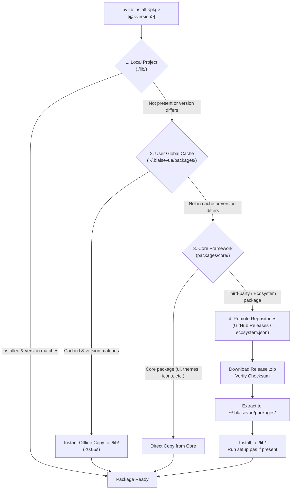

# 📦 BlaiseVue Package Ecosystem & Registries

BlaiseVue features an enterprise-grade package ecosystem and registry management architecture designed for modularity, SemVer versioning, offline-first execution, and zero-conflict framework updates.

---

## 🏛️ Architecture Overview

The package ecosystem is organized into four distinct, prioritized layers:



### 1. Local Project Layer (`./lib/<package>/`)
- Isolated to the current application.
- All `.bv` Single-File Components within `lib/` are automatically scanned and registered globally without requiring manual registration.
- Any `.css` or `.js` vendor assets in `lib/` are automatically bundled and injected into production builds.

### 2. User Global Cache Layer (`~/.blaisevue/packages/<package>/`)
- Auto-created under the user's home directory (`~/.blaisevue/packages/` on Linux/macOS, `%USERPROFILE%\.blaisevue\packages\` on Windows).
- **Safe from Git Conflicts**: Because user packages live outside the BlaiseVue framework repository, running `bv self-update` will never encounter untracked files or merge conflicts.
- Serves as an instant offline cache: once a package version is downloaded once, other projects install it in milliseconds without network access.

### 3. Core Framework Layer (`packages/core/<package>/`)
- Contains official built-in libraries shipped with the framework (`blaise-ui`, `blaise-themes`, `blaise-icons`, `blaise-ui-mobile`, `blaise-charts`, `blaise-reports`, `blaise-studio`).
- **Shielded Protection**: The CLI prevents accidental deletion or modification of core packages via `bv lib remove`.

### 4. Remote Repositories Layer (`blaisevue-ecosystem`)
- Upstream catalog hosted at [`affonsoelias/blaisevue-ecosystem`](https://github.com/affonsoelias/blaisevue-ecosystem).
- Releases are published as versioned tags (`<package>@<version>`) with packaged `.zip` archives.

---

## 🗂️ Managing Repositories (`bv repo`)

The CLI allows developers and organizations to manage multiple upstream package registries.

```bash
# List all configured repositories (* denotes default active catalog):
bv repo list

# Register a new package ecosystem repository:
bv repo add internal-corp https://github.com/my-corp/blaisevue-internal-packages

# Set default primary repository:
bv repo default internal-corp

# Synchronize and cache local metadata catalogs:
bv repo sync

# Search for packages across all configured ecosystems:
bv repo search chart

# Remove a configured repository:
bv repo remove internal-corp
```

### Configuration File (`repos.json`)
Repository settings are stored centrally in `~/.blaisevue/repos.json`:

```json
{
  "repositories": [
    {
      "name": "official",
      "url": "https://github.com/affonsoelias/blaisevue-ecosystem",
      "type": "ecosystem",
      "default": true
    }
  ]
}
```

---

## 📥 Package Installation (`bv lib install`)

The install command supports SemVer version constraints, global user caching, and core aliases:

```bash
# 1. Install latest version into current project (from default repository):
bv lib install test

# 2. Install a specific pinned version:
bv lib install test@1.0.0

# 3. Disambiguate source repository using <repo>:<package>[@version]:
bv lib install official:test@1.1.0
bv lib install internal-corp:my-pkg

# 3. Install directly into user global cache (~/.blaisevue/packages/):
bv lib install test --global  # (or alias: -g)

# 4. Install official core framework packages:
# Supports short aliases (themes), full names (blaise-themes), or scoped names (@blaise-themes):
bv lib install themes    # (or: blaise-themes, @blaise-themes) -> lib/themes/
bv lib install ui        # (or: blaise-ui, @blaise-ui)         -> lib/blaise-ui/
bv lib install icons     # (or: blaise-icons, @blaise-icons)   -> lib/icons/
bv lib install charts    # (or: blaise-charts, @blaise-charts) -> lib/blaise-charts/
bv lib install reports   # (or: blaise-reports, @blaise-reports) -> lib/blaise-reports/
bv lib install mobile    # (or: blaise-ui-mobile, @blaise-ui-mobile) -> lib/blaise-ui-mobile/
bv lib install studio    # (or: blaise-studio, @blaise-studio) -> lib/blaise-studio/

# 5. Install from arbitrary URL or local archive:
bv lib install https://vendor.com/assets/my-library.zip
bv lib install ./dist/my-library-1.0.0.zip
```

---

## 🔍 Version Inspection & Upgrades (`bv lib outdated` & `bv lib update`)

### Checking for Outdated Packages
To view which packages have newer versions available in the ecosystem:

```bash
# Check local project libraries:
bv lib outdated

# Check user global cache:
bv lib outdated --global
```

**Terminal Output Example:**
```text
=== Package Version Inspection (bv lib outdated) ===
Scope: Local Project (/lib)
------------------------------------------------------------------------------
Package               Installed     Latest          Status                    
------------------------------------------------------------------------------
test                  v1.0.0        v1.1.0          Outdated -> v1.1.0
blaise-ui             v4.4.0        v4.4.0          Official Core (Up to date)
------------------------------------------------------------------------------
1 of 2 package(s) are outdated.
To update, run: bv lib update
```

### Upgrading Packages
```bash
# Upgrade all out-of-date packages in current project:
bv lib update

# Upgrade a specific package:
bv lib update test

# Upgrade user global cache:
bv lib update --global
```

---

## 🛡️ Core Reserved Names & Collision Prevention

To ensure enterprise stability and eliminate typosquatting or namespace hijacking:

### Reserved Names Policy
- **Prefix `blaise-`**: Any package name beginning with `blaise-` (case-insensitive) is reserved strictly for official BlaiseVue framework components and ecosystem modules.
- **Core Module Names**: The names `ui`, `themes`, `icons`, `charts`, `reports`, `studio`, `mobile`, `core`, `sdk`, `tools`, `pas2js`, `framework`, `std`, and `runtime` are protected.

### Protection Enforcements:
1. **Scaffold Protection (`bv create <name> --lib`)**:
   The CLI rejects creating any library whose name uses a reserved core name or the `blaise-` prefix, instructing the author to select another identifier (e.g. `my-chart-lib`).
2. **Packaging Warning (`bv lib pack`)**:
   If an external library root matches a reserved core name, packaging generates an explicit warning alerting the author that third-party catalogs will reject the package.
3. **Repository Namespace Shielding (`bv lib install`)**:
   Third-party registries (`internal-corp`, etc.) are prohibited from publishing packages with reserved core names. Installing `internal-corp:ui` or `myrepo:blaise-charts` will immediately halt with a security exception.
4. **Catalog Search Isolation (`bv lib search`)**:
   Packages in third-party catalogs claiming reserved core names are automatically sanitized and hidden from search listings.

---

## 🔀 Repository Disambiguation Syntax (`<repo>:<package>`)

When multiple registries are registered in `~/.blaisevue/repos.json` (e.g. `official` and `internal-corp`):

1. **Default Repository Priority**: If no repository prefix is provided (e.g. `bv lib install test`), BlaiseVue queries the active default repository first (`"default": true`).
2. **Duplicate Notification**: If a package with the same name exists in both repositories and the default was selected, the CLI outputs a notice:
   ```text
   Notice: Package "test" was also found in repository: internal-corp.
           Using [official] (by priority). To specify repository, use: bv lib install <repo>:test
   ```
3. **Explicit Targeting**: Use `<repo>:<package>[@version]` with any package management command:
   ```bash
   bv lib install internal-corp:test@2.0.0
   bv lib update internal-corp:test
   bv lib search internal-corp:
   ```

---

## 🛠️ Authoring & Publishing Packages

To create a new package for the BlaiseVue ecosystem:

### 1. Scaffold Library
```bash
bv create my-chart-lib --lib
```

### 2. Configure `package.json`
Inside `my-chart-lib/package.json`:
```json
{
  "name": "my-chart-lib",
  "version": "1.0.0",
  "description": "High-performance reactive chart components for BlaiseVue",
  "main": "MyChartLib.pas",
  "author": "Your Name <you@example.com>",
  "license": "MIT"
}
```

### 3. Verify & Pack Release
Run pre-flight tests and generate release `.zip` and SHA-256 checksum:
```bash
bv lib pack
```
This produces `dist/my-chart-lib-1.0.0.zip` and `dist/my-chart-lib-1.0.0.zip.sha256`.

### 4. Publish to Ecosystem
1. Create a GitHub Release in your repository tagged as `my-chart-lib@1.0.0`.
2. Upload `my-chart-lib-1.0.0.zip` as the release asset.
3. Submit a Pull Request to `blaisevue-ecosystem` adding your package to `ecosystem.json`:
   ```json
   {
     "packages": {
       "my-chart-lib": {
         "name": "my-chart-lib",
         "description": "High-performance reactive chart components for BlaiseVue",
         "latest": "1.0.0",
         "versions": ["1.0.0"],
         "download": "https://github.com/my-org/my-chart-lib/releases/download/{tag}/{package}-{version}.zip"
       }
     }
   }
   ```

### 5. Providing Documentation & Runnable Examples
Package authors are strongly encouraged to provide documentation and runnable examples when submitting their libraries to the ecosystem:
- **In-Package Documentation & Sandbox**: The library's `README.md` and live development sandbox in `demo/` (featuring `App.bv` and `index.html`) are bundled directly into the release `.zip` and extracted to the consumer's `lib/<package>/` folder.
- **Ecosystem Examples Directory (`examples/<package>/`)**: Authors can contribute complete, runnable BlaiseVue demo projects showcasing their package inside the `examples/<package>/` directory of the `blaisevue-ecosystem` repository.
- **Dedicated Ecosystem Guides (`doc/packages/<package>.md`)**: Detailed API specifications, Pascal unit references, and architectural walk-throughs can be submitted directly into the `doc/packages/` folder of the ecosystem repository.

### 6. Publishing Developer Tools & Extensions (`tools/` & `bv tool`)
The BlaiseVue ecosystem repository supports both runtime libraries (`bv lib`) and developer tools, IDE plugins, and CLI extensions (`bv tool`):
- **Ecosystem Manifest (`ecosystem.json`)**: Tools are declared under the `"tools"` section:
  ```json
  {
    "packages": { ... },
    "tools": {
      "my-tool": {
        "name": "my-tool",
        "type": "co-official",
        "category": "Developer Tool",
        "description": "Verification and diagnostics tool for BlaiseVue",
        "latest": "1.0.0",
        "versions": [
          {
            "version": "1.0.0",
            "download_url": "https://github.com/my-org/my-tool/releases/download/{tag}/{package}-{version}.zip"
          }
        ]
      }
    }
  }
  ```
- **User Tools Isolation (`~/.blaisevue/tools/<name>/`)**: When installed with `bv tool install <name>`, tools are downloaded and extracted exclusively into the user global directory (`~/.blaisevue/tools/`), keeping the base framework download lightweight and avoiding project `/lib` clutter.
- **Documentation (`doc/`) & Examples (`examples/`) in Tools**: Tool packages can include a `doc/` directory with detailed usage manuals, and an `examples/` directory containing configuration samples, test scripts, and reference workflows. Both are included when packaging with `bv tool pack`.

