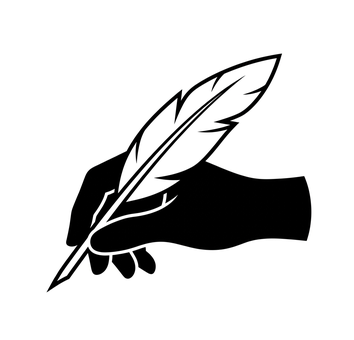

# 🖋️ BlaiseVue Brand Identity & Guidelines

Official visual identity, logo assets, color specifications, and usage guidelines for the **BlaiseVue** project.

---

## 🌟 The Official Logo: "The Shadow Hand & The White Quill"

The official BlaiseVue logo unites the classical intellectual heritage of 17th-century philosopher and mathematician **Blaise Pascal** with the lightweight agility of modern reactive programming:

- **The Hand Silhouette**: A pure, solid black shadow hand (`#000000`) without distracting facial expression or realistic skin hatching, embodying timeless human craftsmanship and software architecture.
- **The White Quill**: A simplified, elegant white feather quill (`#FFFFFF`) with distinct black contrast outlines and notches, pointing diagonally to write code.
- **The Contrast**: Pure black and white aesthetic that delivers maximum readability from high-resolution banners (512px) down to tiny browser tab favicons (16px).

  

---

## 📦 Brand Assets

All official visual assets are stored in this directory:

| Asset | Format | Resolution | Description / Target |
|---|---|---|---|
| [`logo.png`](logo.png) | PNG | 354x340 | Master raster logo with pure white background for light themes and documents. |
| [`logo-transparent.png`](logo-transparent.png) | PNG | 354x340 | Transparent background asset with white hand contour and black quill outline. |
| [`logo-transparent.svg`](logo-transparent.svg) | SVG | Vector 512x512 | Transparent vector with white hand contour and black quill outline (universal mode). |
| [`logo.svg`](logo.svg) | SVG | Vector 512x512 | Scalable vector graphic for web headers, icons, and print media. |
| [`logo.jpg`](logo.jpg) | JPG | 354x340 | Compressed graphic version. |
| [`preview.html`](preview.html) | HTML | Interactive | Brand showcase gallery with scaling simulations and banner previews. |
| [`../../vscode-extension/icon.png`](../../vscode-extension/icon.png) | PNG | 128x128 | Official Visual Studio Code extension marketplace icon. |
| [`../../demo-app/public/favicon.ico`](../../demo-app/public/favicon.ico) | ICO | 16, 32, 48, 64 | Multi-resolution favicon for BlaiseVue web applications. |

---

## 🎨 Color Palette

| Name | Hex Code | Usage |
|---|---|---|
| **Shadow Black** | `#000000` | Hand silhouette, quill outline, primary typography |
| **Pure White** | `#FFFFFF` | Feather fill, background canvas, inverted text |
| **Slate Dark** | `#0B0F19` | Dark mode backgrounds, code blocks, banners |
| **Navy Deep** | `#0F172A` | Surface backgrounds and secondary containers |
| **Pascal Blue** | `#2563EB` | Links, primary UI buttons, compiler tags |
| **Reactive Emerald** | `#00E676` | Success status, active watchers, badges |

---

## 📐 Usage Guidelines

### ✅ Do:
- Use the official `logo.png` or `logo.svg` when representing the BlaiseVue framework in documentation, community articles, and plugins.
- Maintain adequate clear space around the logo so the feather and silhouette remain unobstructed.
- Preserve the high contrast between the white quill and the dark hand.

### ❌ Don't:
- Do not stretch, distort, or alter the aspect ratio of the logo.
- Do not add neon glows, drop shadows, or gradient fills to the hand silhouette.
- Do not invert the hand to white and the feather to black; the hand is always dark/shadow and the feather is always white.

---

## ⚖️ Trademark Notice

The **BlaiseVue** name, framework architecture, and the **Shadow Hand & White Quill** logo are authored by **Elias Affonso**. All rights reserved under the official project license.
